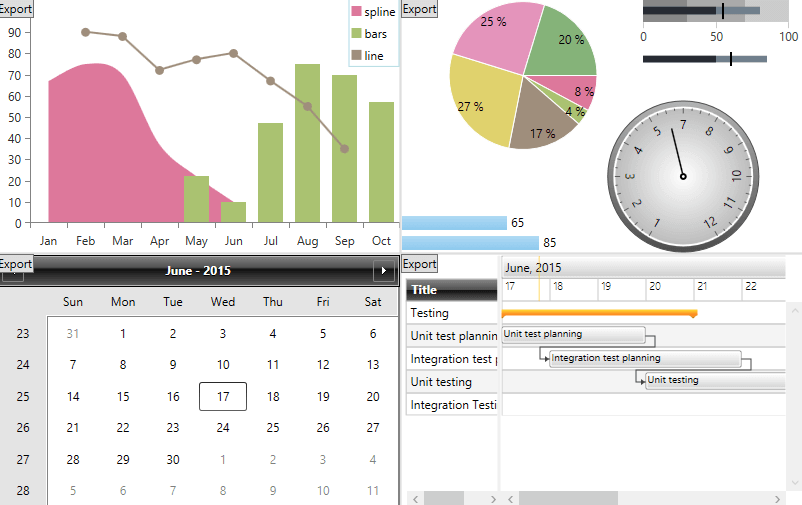

# Export Support

Telerik UI for WPF supports exporting control data and rendered content. Choose an approach based on the output you need:

* Use built-in export for the data, document content, or image formats supported by a specific control.
* Use image export to capture a control's rendered appearance.
* Use Telerik Document Processing to create a document with a custom structure or embedded control images.


## Built-In Export


Several controls in the Telerik UI for WPF suite provide built-in export capabilities:

* [`RadDiagram` image export]()
* [`RadGridView` data export]()
* [`RadRichTextBox` document import and export]()


## Document Processing Integration


The Telerik UI for WPF suite includes Telerik Document Processing libraries for document import, export, and editing:


* [RadPdfProcessing](https://docs.telerik.com/devtools/document-processing/libraries/radpdfprocessing/overview)&mdash;Supports export to PDF.

* [RadSpreadProcessing](https://docs.telerik.com/devtools/document-processing/libraries/radspreadprocessing/overview)&mdash;Supports export to XLSX, CSV, PDF, and plain text (TXT).


* [RadSpreadStreamProcessing](https://docs.telerik.com/devtools/document-processing/libraries/radspreadstreamprocessing/overview)&mdash;Supports export to XLSX and CSV. Creates large spreadsheet documents with minimal resource usage.

* [RadWordsProcessing](https://docs.telerik.com/devtools/document-processing/libraries/radwordsprocessing/overview)&mdash;Supports export to DOCX, RTF, HTML, PDF, and plain text (TXT).


The libraries let you create a document from scratch and export it to supported file formats. To include control content, add an exported image or build a document structure from the control's data. For example, create a table for `RadGridView` data when exporting to DOCX.


The Telerik XAML SDK repository includes examples that you can adapt for document export:


*  [RadDiagram Export to PDF](https://github.com/telerik/xaml-sdk/tree/master/Diagram/ExportToPDF)
*  [RadPivotGrid Export to XLSX, DOCX, HTML and PDF](https://github.com/telerik/xaml-sdk/blob/master/PivotGrid/ExportPivotGrid/Example.xaml.cs)
*  [RadPdfProcessing Export UI Element to PDF](https://github.com/telerik/xaml-sdk/tree/master/PdfProcessing/ExportUIElement)


### Export XAML UI Elements to PDF


The [RadPdfProcessing Export UI Element to PDF](https://github.com/telerik/document-processing-sdk/tree/2d32fd229282a1f7101d6f9b0961a650e89a1dc1/PdfProcessing/ExportUIElement) example maps supported XAML elements to PDF drawing instructions. It demonstrates export of several Telerik UI for WPF controls, including multiple controls in the same view. Treat it as sample code to adapt, not a general-purpose converter for arbitrary XAML.

The following image illustrates the sample's charts, gauges, calendar, and Gantt view.

 

 
The sample uses renderers derived from `UIElementRendererBase`, such as `TextBlockRenderer` and `BorderRenderer`. Each renderer draws its corresponding element. Export coverage depends on the available renderers; extend the sample for elements that those renderers do not handle.


For the PDF drawing API, see the [`FixedContentEditor` documentation](https://docs.telerik.com/devtools/document-processing/libraries/radpdfprocessing/editing/fixedcontenteditor).


## Export Images With ExportExtensions


The `ExportExtensions` class in the `Telerik.Windows.Media.Imaging` namespace is part of the `Telerik.Windows.Controls` assembly. Use it to export a control's rendered content to the following formats:


* PNG&mdash;Portable Network Graphics. Use the `ExportToImage(FrameworkElement, Stream)` method.

* BMP&mdash;Bitmap file. Use `ExportToImage(FrameworkElement, Stream, BitmapEncoder)` with a `BmpBitmapEncoder`.

* XPS&mdash;XML Paper Specification file. Use the `ExportToXpsImage(FrameworkElement, Stream)` method.


This approach suits controls whose rendered content fits on one page, such as a `RadGauge`. Use a control's data export API when you need its data rather than an image of its appearance.



>note The export methods also have overloads that accept a file name instead of a stream, so you can export directly to the file system.



Example 1 contains code-behind fragments that export an existing `RadGauge` named `radGauge` to a PNG file. Add the `Button_Click` handler to the view's code-behind class and connect it to a button's `Click` event. The `SaveFileDialog` lets the user choose the output path.

The fragments assume that the gauge and its assembly references are already configured. For gauge setup, see [Creating a Radial Gauge]().

For C#, add `using Microsoft.Win32;`, `using System.IO;`, and `using System.Windows;` before the code-behind class. For VB.NET, add `Imports Microsoft.Win32`, `Imports System.IO`, and `Imports System.Windows` at the top of the file.

>important The control must be measured and arranged before image export. Otherwise, unexpected results may occur.

**Example 1: Export Control to PNG**

```C#
	 private void Button_Click(object sender, RoutedEventArgs e)
	  {
		string extension = "png";
		SaveFileDialog dialog = new SaveFileDialog()
		{
			DefaultExt = extension,
			Filter = "Png (*.png)|*.png"
		};
	
		if (dialog.ShowDialog() == true)
		{
			using (Stream stream = dialog.OpenFile())
			{
				Telerik.Windows.Media.Imaging.ExportExtensions.ExportToImage(
					 this.radGauge, stream, new System.Windows.Media.Imaging.PngBitmapEncoder());
			}
		}
	}
```
```VB.NET
	 Private Sub Button_Click(ByVal sender As Object, ByVal e As RoutedEventArgs)
		Dim extension As String = "png"
		Dim dialog As New SaveFileDialog() With {.DefaultExt = extension, .Filter = "Png (*.png)|*.png"}
	
		If dialog.ShowDialog() = True Then
			Using stream As Stream = dialog.OpenFile()
				Telerik.Windows.Media.Imaging.ExportExtensions.ExportToImage(Me.radGauge, stream, New System.Windows.Media.Imaging.PngBitmapEncoder())
			End Using
		End If
	 End Sub
```

## See Also

* [RadPdfProcessing](https://docs.telerik.com/devtools/document-processing/libraries/radpdfprocessing/overview)
* [RadSpreadProcessing](https://docs.telerik.com/devtools/document-processing/libraries/radspreadprocessing/overview)
* [RadWordsProcessing](https://docs.telerik.com/devtools/document-processing/libraries/radwordsprocessing/overview)
* [RadGridView Export]()
* [Export UI Element to PDF](https://github.com/telerik/xaml-sdk/tree/master/PdfProcessing/ExportUIElement)
