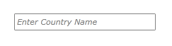
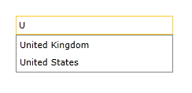
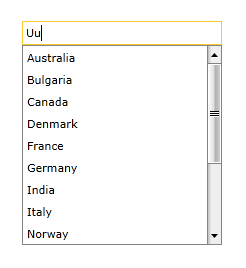
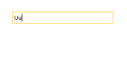

# Filtering Behavior

The `RadAutoCompleteBox` control filters items from its `ItemsSource` based on the text you enter. Use the built-in `AsyncFilteringBehavior` for asynchronous filtering, or implement a custom `FilteringBehavior` to change which items appear in the dropdown.

The examples assume that you have configured the control and bound it to a collection. Follow [Getting Started]() for setup and [Binding To Object]() for the sample country data.

## Async Filtering Behavior

Unlike the default `FilteringBehavior`, `AsyncFilteringBehavior` runs the filtering operation on a separate thread when possible. Use it when you need asynchronous filtering for large collections.

Set the control's `FilteringBehavior` property to an `AsyncFilteringBehavior` instance:

<snippet id='radautocompletebox-features-filteringbehavior-radautocompletebox_with_asyncfilteringbehavior-xaml' />

## Custom Filtering Behavior

Create a class that inherits from `FilteringBehavior` to customize the filter logic. The following example populates the dropdown with available items from `ItemsSource` when no match is found.

To implement the custom behavior:

1. Create a custom class that inherits from `FilteringBehavior`:

    <snippet id='radautocompletebox-features-filteringbehavior-radautocompletebox_with_asyncfilteringbehavior-cs' />

1. Override `FindMatchingItems()` to return the available items when no match is found:

    <snippet id='radautocompletebox-features-filteringbehavior-radautocompletebox_with_asyncfilteringbehavior-cs' />

1. Assign an instance of the custom class to the control's `FilteringBehavior` property in XAML:

    <snippet id='radautocompletebox-features-filteringbehavior-radautocompletebox_with_asyncfilteringbehavior-xaml' />

>tip Find the complete custom behavior class and XAML setup in the [NoMatchFilteringBehavior SDK example](https://github.com/telerik/xaml-sdk/tree/master/AutoCompleteBox/NoMatchFilteringBehavior).

The control initially displays the country-name watermark:

Enter `U` to display matching countries:

With the custom `FilteringBehavior`, enter `Uu` to display available countries even though none match:

With the default `FilteringBehavior`, the same input produces no dropdown results:

## See Also

 * [Binding To Object]()
 * [Getting Started]()
