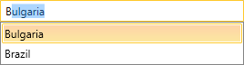
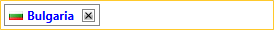

# Customizing the BoxesItemTemplate

Use `BoxesItemTemplate` to customize how selected items appear in the input area of `RadAutoCompleteBox`.

>important `BoxesItemTemplate` applies only when `SelectionMode` is set to `Multiple`.

## Creating custom BoxesItemTemplate

This example adds a country flag to each selected item and sets the text color based on its continent.

Start with a `RadAutoCompleteBox` bound to a collection of objects, as described in [Binding to Objects](). The following snippets are fragments; the [complete SDK example](https://github.com/telerik/xaml-sdk/tree/master/AutoCompleteBox/CustomBoxesItemTemplate) includes the viewmodel, converter, and flag images.

To customize the selected-item boxes:

1. Create a `Country` business object:

   **Creation of the business object**

   <snippet id='radautocompletebox-styles-and-templates-customizing-boxes-itemtemplate-creation_of_the_business_object-cs' />

   The `Flag` property is a string bound to `Image.Source`. The `Continent` property uses an enumeration of continents.

2. Create and populate the viewmodel with country data. Use the [object-binding setup]() to make the collection available to the control's `ItemsSource` binding. Include the flag images referenced by the `Flag` values in your project.

3. Add the converter and template to the resources of the containing view. In the linked SDK sample, declare `ContinentToColorConverter` with the resource key `ContinentToColorConverter` before the template that references it. Map the `local` XAML namespace to the CLR namespace containing your converter.

   The SDK sample's converter receives the entire `Country` object, reads its `Continent` property, and returns a `SolidColorBrush` for `TextBlock.Foreground`. A `Color` value alone is not the brush expected by `Foreground`.

   Create a `DataTemplate` with bindings to the country item's `Name` and `Flag` properties:

   **Declaring the BoxesItemTemplate**

   <snippet id='radautocompletebox-styles-and-templates-customizing-boxes-itemtemplate-declaring_the_boxesitemtemplate-xaml' />

4. Declare `RadAutoCompleteBox` in XAML. Set `ItemsSource` to the country collection, `DisplayMemberPath` to `Name`, and `BoxesItemTemplate` to the template resource. Set `SelectionMode` to `Multiple`:

   **Setting the BoxesItemTemplate**

   <snippet id='radautocompletebox-styles-and-templates-customizing-boxes-itemtemplate-setting_the_boxesitemtemplate-xaml' />

Type a country name to display matching suggestions:

Select a suggestion to see the customized box in the input area:

>tip If the custom boxes do not appear, check that `SelectionMode` is `Multiple`. If a flag is missing, check that its `Flag` path resolves to an image included in your project.

## See Also

 * [Binding To Object]()
