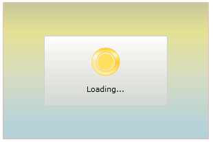
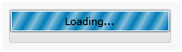

# Customizing BusyIndicator Elements

You can customize the overlay and the progress bar that `RadBusyIndicator` displays while it is busy.

## Set the Overlay Style

The `OverlayStyle` property applies a style to the `Rectangle` that overlays the control's content while the busy indicator is active. Define the style in a resource scope visible to the control, then assign it to `OverlayStyle`.

The following XAML fragment sets the overlay fill and opacity. Place the `Grid` where you want the busy indicator in your view, and declare the Telerik XAML namespace on the containing view.

```xaml
<Grid>
    <Grid.Resources>
        <Style x:Key="OverlayStyle" TargetType="Rectangle">
            <Setter Property="Fill" Value="#FF6BBDD2" />
            <Setter Property="Opacity" Value="0.5" />
        </Style>
    </Grid.Resources>
    <telerik:RadBusyIndicator
        IsBusy="True"
        OverlayStyle="{StaticResource OverlayStyle}"
        Background="Transparent">
        <TextBlock Text="Content remains visible while the indicator is active." />
    </telerik:RadBusyIndicator>
</Grid>
```

Set the `Background` property to `Transparent` if you do not want a background behind the busy content.

>caption RadBusyIndicator displaying a custom overlay while it is busy



## Create a Custom Progress Bar Style

The `ProgressBarStyle` property lets you apply a custom style to the `RadProgressBar` inside `RadBusyIndicator`. The following example defines a style and applies it to the control:

<snippet id='radbusyindicator-styles-and-templates-styling-the-radprogressbar-custom_radprogressbar_style-xaml' />

<snippet id='radbusyindicator-styles-and-templates-styling-the-radprogressbar-setting_the_progressbarstyle-xaml' />

Review the default template and required parts for your Telerik UI for WPF version and theme before applying a custom style. A custom `ProgressBarStyle` may not retain the default `RadProgressBar` template.

>caption RadBusyIndicator displaying a custom progress bar style



## See Also

* [Custom Busy Content]()
* [RadProgressBar Overview]()
