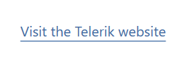
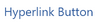
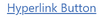
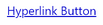

# Hyperlink Button

__RadHyperlinkButton__ provides the RadButton functionality extending it with Hyperlink capabilities. 



## Setting the Content, Uri and the Target

The most common properties for utilizing the control are its __NavigateUri__ and __Content__ properties. The former one is intended to be used for navigating to the needed Uri when __RadHyperlinkButton__ is clicked. The latter one sets the content that will be visualized by the control. Also, the location at which the link to be opened can be set through the __TargetName__ string property.

__Example 1: Setting the NavigateUri and Content__
<snippet id='radbuttons-features-hyperlink-button-example_1_setting_the_navigateuri_and_content-xaml' />

>caption RadHyperlinkButton in normal state



This example shows how a string can be set as a Content of RadHyperlinkButton. The Content can also be set to be an Image, for example. In such setup the link will be opened when the user clicks on the Image.

## Visited and Hovered States

> The default __Foreground__ for the control when the link is visited can be altered via the __VisitedForeground__ property. Also, __RadHyperlinkButton__ provides information whether the link is visited or not through its __IsVisited__ boolean property.

The figure above shows __RadHyperlink__ in its __Normal__ state. When hovered or clicked, the control will be underlined.

>caption RadHyperlinkButton when hovered or clicked



The control will indicate when the link is visited by modifying the text Foreground.

>caption RadHyperlinkButton when the link is visited



## Handling Hyperlink Navigation

`RadHyperlinkButton` raises its `HyperlinkClicked` event before it launches a link. The event uses `RadHyperlinkButtonClickedEventArgs`, which derives from `HyperlinkClickedEventArgsBase` and exposes `Url`, `IsTrustedUrl`, and `Handled`.

By default, the button launches only URLs that pass its pattern and scheme checks. Absolute HTTP, HTTPS, and mailto URLs can be trusted by default when they pass those checks. Other URLs do not launch unless an event handler sets `IsTrustedUrl` to `true`. This launch restriction is a behavior change for `RadHyperlinkButton`.

Set `Handled` to `true` to cancel the button's default navigation. The shared `HyperlinkManager.HyperlinkClicked` event runs after the button event if the button event leaves `Handled` as `false`.

### Canceling Navigation in the Button Event

__Canceling navigation in the button event__

```C#
private void OnHyperlinkClicked(object sender, RadHyperlinkButtonClickedEventArgs e)
{
    e.Handled = true;
}
```

### Approving a URL with the Shared Event

The shared event lets your application handle links from multiple controls in one place. Its `sender` identifies the originating control or component. Set `IsTrustedUrl` to `true` after your application approves the URL. The following window handler prompts before it allows a URL that is not trusted by default:

__Approving an untrusted URL after user confirmation__

```C#
using System;
using System.Windows;
using Telerik.Windows.Controls;

public partial class MainWindow : Window
{
    public MainWindow()
    {
        InitializeComponent();
        HyperlinkManager.HyperlinkClicked += this.OnHyperlinkClicked;
        this.Closed += this.OnClosed;
    }

    private void OnHyperlinkClicked(object sender, HyperlinkClickedEventArgsBase e)
    {
        if (e.IsTrustedUrl)
        {
            return;
        }

        MessageBoxResult result = MessageBox.Show(
            this,
            $"Open {e.Url}?",
            "Confirm hyperlink",
            MessageBoxButton.YesNo,
            MessageBoxImage.Warning);

        if (result == MessageBoxResult.Yes)
        {
            e.IsTrustedUrl = true;
        }
        else
        {
            e.Handled = true;
        }
    }

    private void OnClosed(object sender, EventArgs e)
    {
        HyperlinkManager.HyperlinkClicked -= this.OnHyperlinkClicked;
    }
}
```

The window removes its handler when it closes because `HyperlinkManager.HyperlinkClicked` is static. Unsubscribe whenever the handler owner has a shorter lifetime than the application.

>note Set `e.IsTrustedUrl = true` in either event handler to permit the default launch of a URL that the validator does not trust by default. The shared validator accepts absolute HTTP, HTTPS, and mailto URLs that pass its pattern and scheme checks.

## See Also 
 * [Button]()
 * [Radio Button]()
 * [Commands]()
 * [Events]() 
 * [Telerik UI for WPF API Reference](https://docs.telerik.com/devtools/wpf/api/)
 * [RadToggleButton API](http://www.telerik.com/help/wpf/t_telerik_windows_controls_radtogglebutton.html)
