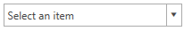
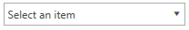
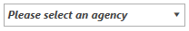

# EmptyText 

The __EmptyText__ property allows you to specify a string that will be shown when there is no selection. 

__Example 1: Setting the EmptyText property__

<snippet id='radcombobox-howto-create-a-watermark-example_1_setting_the_emptytext_property-xaml' />

>caption RadComboBox with IsEditable property set to true and EmptyText in the Office2016 theme

>caption RadComboBox with IsEditable property set to false(default) and EmptyText in the Office2016 theme

>tip If the __IsEditable__ property of the RadComboBox is set to __True__ and the control has focus the __EmptyText__ is not displayed.

## EmptySelectionBoxTemplate

The __EmptySelectionBoxTemplate__ gives you the ability to define a separate DataTemplate to be shown when there is no selected item. __Example 2__ demonstrates how to create and apply an __EmptySelectionBoxTemplate__.

__Example 2: Set the EmptySelectionBoxTemplate property__

<snippet id='radcombobox-howto-create-a-watermark-example_2_set_the_emptyselectionboxtemplate_property-xaml' />

>caption RadComboBox with EmptySelectionBoxTemplate in the Office2016 theme

>tip The __EmptySelectionBoxTemplate__ property only works if the RadComboBox is in non-editable mode, i.e its __IsEditable__ property is set to __False__. Otherwise, the __EmptyText__ will be applied.
