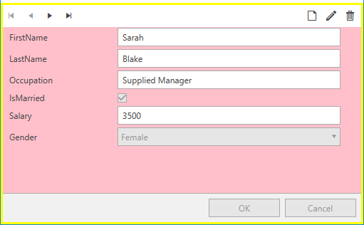
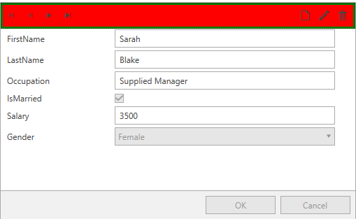
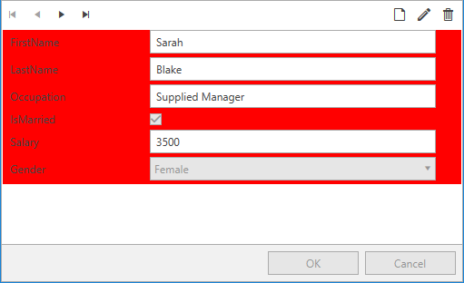

# Customizing DataForm Elements

The `RadDataForm` control in Progress® Telerik® UI for WPF supports styles for the form and its elements. This article covers styles for the form, its collection navigator, and its data fields.

## Style the RadDataForm

Create an implicit style targeting `RadDataForm` to style the form. Alternatively, give the style an `x:Key` and assign it to the control's `Style` property.

The following example defines an implicit style for `RadDataForm`:

<snippet id='raddataform-styles-and-templates-raddatafor-styling-raddataform-example_1_creating_an_implicit_style_targeting_raddataform-xaml' />

>caption RadDataForm with a custom style in the Office2016 theme

## Style the CollectionNavigator

The `CollectionNavigator` hosts the buttons for navigating, adding, editing, and deleting items. To style it, create an implicit style targeting `CollectionNavigator`.

The following example defines an implicit style for `CollectionNavigator`:

<snippet id='raddataform-styles-and-templates-raddatafor-styling-collectionnavigator-example_1_creating_an_implicit_style_targeting_collectionnavigator-xaml' />

>caption CollectionNavigator with a custom style in the Office2016 theme

## Style the Data Fields

`DataFormDataField` is the base class for the form's fields. Other field types include `DataFormComboBoxField`, `DataFormCheckBoxField`, and `DataFormDateField`.

To style the fields, create a style targeting `DataFormDataField` and assign it to the `RadDataForm` control's `DataFieldStyle` property. The following example defines the style:

<snippet id='raddataform-styles-and-templates-styling-dataformdatafield-example_1_creating_a_style_targeting_dataformdatafield-xaml' />

>caption RadDataForm with a custom DataFieldStyle in the Office2016 theme

## See Also

* [Setting a Theme Using Implicit Styles]()
* [Editing Control Templates]()
* [Autogenerated Fields]()
