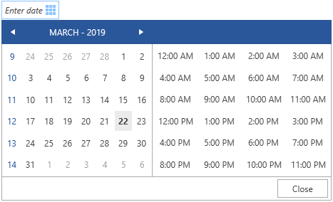
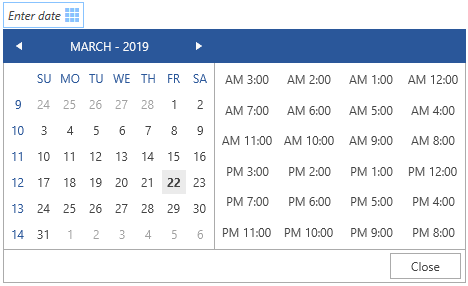

# Customizing the Calendar and Clock

The `RadDateTimePicker` control in Progress® Telerik® UI for WPF exposes properties for styling the calendar and clock in its dropdown.

## Style the Calendar

To customize the `RadCalendar`, create a `Style` targeting `RadCalendar` and assign it to the `CalendarStyle` property of `RadDateTimePicker`.

If you use the [Xaml assemblies](), extract the complete `RadCalendar` style, including its `ControlTemplate`, from `Telerik.Windows.Controls.Input.xaml`. For extraction instructions, see [Editing Control Templates](). If you use NoXaml assemblies, base the custom style on the default `RadCalendarStyle` resource instead.

The following example uses `CalendarStyle` to hide the week names:

<snippet id='raddatetimepicker-styles-and-templates-styling-calendar-example_1_hiding_the_week_names_from_the_calendar_using_the_calendarstyle_property-xaml' />

>caption Calendar with week names hidden in the Office2016 theme

The calendar uses `CalendarButton` controls to represent days, months, weeks, and other values. Customize them with the `DayButtonStyle`, `MonthButtonStyle`, `YearButtonStyle`, and `DecadeButtonStyle` properties of `RadCalendar`.

Each button receives a [CalendarButtonContent](https://docs.telerik.com/devtools/wpf/api/telerik.windows.controls.calendar.calendarbuttoncontent) object as its data context. This object includes the button type, date, and selection state. The following example sets a tooltip for the day buttons:

<snippet id='raddatetimepicker-styles-and-templates-styling-calendar-example_2_setting_a_tooltip_for_the_days_in_the_calendar-xaml' />

## Style the Clock

Create a style for `RadClock` and assign it to the `ClockStyle` property of `RadDateTimePicker`. The following example changes the clock's flow direction:

<snippet id='raddatetimepicker-styles-and-templates-styling-clock-view-example_1_raddatetimepicker_with_clockstyle-xaml' />

>caption Clock with right-to-left flow direction in the Office2016 theme

## See Also

* [Date Items]()
* [Clock Items]()
* [Editing Control Templates]()
