# Predefined Shape Geometries

The __Telerik Diagramming Framework__ provides three types of predefined shape geometries - __ArrowShapes__, __CommonShapes__ and __FlowChartShapes__. For each of these types the framework exposes xaml markup extensions that can be applied at the __RadDiagramShape.Geometry__ property as a shortcut way of creating a shape.

This article contains a list with the available geometries and shows how to set a geometry.

__Create a geometry in code behind__ 
<snippet id='raddiagram-diagram-items-shape-raddiagrams-features-shapes-predefined-shapes-create_a_geometry_in_code_behind-cs' />

## ArrowShapes

>caption Arrow1

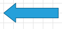

<snippet id='raddiagram-diagram-items-shape-raddiagrams-features-shapes-predefined-shapes-arrow1-xaml' />

>caption Arrow2

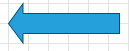

<snippet id='raddiagram-diagram-items-shape-raddiagrams-features-shapes-predefined-shapes-arrow2-xaml' />

>caption Arrow3

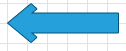

<snippet id='raddiagram-diagram-items-shape-raddiagrams-features-shapes-predefined-shapes-arrow3-xaml' />

>caption Arrow4

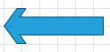

<snippet id='raddiagram-diagram-items-shape-raddiagrams-features-shapes-predefined-shapes-arrow4-xaml' />

>caption Arrow5

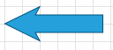

<snippet id='raddiagram-diagram-items-shape-raddiagrams-features-shapes-predefined-shapes-arrow5-xaml' />

>caption Arrow6

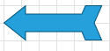

<snippet id='raddiagram-diagram-items-shape-raddiagrams-features-shapes-predefined-shapes-arrow6-xaml' />

>caption Arrow7

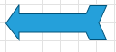

<snippet id='raddiagram-diagram-items-shape-raddiagrams-features-shapes-predefined-shapes-arrow7-xaml' />

>caption Arrow8

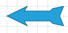

<snippet id='raddiagram-diagram-items-shape-raddiagrams-features-shapes-predefined-shapes-arrow8-xaml' />

>caption DoubleArrow1

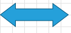

<snippet id='raddiagram-diagram-items-shape-raddiagrams-features-shapes-predefined-shapes-doublearrow1-xaml' />

>caption DoubleArrow2

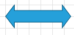

<snippet id='raddiagram-diagram-items-shape-raddiagrams-features-shapes-predefined-shapes-doublearrow2-xaml' />

>caption DoubleArrow3

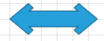

<snippet id='raddiagram-diagram-items-shape-raddiagrams-features-shapes-predefined-shapes-doublearrow3-xaml' />

>caption DoubleArrow4

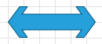

<snippet id='raddiagram-diagram-items-shape-raddiagrams-features-shapes-predefined-shapes-doublearrow4-xaml' />

>caption DoubleArrow5

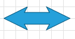

<snippet id='raddiagram-diagram-items-shape-raddiagrams-features-shapes-predefined-shapes-doublearrow5-xaml' />

	
### CommonShapes
					
>caption CloudShape

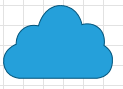

<snippet id='raddiagram-diagram-items-shape-raddiagrams-features-shapes-predefined-shapes-cloudshape-xaml' />

>caption Cross2Shape

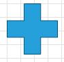

<snippet id='raddiagram-diagram-items-shape-raddiagrams-features-shapes-predefined-shapes-cross2shape-xaml' />

>caption CrossShape

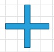

<snippet id='raddiagram-diagram-items-shape-raddiagrams-features-shapes-predefined-shapes-crossshape-xaml' />

>caption EllipseShape

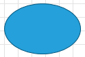

<snippet id='raddiagram-diagram-items-shape-raddiagrams-features-shapes-predefined-shapes-ellipseshape-xaml' />

>caption HexagonShape

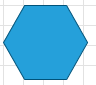

<snippet id='raddiagram-diagram-items-shape-raddiagrams-features-shapes-predefined-shapes-hexagonshape-xaml' />

>caption OctagonShape

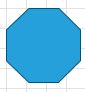

<snippet id='raddiagram-diagram-items-shape-raddiagrams-features-shapes-predefined-shapes-octagonshape-xaml' />

>caption PentagonShape

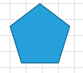

<snippet id='raddiagram-diagram-items-shape-raddiagrams-features-shapes-predefined-shapes-pentagonshape-xaml' />

>caption RectangleShape

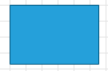

<snippet id='raddiagram-diagram-items-shape-raddiagrams-features-shapes-predefined-shapes-rectangleshape-xaml' />

>caption RightTriangleShape

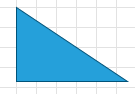

<snippet id='raddiagram-diagram-items-shape-raddiagrams-features-shapes-predefined-shapes-righttriangleshape-xaml' />

>caption RoundedRectangleShape

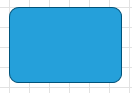

<snippet id='raddiagram-diagram-items-shape-raddiagrams-features-shapes-predefined-shapes-roundedrectangleshape-xaml' />

>caption Star5Shape

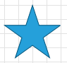

<snippet id='raddiagram-diagram-items-shape-raddiagrams-features-shapes-predefined-shapes-star5shape-xaml' />

>caption Star6Shape

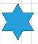

<snippet id='raddiagram-diagram-items-shape-raddiagrams-features-shapes-predefined-shapes-star6shape-xaml' />

>caption Star7Shape

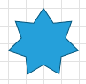

<snippet id='raddiagram-diagram-items-shape-raddiagrams-features-shapes-predefined-shapes-star7shape-xaml' />

>caption TriangleShape

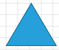

<snippet id='raddiagram-diagram-items-shape-raddiagrams-features-shapes-predefined-shapes-triangleshape-xaml' />

	
### FlowChartShapes

>caption BeginLoopShape

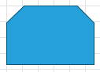

<snippet id='raddiagram-diagram-items-shape-raddiagrams-features-shapes-predefined-shapes-beginloopshape-xaml' />

>caption CardShape

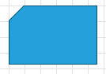

<snippet id='raddiagram-diagram-items-shape-raddiagrams-features-shapes-predefined-shapes-cardshape-xaml' />

>caption CollateShape

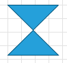

<snippet id='raddiagram-diagram-items-shape-raddiagrams-features-shapes-predefined-shapes-collateshape-xaml' />

>caption CreateRequestShape

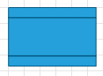

<snippet id='raddiagram-diagram-items-shape-raddiagrams-features-shapes-predefined-shapes-createrequestshape-xaml' />

>caption Database1Shape

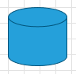

<snippet id='raddiagram-diagram-items-shape-raddiagrams-features-shapes-predefined-shapes-database1shape-xaml' />

>caption Database2Shape

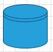

<snippet id='raddiagram-diagram-items-shape-raddiagrams-features-shapes-predefined-shapes-database2shape-xaml' />

>caption Database3Shape

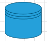

<snippet id='raddiagram-diagram-items-shape-raddiagrams-features-shapes-predefined-shapes-database3shape-xaml' />

>caption DataShape

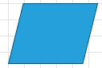

<snippet id='raddiagram-diagram-items-shape-raddiagrams-features-shapes-predefined-shapes-datashape-xaml' />

>caption DataStoreShape

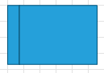

<snippet id='raddiagram-diagram-items-shape-raddiagrams-features-shapes-predefined-shapes-datastoreshape-xaml' />

>caption DecisionShape

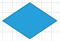

<snippet id='raddiagram-diagram-items-shape-raddiagrams-features-shapes-predefined-shapes-decisionshape-xaml' />

>caption DelayShape

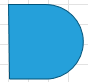

<snippet id='raddiagram-diagram-items-shape-raddiagrams-features-shapes-predefined-shapes-delayshape-xaml' />

>caption DevidedProcessShape

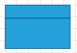

<snippet id='raddiagram-diagram-items-shape-raddiagrams-features-shapes-predefined-shapes-devidedprocessshape-xaml' />

>caption DirectDataShape

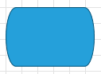

<snippet id='raddiagram-diagram-items-shape-raddiagrams-features-shapes-predefined-shapes-directdatashape-xaml' />

>caption DisplayShape

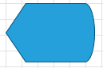

<snippet id='raddiagram-diagram-items-shape-raddiagrams-features-shapes-predefined-shapes-displayshape-xaml' />

>caption DocumentShape

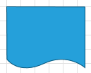

<snippet id='raddiagram-diagram-items-shape-raddiagrams-features-shapes-predefined-shapes-documentshape-xaml' />

>caption DuplicatingShape

<snippet id='raddiagram-diagram-items-shape-raddiagrams-features-shapes-predefined-shapes-duplicatingshape-xaml' />

		
>caption ExternalDataShape

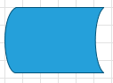

<snippet id='raddiagram-diagram-items-shape-raddiagrams-features-shapes-predefined-shapes-externaldatashape-xaml' />

>caption FeedbackShape

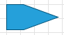

<snippet id='raddiagram-diagram-items-shape-raddiagrams-features-shapes-predefined-shapes-feedbackshape-xaml' />

	
>caption FramedRectangleShape

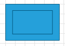

<snippet id='raddiagram-diagram-items-shape-raddiagrams-features-shapes-predefined-shapes-framedrectangleshape-xaml' />

>caption InternalStorageShape

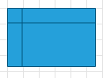

<snippet id='raddiagram-diagram-items-shape-raddiagrams-features-shapes-predefined-shapes-internalstorageshape-xaml' />

>caption LinedDocumentShape

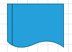

<snippet id='raddiagram-diagram-items-shape-raddiagrams-features-shapes-predefined-shapes-lineddocumentshape-xaml' />

>caption LoopLimitShape

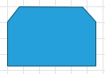

<snippet id='raddiagram-diagram-items-shape-raddiagrams-features-shapes-predefined-shapes-looplimitshape-xaml' />

>caption ManualInputShape

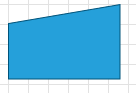

<snippet id='raddiagram-diagram-items-shape-raddiagrams-features-shapes-predefined-shapes-manualinputshape-xaml' />

>caption ManualOperationShape

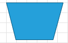

<snippet id='raddiagram-diagram-items-shape-raddiagrams-features-shapes-predefined-shapes-manualoperationshape-xaml' />

>caption MessageFromUserShape

<snippet id='raddiagram-diagram-items-shape-raddiagrams-features-shapes-predefined-shapes-messagefromusershape-xaml' />

>caption MessageToUserShape

<snippet id='raddiagram-diagram-items-shape-raddiagrams-features-shapes-predefined-shapes-messagetousershape-xaml' />

>caption MicroformProcessingShape

<snippet id='raddiagram-diagram-items-shape-raddiagrams-features-shapes-predefined-shapes-microformprocessingshape-xaml' />

>caption MicroformRecordingShape

<snippet id='raddiagram-diagram-items-shape-raddiagrams-features-shapes-predefined-shapes-microformrecordingshape-xaml' />

>caption MultipleDocumentShape

<snippet id='raddiagram-diagram-items-shape-raddiagrams-features-shapes-predefined-shapes-multipledocumentshape-xaml' />

>caption OffPageConnectionShape

<snippet id='raddiagram-diagram-items-shape-raddiagrams-features-shapes-predefined-shapes-offpageconnectionshape-xaml' />

>caption OffPageLinkShape

<snippet id='raddiagram-diagram-items-shape-raddiagrams-features-shapes-predefined-shapes-offpagelinkshape-xaml' />

>caption OffPageReflectionShape

<snippet id='raddiagram-diagram-items-shape-raddiagrams-features-shapes-predefined-shapes-offpagereflectionshape-xaml' />

>caption OrShape

<snippet id='raddiagram-diagram-items-shape-raddiagrams-features-shapes-predefined-shapes-orshape-xaml' />

>caption PaperTapeShape

<snippet id='raddiagram-diagram-items-shape-raddiagrams-features-shapes-predefined-shapes-papertapeshape-xaml' />

>caption PredefinedShape

<snippet id='raddiagram-diagram-items-shape-raddiagrams-features-shapes-predefined-shapes-predefinedshape-xaml' />

>caption PreparationShape

	
<snippet id='raddiagram-diagram-items-shape-raddiagrams-features-shapes-predefined-shapes-preparationshape-xaml' />

>caption PrimitiveFromCallShape

<snippet id='raddiagram-diagram-items-shape-raddiagrams-features-shapes-predefined-shapes-primitivefromcallshape-xaml' />

>caption PrimitiveToCallShape

<snippet id='raddiagram-diagram-items-shape-raddiagrams-features-shapes-predefined-shapes-primitivetocallshape-xaml' />

>caption SequentialDataShape

<snippet id='raddiagram-diagram-items-shape-raddiagrams-features-shapes-predefined-shapes-sequentialdatashape-xaml' />

>caption SortShape

<snippet id='raddiagram-diagram-items-shape-raddiagrams-features-shapes-predefined-shapes-sortshape-xaml' />

>caption StartShape

<snippet id='raddiagram-diagram-items-shape-raddiagrams-features-shapes-predefined-shapes-startshape-xaml' />

>caption StoredDataShape

<snippet id='raddiagram-diagram-items-shape-raddiagrams-features-shapes-predefined-shapes-storeddatashape-xaml' />

>caption SummingJunctionShape

<snippet id='raddiagram-diagram-items-shape-raddiagrams-features-shapes-predefined-shapes-summingjunctionshape-xaml' />

>caption TerminatorShape

<snippet id='raddiagram-diagram-items-shape-raddiagrams-features-shapes-predefined-shapes-terminatorshape-xaml' />

>caption TransmittalTapeShape

<snippet id='raddiagram-diagram-items-shape-raddiagrams-features-shapes-predefined-shapes-transmittaltapeshape-xaml' />

## See Also  
 * [Structure]()
 * [Getting Started]() 
 * [Connections]()
 * [Items Events]()
 * [Diagram Shape]()