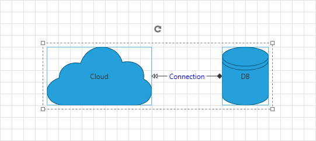

# In Code-Behind

This article shows how to define a `RadDiagram`, shapes, and connections in code-behind with Progress® Telerik® UI for WPF.

>note The examples use the Telerik Windows8 theme. See [setting an application-wide theme]() for the Xaml and NoXaml theme setup options.

## Adding Items In Code Behind

Before using the examples, configure a WPF project with the package or assembly references described in [RadDiagram Getting Started](). Complete the [license activation]() required for your Telerik release and configure the theme for your Xaml or NoXaml assemblies.

The following C# and VB.NET examples create a `RadDiagram` and add two shapes and a connection:

<snippet id='raddiagram-populating-with-data-data-code-behind-block_1-cs' />

<snippet id='raddiagram-populating-with-data-data-code-behind-block_1-vb' />

The examples use the static `ShapeFactory` class from the `Telerik.Windows.Controls.Diagrams` assembly. The following C# and VB.NET examples list its static methods for creating an `EllipseShape`, `RectangleShape`, or `Geometry`:

<snippet id='raddiagram-populating-with-data-data-code-behind-block_2-cs' />

<snippet id='raddiagram-populating-with-data-data-code-behind-block_2-vb' />

Here you see a snapshot of the defined `RadDiagram`:

## See Also
 * [Structure]()
 * [Getting Started]()
 * [Declaratively Populating with Data]()
 * [DataBinding]()
 * [Shapes]()
 * [Connections]()
 * [Removing Items]()