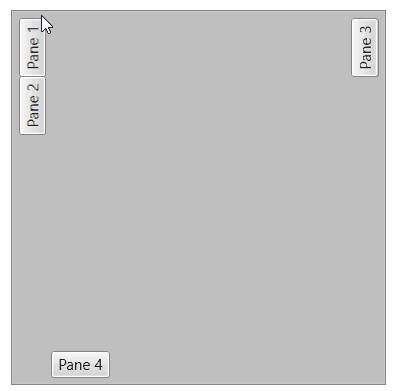
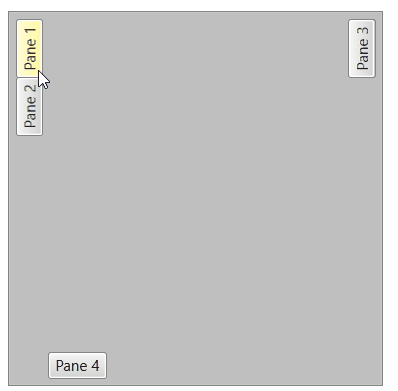

# FlyoutBehavior

`RadDocking` uses flyout behavior to control when panes in the auto-hide area open and close.

To use flyouts, first [unpin a pane]() with its pin/unpin button or set its `IsPinned` property to `False`. When hidden, an unpinned pane leaves its tab header in the *auto-hide area*.

`RadDocking` provides two implementations of `IFlyoutBehavior`: `HoverFlyoutBehavior` (the default) and `ClickFlyoutBehavior`.

## HoverFlyoutBehavior

`HoverFlyoutBehavior` is the default behavior. It opens the flyout when you hover over an unpinned pane's tab header or activate the pane. The flyout closes when the mouse leaves it.

The following animation illustrates the default hover behavior for an unpinned pane.

## ClickFlyoutBehavior

`ClickFlyoutBehavior` opens the flyout when you click an unpinned pane's tab header or activate the pane. The flyout closes when you click the tab header again or when the pane is deactivated.

The following animation illustrates click behavior for an unpinned pane.

## Setting Flyout Behavior

To set or get the current flyout behavior, use the `FlyoutBehavior` property of `RadDocking`.

**Example 1: Setting flyout behavior**
<snippet id='raddocking-features-flyoutbehavior-example_1_setting_flyout_behavior-xaml' />

## Custom Flyout Behavior

To create a custom flyout behavior, implement the `IFlyoutBehavior` interface. The interface requires the following methods to be implemented:

* `OnClosingTimerTimeout`&mdash;Called when the time of the close timer is up. Commonly the close animation is started here. The close timer is started by calling the `StartCloseTimer` method of the `IFlyoutHost`.

* `OnMouseEnter`&mdash;Called when the mouse enters a `RadPane`.

* `OnMouseLeave`&mdash;Called when the mouse leaves a `RadPane`.

* `OnOpeningTimerTimeout`&mdash;Called when the time of the open timer is up. Commonly the open animation is started here. The open timer is started by calling the `StartOpenTimer` method of the `IFlyoutHost`.

* `OnPaneActivated`&mdash;Called when a `RadPane` is being activated.

* `OnPaneDeactivated`&mdash;Called when a `RadPane` is being deactivated.

* `OnPaneMouseLeftButtonDown`&mdash;Called when a pane receives the `MouseLeftButtonDown` event (when you click it).

The following example shows how to implement a custom behavior that opens the flyout on click and animates the opening and closing.

**Example 2: Custom flyout behavior**
<snippet id='raddocking-features-flyoutbehavior-example_2_custom_flyout_behavior-cs' />

**Example 3: Setting the custom flyout behavior**
<snippet id='raddocking-features-flyoutbehavior-example_3_setting_the_custom_flyout_behavior-xaml' />

>tip A runnable project with this example can be found in the [ClickFlyoutBehaviorWithAnimation](https://github.com/telerik/xaml-sdk/tree/master/Docking/ClickFlyoutBehaviorWithAnimation) SDK example.

## Flyout Min Length

The flyout popup element has a default minimum length of 50px. To change this, set the `FlyoutMinLength` property of `RadDocking`. The property value applies to the width of the left and right auto-hide area flyouts. It applies to the height of the top and bottom auto-hide area flyouts.

**Example 4: Setting the minimum size of the flyout popup**
<snippet id='raddocking-features-flyoutbehavior-example_2_setting_the_minimum_size_of_the_flyout_popup-xaml' />

## See Also

* [Pinning and Unpinning Panes]()
* [RadPane Structure and States]()
