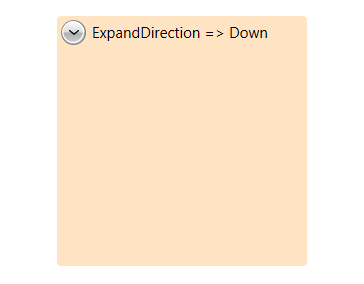
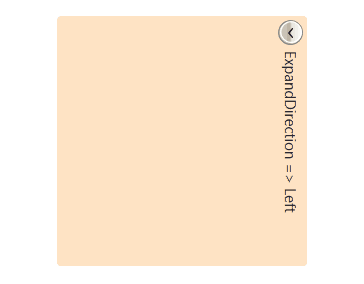
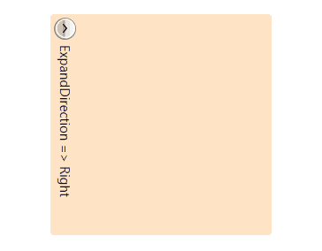
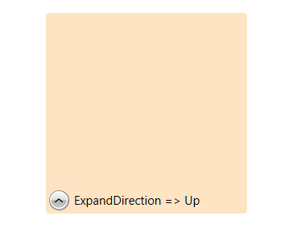

# Expand Direction

The __ExpandDirection__ property gets or sets the direction in which the content would expand. This property is an enumeration which exposes four values: __Down, Left, Right, Up__.

__Example 1: Setting ExpandDirection property__

<snippet id='radexpander-features-expand-direction-example_1_setting_expanddirection_property-xaml' />

>caption ExpandDirection set to down

>caption ExpandDirection set to left

>caption ExpandDirection set to right

>caption ExpandDirection set to up

