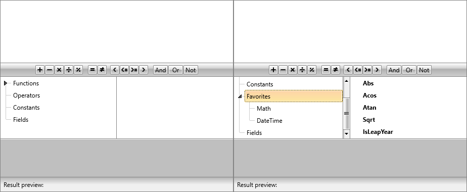

# Custom Categories and Functions

As of **R1 2019**, the RadExpressionEditor control allows users to add custom categories and functions to its UI as well as remove some of the already defined ones.

To do so, you have to create a custom implementation of the **ExpressionEditorViewModel** and override its virtual methods.

__[C#] Example 1: The ExpressionEditorViewModel overrides__

<snippet id='radexpressioneditor-expressions-custom-functions-and-categories-block_1-cs' />


To assign the custom viewmodel to the RadExpressionEditor control, you have to set its **ViewModel** property.

__[C#] Example 2: Set RadExpressionEditor's ViewModel__

<snippet id='radexpressioneditor-expressions-custom-functions-and-categories-block_2-cs' />


## Custom Categories

To add custom categories as well as remove certain predefined categories, you need to override the **GenerateCategories** method.

__[C#] Example 3: Add custom categories__

<snippet id='radexpressioneditor-expressions-custom-functions-and-categories-block_3-cs' />


**Example 3** adds a **Favorites** category with two subcategories - **Math** and **DateTime**. Each of the categories contains some static methods of the respective class. The results before and after respectively can be observed in **Figure 1**.

>caption Custom category



## Custom Functions

Expressions can call only built-in functions and custom methods that you register. The default context includes Telerik's built-in functions. A custom context must pass an `ExpressionFunctionRegistry` to its base constructor. The parameterless `ExpressionFunctionContext` constructor is no longer available.

Use `ExpressionFunctionRegistry.CreateWithBuiltInFunctions()` to retain Telerik's built-in functions. Use `ExpressionFunctionRegistry.CreateEmpty()` to expose only the functions that you register.

The registry provides these methods:

* `AddGlobalFunction` registers a public instance method on an `ExpressionFunctionContext` type as a global function, such as `Discount(price, rate)`.
* `AddInstanceFunction` registers a public instance method on an expression receiver type, such as `Customer.ApplyDiscount(rate)`.
* `AssignGlobalFunction` replaces a global registration with the same target type, name, and parameter signature.
* `AssignInstanceFunction` replaces a receiver registration with the same target type, name, and parameter signature.

Each registration specifies an exact method name and parameter-type signature. Register functions before parsing or evaluating expressions. Registered methods must be public instance methods and must return a value. Methods declared by `object`, generic methods, and methods with by-reference or pointer parameters are not supported.

The active registry determines which functions the Expression Editor can resolve. The editor builds its function list and expression preview from that registry. Use the view-model customization APIs to group or hide function-list entries.

The following example defines custom global functions and registers their exact signatures. It retains Telerik's built-in functions.

__Example 4: Define and Register Custom Functions__

```C#
using Telerik.Expressions;

public sealed class CustomExpressionFunctionContext : ExpressionFunctionContext
{
	public CustomExpressionFunctionContext()
		: base(CreateRegistry())
	{
	}

	private static ExpressionFunctionRegistry CreateRegistry()
	{
		ExpressionFunctionRegistry registry = ExpressionFunctionRegistry.CreateWithBuiltInFunctions();
		registry.AddGlobalFunction(
			typeof(CustomExpressionFunctionContext),
			nameof(Discount),
			new[] { typeof(double), typeof(double) });
		registry.AddGlobalFunction(
			typeof(CustomExpressionFunctionContext),
			nameof(Surcharge),
			new[] { typeof(double), typeof(double) });
		return registry;
	}

	public double Discount(double price, double rate)
	{
		return price * (1d - rate);
	}

	public double Surcharge(double price, double rate)
	{
		return price * (1d + rate);
	}
}
```

The registry includes Telerik's built-in functions and adds the `Discount` and `Surcharge` global functions. Each registration matches a public instance method's exact parameter types.

Assign the context before parsing expressions, as shown in the following example.

__Setting the Active Expression Function Context__

<snippet id='radexpressioneditor-expressions-custom-functions-and-categories-custom_functions_set_context-cs' />


You can add the registered functions to the editor's function list by overriding `GetFunctionsItemModels` or `GenerateCategories`.

__Example 6: Add Custom Functions to the Function List__

<snippet id='radexpressioneditor-expressions-custom-functions-and-categories-custom_functions_get_functions_item_models-cs' />


The snippet adds custom functions to an editor category. The expression engine must also have those functions registered in the active `ExpressionFunctionContext` for the preview to evaluate them.

## Further Customizations

You can further customize the control by overriding the **GetFieldsItemModels**, **GetOperatorsItemModels**, **GetConstantsItemModels** and **GetFieldsCategory** methods.

__[C#] Example 7: Remove operators, constants and fields and add subcategories to the Fields category__

<snippet id='radexpressioneditor-expressions-custom-functions-and-categories-custom_functions-cs' />


The example above removes some of the operators, constants and the **Discontinued** field from the RadExpressionEditor. It also creates a subcategory for the Fields category which holds the **Car** field of the bound object.

## See Also

* [Lambdas]()
