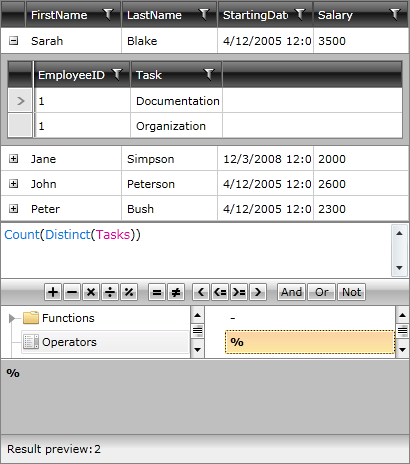

# Function Invocation

The Expression Editor resolves calls to Telerik's built-in functions and registered custom functions. It does not discover and invoke arbitrary public methods automatically. The active `ExpressionFunctionContext` provides the registry.

The default context includes Telerik's built-in functions. For example, call `Distinct` on an enumerable property:

`Distinct(Tasks)`

The `Tasks` property must be an enumerable. The expression returns the distinct items in the collection.



To call a custom method, register it through the active `ExpressionFunctionContext.FunctionRegistry`. The registry identifies the target type, function name, and exact parameter types. Register the method before parsing or evaluating the expression. See [Custom Categories and Functions]() for a custom context example and migration details.

__Parsing an Expression That Uses a Registered Function__

```C#
using Telerik.Expressions;

ExpressionFunctionContext.Context = new CustomExpressionFunctionContext();

using (RadExpressionParser parser = new RadExpressionParser())
{
	parser.Parse("Discount(1000.0, 0.15)");
}
```

This example uses the `CustomExpressionFunctionContext` defined in [Custom Categories and Functions](). Set the context before parsing so the parser resolves the registered function.

The expression `StartingDate.AddDays(3)` does not call `DateTime.AddDays` unless that exact receiver method is registered. Expression function allowlisting controls calls only; expressions can still access members and properties.

The Expression Editor builds its function list from the active expression engine. The preview uses the same engine to resolve function calls. Set `ExpressionFunctionContext.Context` before initializing the editor so both use the intended registry. Use the Expression Editor view model to customize displayed categories and function items.

Use `ExpressionFunctionRegistry.CreateWithBuiltInFunctions()` to retain the built-in functions when you register custom functions. Use `ExpressionFunctionRegistry.CreateEmpty()` to start without functions and register only the functions that your expressions need.

For a `Double` constant, you can use exponential notation such as `0.0E+2`. Use `0.0` for a `Decimal` constant.

## See Also

* [Constants]()
* [Member Access]()
* [Expression Parser]()
* [Custom Categories and Functions]()
