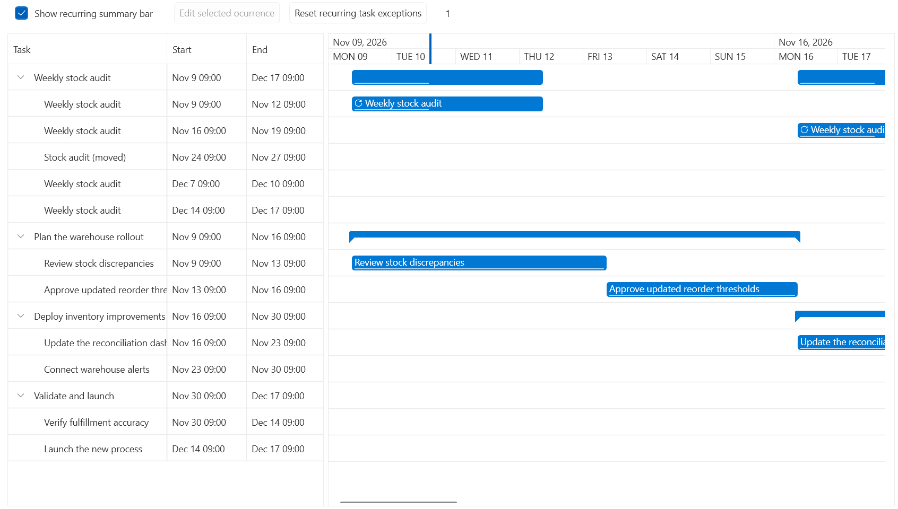
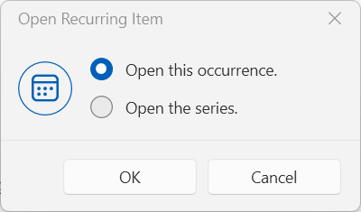
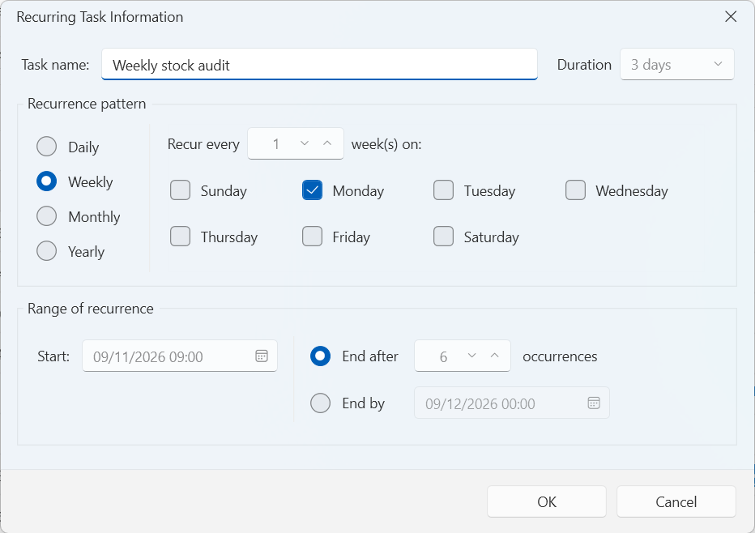
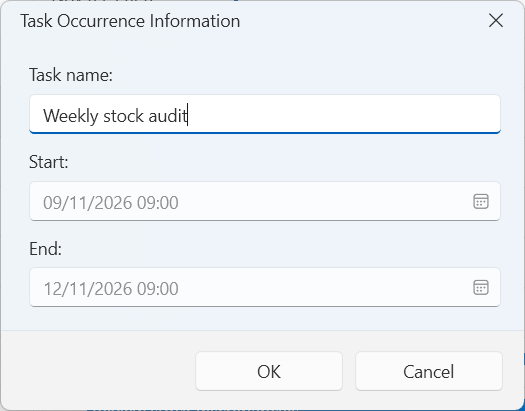

# Recurring Tasks and Shared Timeline Rows

__RadGanttView__ in Telerik UI for WPF supports recurring task series with daily, weekly, monthly, or yearly schedules. You can edit individual occurrences, restore deleted occurrences, and display multiple tasks in shared timeline rows.



## Creating Recurring Task Series

Use `RecurringGanttTask` instead of `GanttTask` for a recurring series. Add the series to `RadGanttView.TasksSource`. The generated occurrences form its child tasks.

The task types are in the `Telerik.Windows.Controls.GanttView` namespace. Use the `Telerik.Windows.Controls.ScheduleView` namespace for `RecurrencePattern`, `RecurrenceFrequency`, and `RecurrenceDays`.

__Creating a weekly recurring task__

```C#
using System;
using Telerik.Windows.Controls;
using Telerik.Windows.Controls.GanttView;
using Telerik.Windows.Controls.ScheduleView;

DateTime anchor = new DateTime(2026, 11, 3, 9, 0, 0);
RecurringGanttTask series = new RecurringGanttTask(
    "stock-audit",
    anchor,
    TimeSpan.FromHours(2),
    new RecurrencePattern
    {
        Frequency = RecurrenceFrequency.Weekly,
        DaysOfWeekMask = RecurrenceDays.Tuesday | RecurrenceDays.Thursday,
        MaxOccurrences = 8
    })
{
    Title = "Stock audit"
};

RadGanttView ganttView = new RadGanttView
{
    TasksSource = new[] { series }
};
```

The series materializes eight child occurrences. A series identifier must be nonempty and contain a non-whitespace character. The anchor supplies the occurrence time of day.

Obtain individual `GanttTaskOccurrence` objects from `series.Occurrences`; do not construct them directly. Each occurrence exposes its owning `Series` and its `OriginalStart`, which remains unchanged when you edit the occurrence dates.

The series is a summary task. Its `Start`, `End`, and `Duration` reflect the bounds of the included occurrences and cannot be set directly. Use `ApplyRecurrence` to change the schedule or per-occurrence duration.

## Configuring Recurrence Patterns

Gantt series accept daily, weekly, monthly, and yearly patterns. They do not accept infinite series, sub-day frequencies, or hour/minute filters.

| Setting | Supported finite behavior |
|---|---|
| `Interval` | Positive integer; defaults to `1` |
| `MaxOccurrences` / `RecursUntil` | Specify exactly one termination condition |
| `DaysOfWeekMask` | Filters weekdays; weekly patterns without a mask repeat on the anchor weekday |
| `FirstDayOfWeek` | Defines the week boundary for multiweek intervals |
| `DaysOfMonth` | One value from `1` through `31` for monthly/yearly patterns |
| `DayOrdinal` | First through fourth (`1`-`4`) or last (`-1`) matching weekday; requires a weekday mask |
| `MonthOfYear` | Required for yearly patterns; value from `1` through `12` |
| Calendar | Gregorian calendar only for finite patterns |
| Duration | Nonnegative `TimeSpan`; zero-duration occurrences are milestones |
| Series size | At most `366` scheduled occurrences |

Monthly and yearly patterns select either a day of month or an ordinal weekday, not both. When using `DaysOfMonth`, leave `DaysOfWeekMask` set to `RecurrenceDays.None`. Daily and weekly patterns cannot specify month filters. Monthly patterns cannot specify a month of year.

Dates that do not exist in a particular month or year are skipped. A February 29 pattern, for example, generates dates only in leap years. A permanently impossible annual date is rejected.

>important The 366-occurrence limit belongs to `RecurringGanttTask`. It applies to the scheduled series, not only to currently visible or undeleted occurrences.

## Displaying a Recurring Series

The series row displays a separate timeline bar for each occurrence, rather than one continuous bar spanning the entire series. These bars remain visible when the series is collapsed. Expanding the series also displays the occurrences in their child rows.

Overlapping occurrences occupy separate lanes and increase the series row height. This presentation does not require `TaskRowKeySelector`.

Set `ShowRecurringTaskSummary` to `false` to hide the occurrence bars on the series row. The series hierarchy and child occurrences remain available. The default value is `true`.

__Hiding the series timeline bars__

```C#
ganttView.ShowRecurringTaskSummary = false;
```

This setting affects the series-row visualization, not the occurrence data or ordinary summary tasks.

## Editing Occurrences

You can edit the whole recurring series or only one occurrence. Execute `RadGanttView.EditRecurrenceCommand` with an occurrence as its parameter to choose between editing that occurrence and the entire series. To open the series editor directly, call `RadGanttView.EditRecurrence` with the series. See [Editing Through Dialogs](#editing-through-dialogs) for examples of both approaches.

To edit an occurrence programmatically, change its inherited `GanttTask` properties to create overrides for its title, description, progress, deadline, or dates. Series property changes update occurrences that do not override the affected field.

__Editing an individual occurrence__

```C#
GanttTaskOccurrence occurrence = series.Occurrences[0];
DateTime originalStart = occurrence.OriginalStart;
occurrence.Title = "Audit with external reviewer";
occurrence.Start = occurrence.Start.AddHours(1);
occurrence.End = occurrence.End.AddHours(1);
```

This example continues from the series creation example. The edited occurrence has `IsException` set to `true` and appears in `series.Exceptions`. Its `OriginalStart` still identifies the original scheduled date. Resources synchronize from the series rather than using per-occurrence overrides.

>note Direct model changes do not raise the control's edit events or automatically create undo records. Use the control's editing, deletion, and restoration methods when the operation must participate in its saving and undo/redo workflow.

## Updating the Series Schedule

The `RecurrencePattern` getter returns a copy. Change that copy and pass it to `ApplyRecurrence` with the anchor and occurrence duration to update the series.

__Extending a recurring series__

```C#
RecurrencePattern updatedPattern = series.RecurrencePattern;
updatedPattern.MaxOccurrences = 10;
IGanttTask[] projectTasks = { series };
series.ApplyRecurrence(series.Anchor, series.OccurrenceDuration, updatedPattern, projectTasks);
```

Occurrences with unchanged original start dates retain their identity and overrides. The example contains only one series; include all project tasks in `dependencyScope` when the project contains other tasks.

When a schedule change removes occurrences, `ApplyRecurrence` requires a dependency scope and rejects unresolved incoming or outgoing dependencies. It also rejects removal of dates that have occurrence overrides or are recorded as deleted. Resolve these exceptions before applying such a change.

## Deleting and Restoring Occurrences

Use the occurrence's `OriginalStart` to delete or restore it through the series model. Deletion removes the occurrence from `Children` and `Occurrences` but records its scheduled date in `DeletedOccurrenceStarts`.

__Deleting and restoring an occurrence__

```C#
GanttTaskOccurrence occurrenceToDelete = series.Occurrences[0];
DateTime deletedStart = occurrenceToDelete.OriginalStart;

IGanttTask[] projectTasks = { series };
series.DeleteOccurrence(deletedStart, projectTasks);
series.RestoreOccurrence(deletedStart);
```

Pass all project tasks to `DeleteOccurrence` so it can check incoming and outgoing dependencies. An unresolved dependency prevents deletion.

`RestoreOccurrence` clears the occurrence's overrides and restores its current series values, even if the occurrence was not deleted. Use `RestoreOccurrences()` to restore all deleted occurrences and reset all occurrence-specific overrides.

To delete or restore an occurrence through the control's saving and undo/redo workflow, use the corresponding `RadGanttView` methods.

__Deleting and restoring through the control__

```C#
GanttTaskOccurrence selectedOccurrence = series.Occurrences[0];
DateTime selectedStart = selectedOccurrence.OriginalStart;
if (ganttView.DeleteOccurrence(selectedOccurrence, GanttRecurrenceEditScope.Occurrence))
{
    ganttView.RestoreOccurrence(series, selectedStart);
}
```

Passing `GanttRecurrenceEditScope.Occurrence` skips the scope dialog. The overload without a scope prompts the user to choose an occurrence or the whole series. For series deletion, handle `RecurringSeriesDeleting`, remove the series from the application source, and set `Handled` to `true`.

## Editing Through Dialogs

You can edit the whole recurring series or only one occurrence through the built-in dialogs. Use `RadGanttView.EditRecurrenceCommand` to open the editing workflow for a series or occurrence, or call `RadGanttView.EditRecurrence` to open the series editor directly.

__Choosing what to edit__

When you execute the command for an occurrence, the first dialog lets you choose whether to edit the whole series or only the selected occurrence. Your choice opens the corresponding editor.



__Editing the whole series__

The series editor lets you change the series title, anchor, occurrence duration, and recurrence pattern. These changes apply to the series; existing occurrence-specific overrides are preserved unless the schedule change requires resetting them, as described below.



__Editing one occurrence__

The occurrence editor lets you change the selected occurrence's title, start, and end without changing the other occurrences. The edited occurrence becomes an exception to the series.



Use the command to edit a recurring series or an individual occurrence. Pass the task as the command parameter and set the command target to the `RadGanttView` instance. When the parameter is an occurrence, the default workflow prompts the user to choose whether to edit only that occurrence or the whole series. Passing a series opens the series editor directly. Without a parameter, the command uses `SelectedItem`.

The following example binds the command to an **Edit selected occurrence** button. It assumes that the `RadGanttView` has `x:Name="ganttView"`.

__Opening an editor with the command__

```XAML
<Button Content="Edit selected occurrence"
    Command="{x:Static telerik:RadGanttView.EditRecurrenceCommand}"
    CommandTarget="{Binding ElementName=ganttView}"
    CommandParameter="{Binding SelectedItem, ElementName=ganttView}" />
```

To edit a whole series programmatically, call `EditRecurrence` with the `RecurringGanttTask` instance. The method opens the series editor without a scope prompt, raises `RecurrenceEditing` before opening the dialog, and returns whether the edit was committed.

__Opening the series editor__

```C#
ganttView.EditRecurrence(series);
```

The series duration editor accepts time spans or values with `d`, `h`, and `m` suffixes. A day represents 24 hours, not a working-calendar day.

In the series editor, title-only edits and count extensions preserve exception edits and deleted dates. The reset confirmation appears when the proposed schedule removes an exception or deleted date. Accepting the confirmation resets all occurrence overrides and restores deleted occurrences before the new schedule is applied. Declining leaves the edit uncommitted.

Successful control edits participate in undo/redo. Canceled saves and failed recurrence edits restore the prior task state. Whole-series removal remains the application's responsibility.

### Choosing the Edit Scope

Handle `RecurringTaskEditing` and assign its `Scope` property to select occurrence or series editing without displaying the default choice dialog.

| Event | Event arguments | Application customization |
|---|---|---|
| `RecurrenceEditing` | `RecurrenceEditingEventArgs` | Set `Cancel` to stop editing, or supply `Anchor`, `Duration`, `Pattern`, and `Title` and set `Handled` to commit those settings without the default series dialog. |
| `RecurringTaskEditing` | `RecurringTaskEditingEventArgs` | Cancel an occurrence edit or set `Scope` to choose occurrence or series editing. |
| `RecurringSeriesDeleting` | `RecurringSeriesDeletingEventArgs` | Cancel removal or remove the series from the application source and set `Handled = true`. |

__Selecting occurrence-only editing__

```C#
ganttView.RecurringTaskEditing += (sender, e) =>
{
    e.Scope = GanttRecurrenceEditScope.Occurrence;
};
```

The handler selects occurrence-only editing without prompting for series scope. The three events use direct routing, so attach their handlers to the `RadGanttView` instance.

### Understanding Timeline Interaction Restrictions

Recurring series summaries and projected rows cannot be dragged, resized, or used as dependency endpoints through the default interaction behaviors. Individual occurrences can be moved or resized on the timeline and can participate in dependencies.

Timeline movement and resizing edit the occurrence without the default scope prompt. `RecurringTaskEditing` still allows the application to cancel or explicitly select series scope. Occurrences cannot be reparented to other task groups.

If you replace the default drag, resize, or dependency-link behaviors, preserve these restrictions for series and projected rows.

## Displaying Multiple Tasks in One Timeline Row

Set `RadGanttView.TaskRowKeySelector` to a `Func<IGanttTask, object>` that returns a non-null row key. Tasks with equal keys share a projected row. Set the selector to `null`, its default value, to use the hierarchical presentation.

The projection collects leaf tasks from the hierarchy, including recurring occurrences. It does not replace the original task objects in `TasksSource`. If all occurrences of a series are deleted, the series itself remains accessible in the grouped view for restoration, without occurrence bars.

__Grouping tasks by title__

```C#
ganttView.TaskRowKeySelector = task =>
    (task is GanttTaskOccurrence occurrence
        ? occurrence.Series.Title
        : task.Title) ?? string.Empty;
```

This example groups occurrences under their series title. Other tasks with the same title also share that row. Return stable application-specific keys to avoid unintended grouping.

The control creates `GanttTaskRow` objects for this presentation. Each row exposes its `Key`, original `Tasks`, and `LaneCount`. The initial row `Title` uses the key's string representation and can be changed. `Start` and `End` are the earliest start and latest end of the grouped tasks, `Duration` spans those bounds, and `Progress` is their arithmetic mean. These aggregate properties cannot be set; edit the original tasks instead.

Overlapping tasks occupy separate lanes and increase row height. Selection, highlighting, dependency routing, and automation target the original tasks. Projected rows cannot be selected or edited through the task-editing workflow.

Source and child collections that implement `INotifyCollectionChanged` refresh the projection when their contents change. Tasks that implement `INotifyPropertyChanged` allow the projection to reevaluate their row keys and refresh affected row data. Changes only to external state used by the selector do not automatically refresh grouping. Sources with duplicate task objects, hierarchy cycles, invalid entries, or null selector results are rejected.

## Customizing Recurrence Dialogs and Templates

Override the following protected virtual `RadGanttView` methods to replace the built-in dialog workflow.

| Method | Contract |
|---|---|
| `bool ShowRecurrenceDialog(RecurrenceEditingEventArgs args, Func<bool> commit)` | Present series settings and invoke `commit` to save. |
| `bool ShowOccurrenceDialog(GanttTaskOccurrence occurrence, Func<string, DateTime, DateTime, bool> commit)` | Present occurrence settings and commit title, start, and end. |
| `GanttRecurrenceEditScope? ChooseRecurrenceScope(GanttTaskOccurrence occurrence, bool deleting)` | Return occurrence or series scope; return `null` to cancel. |

To change the appearance, customize the styles and templates of `GanttRecurrenceDialogContent`, `GanttOccurrenceDialogContent`, and `GanttRecurrenceScopeDialogContent`. These controls are in the `Telerik.Windows.Controls` namespace and cannot be constructed directly by application code.

The dialog style resources are `RadGanttViewWindowStyle`, `RadGanttViewRecurrenceDialogContentStyle`, `RadGanttViewOccurrenceDialogContentStyle`, and `RadGanttViewRecurrenceScopeDialogContentStyle`. Preserve the template parts required by each dialog when replacing its template.

Custom event templates can use the read-only `EventProxy.IsRecurring` property to display recurrence indicators. The property is `false` for the content-hidden bars on the series row. Existing custom templates do not automatically include the indicator.

Dialog labels, validation messages, reset confirmations, and scope choices use `LocalizationManager`.

## Reusing Recurrence Patterns Across Controls

`RecurrencePattern`, `RecurrenceDays`, and `RecurrenceFrequency` move from `Telerik.Windows.Controls.ScheduleView.dll` to `Telerik.Windows.Controls.dll`. Their namespace remains `Telerik.Windows.Controls.ScheduleView`.

Update related Telerik assemblies together. Keep the existing `using Telerik.Windows.Controls.ScheduleView;` directive. Gantt recurrence does not require a reference to the ScheduleView assembly solely to obtain these types; ScheduleView supplies type forwarders for compatibility.

Use the following methods when validating or enumerating finite patterns independently of a Gantt task series.

| Method | Contract |
|---|---|
| `void ValidateFinite(DateTime start)` | Validates the finite daily-through-yearly subset used by Gantt. Invalid settings throw argument exceptions. |
| `IEnumerable<DateTime> GetFiniteOccurrences(DateTime start, DateTime from, DateTime to)` | Validates the finite pattern and returns a snapshot-based sequence within the inclusive query bounds. |

`GetFiniteOccurrences` validates the pattern and query bounds when called, then returns a lazily evaluated sequence based on an isolated snapshot. It treats `RecursUntil` as an inclusive calendar date. In contrast, `GetOccurrences` uses the full `RecursUntil` date and time and does not provide the finite API's validation or snapshot isolation. Both methods count occurrences from the series anchor, not from the query's `from` argument.

`GetFiniteOccurrences` throws an `ArgumentException` if `to` precedes `from`. During enumeration, it can throw an `ArgumentOutOfRangeException` if reaching `DateTime.MaxValue` prevents the configured occurrence count from being satisfied.

The finite enumeration method does not enforce the 366-occurrence limit. Constructing or updating a `RecurringGanttTask` enforces that limit.

## See Also

* [GanttView Overview]()
* [Getting Started with GanttView]()
* [ScheduleView Overview]()
* [Telerik UI for WPF API Reference](https://www.telerik.com/products/wpf/documentation/api/)
