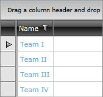

# Dynamic Hyperlink Column

__GridViewDynamicHyperlinkColumn__ derives from [GridViewBoundColumnBase]() class. Except the binding to the desired property of your business object it allows you to easily build a URL for the hyperlink that hosts the content.

## GridViewDynamicHyperlinkColumn vs GridViewHyperlinkColumn

The advantage of the GridViewDynamicHyperlinkColumn over the [GridViewHyperlinkColumn]() is that it allows you to build a Uri by combining the values of several properties of your business object. If you have the entire Uri that you want to navigate to in a single property, you can use a GridViewHyperlinkColumn.

## Properties

Here is a list of the most important properties:

* __DataMemberBinding__: Allows you to specify the property of the business object to be displayed as value in the cell. It is automatically displayed as a link.

* __NavigateUrlMemberPaths__: Comma separated property names, the values of which will be inserted at the placeholder positions defined in the __NavigateUrlFormatString__.

* __NavigateUrlFormatString__: Allows you to provide a format string for the value of the URL.  
 
>To learn more about formatting you can check [Data Formatting]() topic. 

* __TargetName__: Specifies the location to open the link.

__Example 1: Define GridViewDynamicHyperlinkColumn in XAML.__
<snippet id='radgridview-columns-columntypes-column-types-dynamic-hyperlink-column-example_1_define_gridviewdynamichyperlinkcolumn_in_xaml-xaml' />

You can also directly configure the navigate url to be a complete one and specify an empty format as demonstrated in __Example 2__, though in such a scenario it would be easier to use a [GridViewHyperlinkColumn]().

__Example 2: Define navigate url without additional format.__
<snippet id='radgridview-columns-columntypes-column-types-dynamic-hyperlink-column-example_2_define_navigate_url_without_additional_format-xaml' />

>caption GridViewDynamicHyperlinkColumn in RadGridView

>tip To handle hyperlink navigation, use the approach in [Hyperlink column click handling]().

## Handling Hyperlink Navigation

`GridViewDynamicHyperlinkColumn` launches only URLs that pass the pattern and scheme checks. Absolute HTTP, HTTPS, and mailto URLs can be trusted by default. Other URLs do not launch unless a handler sets `IsTrustedUrl` to `true`. This default launch restriction is a behavior change for GridView hyperlinks.

The dynamic column does not expose its own `HyperlinkClicked` event. Subscribe to the shared `HyperlinkManager.HyperlinkClicked` event to cancel navigation or approve a URL. Its arguments expose `Url`, `IsTrustedUrl`, and `Handled`; the `sender` depends on the control that originated the request.

Set `Handled` to `true` to stop the default action. Set `IsTrustedUrl` to `true` to allow a URL that the validator would otherwise reject. The shared validator accepts absolute HTTP, HTTPS, and mailto URLs that pass its pattern and scheme checks. Because the manager event is static, unsubscribe when the handler owner has a shorter lifetime than the application. See [Handling hyperlink navigation in RadHyperlinkButton]() for a shared-event example.

## See also
* [Hyperlink Column]()
* [CellTemplate and CellEditTemplate]()
* [Telerik UI for WPF API Reference](https://docs.telerik.com/devtools/wpf/api/)