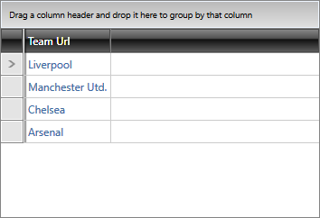

# Hyperlink Column

__GridViewHyperlinkColumn__ derives from the [GridViewBoundColumnBase]() class and its content is represented by a __HyperlinkButton__ control.

## Properties

Here's a list of properties that the column exposes:

* __DataMemberBinding__: Here you need to specify the property of the business object which is the actual link that will be navigated to. The type of the property can be a **Uri** or a plain **string**.

* __ContentBinding__: You can specify the property of the business object to be displayed as the value in the cell. If this binding is not specified, the actual link provided as the DataMemberBinding is displayed.
            
* __TargetName__: Gets or sets the name of a target window or frame for the hyperlink.

## Defining the Data

For the purposes of this article we will assume that the data objects expose **Name** and **TeamUrl** properties as defined in **Example 1**.

__Example 1: The Club class__

<snippet id='radgridview-columns-columntypes-column-types-hyperlink-column-example_1_the_club_class-cs' />

<snippet id='radgridview-columns-columntypes-column-types-hyperlink-column-example_1_the_club_class-vb' />


## Set Up the Hyperlink Column

If you bind the RadGridView control to a collection of **Club** objects, you can define the GridViewHyperlinkColumn column as shown in **Example 2**.

__Example 2: Define GridViewHyperlinkColumn in XAML__

<snippet id='radgridview-columns-columntypes-column-types-hyperlink-column-example_2_define_gridviewhyperlinkcolumn_in_xaml-xaml' />


**Figure 1** illustrates the result of the code in **Example 1**.

>caption RadGridView with a hyperlink column



## Handling Hyperlink Navigation

`GridViewHyperlinkColumn` launches only URLs that pass its pattern and scheme checks. Absolute HTTP, HTTPS, and mailto URLs can be trusted by default; other URLs do not launch unless a handler approves them. This default launch restriction is a behavior change for GridView hyperlinks.

Handle the column's `HyperlinkClicked` event to cancel navigation or approve a URL. The event arguments are `GridViewHyperlinkClickedEventArgs`, which provide `Url`, `IsTrustedUrl`, `Handled`, and `DataItem` for the row that contains the link.

__Canceling navigation for a row link__

```C#
private void OnColumnHyperlinkClicked(object sender, GridViewHyperlinkClickedEventArgs e)
{
    if (e.DataItem == null)
    {
        e.Handled = true;
    }
}
```

Set `Handled` to `true` to prevent the default launch. If the local event does not handle the request, `HyperlinkManager.HyperlinkClicked` runs next. Its `sender` depends on the originating control; for this column, it is the column. Use the shared event for links from `GridViewDynamicHyperlinkColumn`, which does not expose a local `HyperlinkClicked` event. Unsubscribe from the static event when the handler owner has a shorter lifetime than the application.

Set `IsTrustedUrl` to `true` in the local or shared event to allow the default launch for a URL the validator would otherwise reject. The shared validator accepts absolute HTTP, HTTPS, and mailto URLs that pass its pattern and scheme checks. See [Handling hyperlink navigation in RadHyperlinkButton]() for a shared-event example.

## See also

* [Dynamic Hyperlink Column]()
* [CellTemplate and CellEditTemplate]()
* [Telerik UI for WPF API Reference](https://docs.telerik.com/devtools/wpf/api/)