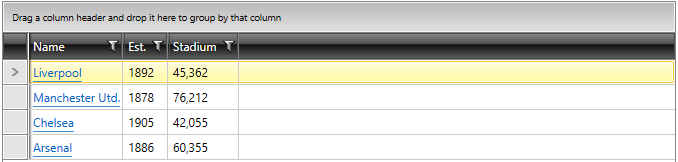
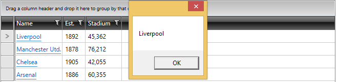

# Hyperlink Column Click Handling

Handle a link click in `GridViewHyperlinkColumn` with its `HyperlinkClicked` event. Use a `GridViewDataColumn` with a custom cell template when you need to handle a different click interaction.

If the first column of the __RadGridView__ is a __GridViewHyperlinkColumn__, as in the picture below:

>caption RadGridView with GridViewHyperLinkColumn



The column launches only URLs that pass the pattern and scheme checks. Absolute HTTP, HTTPS, and mailto URLs can be trusted by default when they pass those checks; other URLs do not launch unless a local or shared handler sets `IsTrustedUrl` to `true`. This launch restriction is a behavior change for GridView hyperlinks.

## Handling the Column Hyperlink Event

Subscribe to `GridViewHyperlinkColumn.HyperlinkClicked` to inspect the URL and row data or cancel navigation:

The event arguments expose the URL, trust status, handling status, and the row's data item. Set `Handled` to `true` to prevent the default launch.

__Handling a link click in GridViewHyperlinkColumn__

```C#
private void OnColumnHyperlinkClicked(object sender, GridViewHyperlinkClickedEventArgs e)
{
    if (e.DataItem == null)
    {
        e.Handled = true;
    }
}
```

`GridViewHyperlinkClickedEventArgs` provides `Url`, `IsTrustedUrl`, `Handled`, and `DataItem`. The example cancels navigation when the event does not have a row data item.


__Figure 2__ shows the result after clicking the hyperlink:

>caption The result after clicking the hyperlink



## Handling a Custom Cell Click

Declare a standard __GridViewDataColumn__ instead of __GridViewHyperlinkColumn__. Subscribe to the `MouseLeftButtonUp` event of the `TextBlock` in the cell template and use a style to imitate a hyperlink:

__Declare the GridViewHyperlinkColumn and its CellTemplate:__
<snippet id='radgridview-columns-how-to-hyperlink-column-click-event-declare_the_gridviewhyperlinkcolumn_and_its_celltemplate-xaml' />


__Handle the MouseLeftButtonUp event__
<snippet id='radgridview-columns-how-to-hyperlink-column-click-event-handle_the_mouseleftbuttonup_event-cs' />


The result will be the same as the one shown in __Figure 2__.

## Using the Shared Hyperlink Event

`HyperlinkManager.HyperlinkClicked` runs after the column event if the column event does not handle the request. The shared event also handles links from `GridViewDynamicHyperlinkColumn`, which has no local `HyperlinkClicked` event. Set `Handled` to `true` to cancel navigation or `IsTrustedUrl` to `true` to permit a URL that is not trusted by default. The `sender` identifies the originating control or component.

The shared validator accepts absolute HTTP, HTTPS, and mailto URLs that pass its pattern and scheme checks. `HyperlinkManager.HyperlinkClicked` is static, so unsubscribe when the handler owner has a shorter lifetime than the application. For a shared-event code example, see [Handling hyperlink navigation in RadHyperlinkButton]().

## See Also
 * [CellTemplate and CellEditTemplate]()
 * [CheckBox Column]()
 * [Telerik UI for WPF API Reference](https://docs.telerik.com/devtools/wpf/api/)