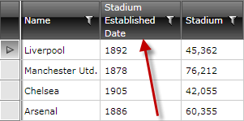

# Wrap the Text in the Column Header

Wrap column header text in `RadGridView` to display long headings on multiple lines. Use `HeaderTextWrapping` for text headers, or a `TextBlock` for custom header content.

The following image shows a column header with text on multiple lines:

The XAML examples assume an existing `RadGridView`. For project setup and required references, follow [Getting Started with RadGridView]().

## Set Header Text Wrapping

Use the column's `HeaderTextWrapping` property for text headers. This property is available starting with R2 2016 and avoids the need for a custom header element.

Apply the header settings to a column in your existing `RadGridView`:

<snippet id='radgridview-columns-how-to-wrap-text-column-header-block_1-xaml' />

If the header stays on one line, check the column's `Width`. The default `SizeToHeader` sizing mode sizes the column to its header text. Set a fixed width that is narrower than the unwrapped heading to allow the text to wrap. See [Controlling Columns Width]() for sizing options.

For alignment, trimming, and other header settings, see [Column Headers: Text Properties](#text-properties).

## Use a TextBlock Header

Use a `TextBlock` when you need custom header content. The column's `Header` property is of type `object`, so it accepts a `TextBlock` instead of a text value.

Set the `TextBlock.TextWrapping` property on the element assigned to the column's `Header`:

<snippet id='radgridview-columns-how-to-wrap-text-column-header-block_2-xaml' />

>important If another control uses the column's `Header` as its content, do not reuse the same `TextBlock` instance. This includes the checkboxes in the [Control Panel]() example. Create a separate `TextBlock` or use a converter that returns only its `Text` value.

## See Also
 * [Column Headers]()
 * [Foreground color does not change in a custom header]()