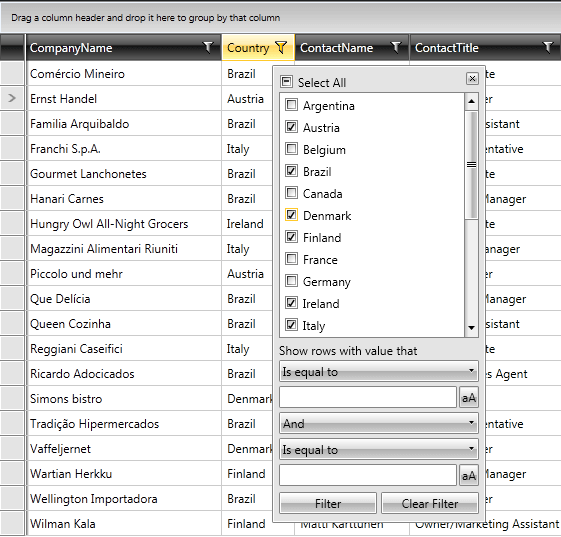
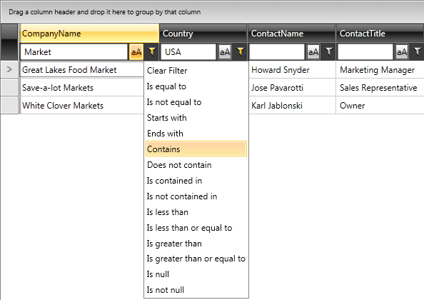
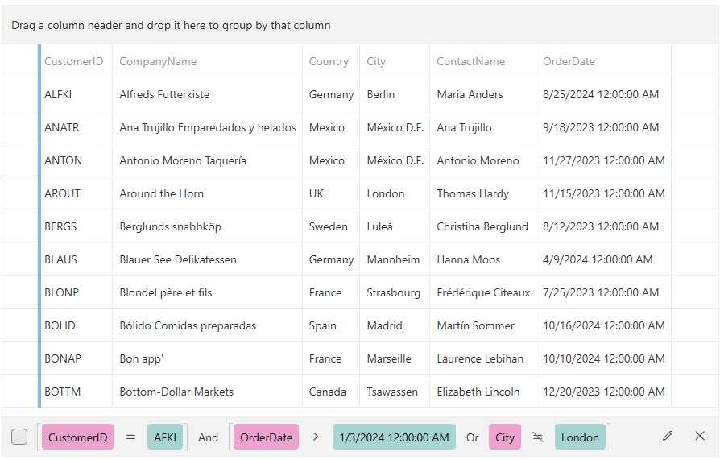
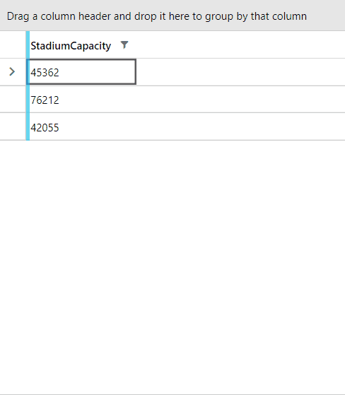

# Basic Filtering

The `RadGridView` control supports filtering data by one or more columns. Filtering is enabled by default for common .NET types, including strings, numeric types, and `DateTime`.

For a data-bound grid, use the following options to configure filtering:

* [Filter Modes](#filter-modes)

* [FilterMemberPath](#filtermemberpath)

* [OptimizeDistinctFilterQuery](#optimizedistinctfilterquery)

* [Distinct Values Filtering](#distinct-values-filtering)

>note To filter a column bound to a custom type, the type must meet the [custom-type filtering requirements]().

To disable filtering for the entire grid, set its [`IsFilteringAllowed`]() property to `False`. To disable filtering for a specific column, set the column's [`IsFilterable`]() property to `False`.

## Filter Modes

Set the `FilteringMode` property of `RadGridView` to one of these three built-in modes:

* [Popup Filtering](#popup-filtering)

* [Filter Row](#filter-row)

* [Filter Editor](#filter-editor)

## Popup Filtering

`Popup` is the default value of `RadGridView.FilteringMode`. Click the funnel icon in a column header to open its filtering popup.

>caption The filtering popup

### Distinct Values

The upper part of the popup lists the column's distinct values. By default, this list includes only values from rows that pass the other columns' filters. To include values excluded by other column filters, see [displaying all distinct values]().

The list displays values formatted with the column's `DataMemberBinding` converter (`IValueConverter`) or `DataFormatString`, if configured. For example, a currency format changes how a numeric value appears in the list, but filtering still uses the original numeric value.

>important `IValueConverter` and `DataFormatString` affect display only. Filtering uses the raw data values, not the formatted text.

By default, the list shows only the first 1000 distinct values. Set `RadGridView.DefaultDistinctValuesCount` to change this limit. For event-based control over the list, see [retrieving and displaying distinct values]().

To hide the distinct-values list, set the column's `ShowDistinctFilters` property to `False`. This property applies only to `Popup` mode.

### Field Filters

The lower part of the popup contains two field filters joined by a logical operator. Use them to define criteria such as "age is greater than 18 and is less than 60."

Each field filter contains an operator selector and a value editor. Available operators depend on the column's data type. String columns offer operators such as **Contains** and **Is Contained In**. Numeric and date columns offer comparisons such as **Is Greater Than** and **Is Less Than**.

See the [filter operators by data type](#filterdescriptor) for the available comparisons. Handle `RadGridView.FilterOperatorsLoading` to remove operators or [change the default selected operators]().

The value editor also depends on the column's data type. For example, date columns use a date-time picker. You can [create a custom field filter editor]() or handle `RadGridView.FieldFilterEditorCreated` to [customize the default field filter editor]().

To hide the field filters in `Popup` mode, set the column's `ShowFieldFilters` property to `False`. For Boolean columns, this property is `False` by default.

The column's `ShouldGenerateFieldFilterEditors` property controls editor creation in both `Popup` and `FilterRow` modes:

* `null` (default)&mdash;Generates field filter editors for non-Boolean columns.
* `False`&mdash;Prevents editor generation. The `FilterOperatorsLoading` event is not raised.
* `True`&mdash;Also generates editors for Boolean columns. These columns use a checkbox with `IsEqualTo` and `IsNotEqualTo` operators instead of the **Is True** and **Is False** choices.

>note In `Popup` mode, both `ShowFieldFilters` and `ShouldGenerateFieldFilterEditors` apply. If either property is `False`, no field filter editors are created.

### Deferred Filtering

By default, the popup applies filters as soon as you select a distinct value or change a field filter. In this immediate mode, you can hide the **Filter** button by setting the column's `ShowFilterButton` property to `False`.

To apply changes only after you click **Filter**, set the column's `IsFilteringDeferred` property to `True`. Keep `ShowFilterButton` set to `True` so that you can apply the pending changes. Deferred filtering can reduce requests when a remote server handles filtering.

`IsFilteringDeferred` applies only when `FilteringMode` is `Popup`. The clear button always removes all filters for the column immediately, even when filtering is deferred.

### Keep Filter Popup Open

Set `RadGridView.FilteringDropDownStaysOpen` to `True` to keep the popup open when you click outside it. The default value is `False`. When the property is `True`, click the close button or the column's funnel icon to close the popup.

## Filter Row

Set `RadGridView.FilteringMode` to `FilterRow` to display an inline filter in each filterable column's header. Each column has one field filter editor that remains visible. Unlike `Popup` mode, `FilterRow` does not display a distinct-values list.

>caption The filter rows

To apply a filter to a non-Boolean column:

1. Enter a value in the column's filter editor.
2. Click the funnel icon to open the operator list.
3. Select an operator appropriate for the column's data type.

The filter becomes active when it has a value and an operator. Changes to an active filter's value or operator apply immediately. Select **Clear Filter** from the operator list to reset the filter. To activate it again, select an operator.

Handle `RadGridView.FilterOperatorsLoading` to remove available operators. For default-operator configuration, see [changing the default selected filter operators]().

By default, Boolean columns have no value editor. Select **Is True** or **Is False** from the operator list instead. To generate a checkbox editor, use `ShouldGenerateFieldFilterEditors` as described in [Field Filters](#field-filters).

`IsFilteringDeferred` does not apply to `FilterRow`. Filters always apply immediately after activation.

`FilterRow` supports [custom field filter editors]() and [customization of the default editor]().

>note A custom filtering control replaces the entire popup and is supported only in `Popup` mode. This differs from a custom field filter editor, which is supported in both `Popup` and `FilterRow` modes.

## Filter Editor 

Set `RadGridView.FilteringMode` to `FilterEditor` to create complex filter expressions with `RadDataFilter`. This mode displays a data filter view panel at the bottom of the grid by default. See [Filter Editor setup and required assemblies]() for configuration details.

>caption RadGridView in FilterEditor mode

## FilterMemberPath

Set `GridViewColumn.FilterMemberPath` to filter by a property different from the one displayed in the column's cells. If the data engine cannot determine that property's type automatically, set the column's `FilterMemberType` property.

The following example shows how to specify the `FilterMemberPath` for the column to filter it based on the `NameToFilterOn` property of the bound business object.
        

**Specifying the FilterMemberPath for a column**
<snippet id='radgridview-filtering-basic-specifying_the_filtermemberpath_for_a_column-xaml' />

## OptimizeDistinctFilterQuery

By default, each selected distinct value produces a `Member IsEqualTo Value` condition. The data engine combines these conditions with `OR`. Queries can become slow when many distinct values are selected.

Set `GridViewColumn.OptimizeDistinctFilterQuery` to `True` to generate a shorter Language Integrated Query (LINQ) `Where` clause. The generated conditions depend on the selection:

* Half or fewer of the distinct values selected&mdash;Combines equality conditions for selected values with `OR`.
* More than half selected&mdash;Combines `IsNotEqualTo` conditions for unselected values with `AND`.
* All values selected&mdash;Generates no distinct-value condition because the selection does not restrict the data.

>important When query optimization is enabled, set `RadGridView.DefaultDistinctValuesCount` to at least the number of expected distinct values. See [customizing distinct values]() for details.

## Distinct Values Filtering

The `GridViewColumn` base class exposes the `EnableDistinctValuesFiltering` and `DistinctValuesSearchMode` properties, which allow you to filter the column's distinct values.

Set `EnableDistinctValuesFiltering` to `True` to display a `RadWatermarkTextBox` in the `FilteringControl`. Enter text in this search box to narrow the displayed distinct-values list. This searches the list, rather than directly filtering the grid's rows.

Set `DistinctValuesSearchMode` to choose how the search text matches the values. Available modes are `Contains`, `ContainsCaseSensitive`, `StartsWith`, and `StartsWithCaseSensitive`. The default is `StartsWith`.

>tip The `EnableDistinctValuesFiltering` and `DistinctValuesSearchMode` properties apply only when `RadGridView.FilteringMode` is `Popup`.

The following example shows how to use these properties.

**Setting EnableDistinctValuesFiltering and DistinctValuesSearchMode properties**
<snippet id='radgridview-filtering-basic-setting_enabledistinctvaluesfiltering_and_distinctvaluessearchmode_properties-xaml' />

>caption Filtering the StadiumCapacity column's distinct values

## See Also

 * [Visual Structure]()

 * [Programmatic Filtering]()

 * [Reevaluation of data operations]()
