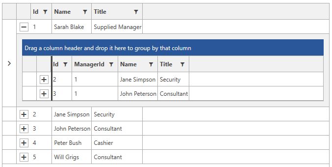
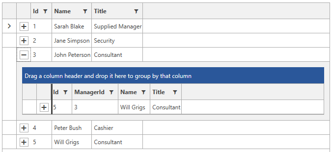

# Self-Referencing GridView

Use a *self-referencing hierarchy* to display parent and child items of the same type from one collection. The `RadGridView` control in Progress® Telerik® UI for WPF matches items through a relation that points back to that collection.

Before you begin, configure a WPF project with `RadGridView` by following the [GridView Getting Started guide](). That guide covers package or assembly references, licensing, the Telerik XAML namespace, data binding, and theme setup.

## Configuring a Self-Referencing Hierarchy

Start with the `RadGridView` declaration in Example 1 and the viewmodel in Example 2.

**Example 1: RadGridView declaration**

<snippet id='radgridview-hierarchical-gridview-self-referencing-grid-example_1_radgridview_declaration-xaml' />

Example 2 defines the `Employee` class and the viewmodel for the sample hierarchy.

**Example 2: Creating the ViewModel**

<snippet id='radgridview-hierarchical-gridview-self-referencing-grid-example_2_creating_the_viewmodel-cs' />

<snippet id='radgridview-hierarchical-gridview-self-referencing-grid-example_2_creating_the_viewmodel-vb' />

Use the `ChildTableDefinitions` collection of `RadGridView` to define the child grids. Example 3 defines a self-referencing relation for the `Employee` class from Example 2.

**Example 3: Setting the ChildTableDefinitions**

<snippet id='radgridview-hierarchical-gridview-self-referencing-grid-example_3_setting_the_childtabledefinitions-xaml' />

Each `FieldDescriptorNamePair` specifies the properties to compare in the parent and child items:

- `ParentFieldDescriptorName`&mdash;Names the property on the parent item.
- `ChildFieldDescriptorName`&mdash;Names the property on the child item.

The child grid displays items whose child-field value equals the corresponding parent-field value.

Figure 1 shows the result of Example 3:

>caption Self-referencing RadGridView

## Matching Multiple Fields

Use more than one `FieldDescriptorNamePair` to add conditions to the relation. Example 4 adds a title comparison so that child items must also have the same title as the parent item.

**Example 4: Specifying two FieldDescriptorNamePair objects**

<snippet id='radgridview-hierarchical-gridview-self-referencing-grid-example_4_specifying_two_fileddescriptornamepair-xaml' />

In Figure 2, the parent item has `Id` equal to `3` and `Title` equal to `"Consultant"`. Its child grid displays only the employee whose `ManagerId` equals `3` and whose `Title` equals `"Consultant"`.

>caption Custom relation

>tip To hide the `GridViewToggleButton` for items without children, add a Boolean property to `Employee`. Bind it through [`IsExpandableBinding`](#isexpandablebinding) on `RadGridView` to indicate whether each item has children.

To customize the nested grids, see [Setting Properties of the Child GridView]().

## See Also

 * [Basic Hierarchies]()

 * [Custom Hierarchies]()
