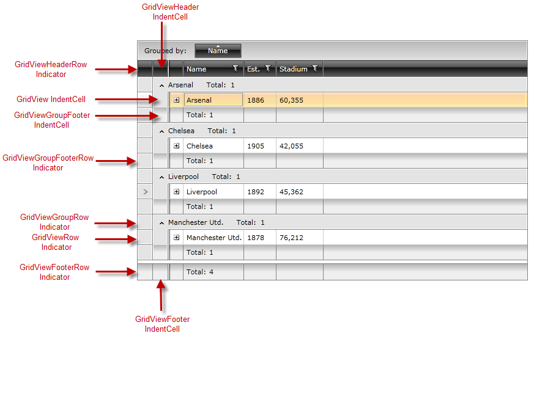
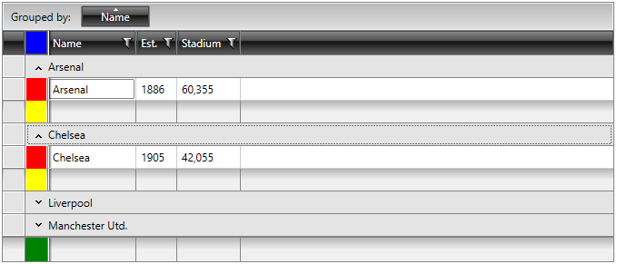

# Styling Indent Cells

__RadGridView__ displays different indent cells when grouped, in a hierarchy, or when displaying footers. The following image identifies indent cells and row indicators in a grouped RadGridView with __ShowColumnFooters__ and __ShowGroupFooters__ set to True.

>caption RadGridView indent cells and indicator presenters

## Indent Cells

RadGridView exposes four different indent cell types:

* **GridViewIndentCell**: It is part of the **GridViewRow**.

* **GridViewHeaderIndentCell**: It is part of the **GridViewHeaderRow**.

* **GridViewFooterIndentCell**: It is part of the **GridViewFooterRow**.

* **GridViewGroupFooterIndentCell**: It is part of the **GridViewGroupFooterRow**.

Create styles that target the indent cells to customize their appearance, as shown in __Example 1__. You can also [edit their control templates]().

__Example 1: Styling Indent Cells__

<snippet id='radgridview-styles-and-templates-styling-indent-cells-example_1_styling_indent_cells-xaml' />

>caption A grouped RadGridView with styled indent cells

## See Also

* [Styling Rows]()

* [Styling Group Row]()

* [Styling Header Row]()