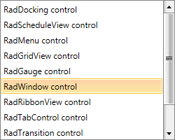

# {{ site.framework_name }} ListBox Overview

`RadListBox`, part of Progress® Telerik® UI for WPF, displays a list of items from which users can choose.

The control supports multiple selection, autocomplete, keyboard shortcuts, drag and drop, and customization. To set up the control, follow the [RadListBox Getting Started guide]().





>caption `RadListBox` displaying a list of Telerik controls

## Key Features:

`RadListBox` provides the following features:

* Selection&mdash;`RadListBox` provides three selection modes: `Single`, `Multiple`, and `Extended`. See the [Selection]() article.

* Autocomplete&mdash;When the control has focus, it selects the first matching item as you type. See the [Autocomplete]() article.

* Drag and Drop&mdash;Configure drag-and-drop support to reorder items or move them between `RadListBox` controls. Statically declared items support reordering, but not transfer between controls. See the [Drag and Drop]() article for configuration and limitations.

* Keyboard Support&mdash;`RadListBox` supports keyboard shortcuts for common tasks. See the [Keyboard Support]() article.

* Theming&mdash;`RadListBox` supports different themes. See the [Styling and Appearance]() section.

>caution If you use [NoXaml binaries]() with a custom `Style` targeting `RadListBoxItem`, base it on the control's default style. Example 1 demonstrates this approach.

**Example 1: Implicit Style with `BasedOn` property set**
<snippet id='radlistbox-overview-block_1-cs' />

>tip Follow the [RadListBox Getting Started guide]() for a basic usage scenario.

Explore the [Telerik UI for WPF demos](https://demos.telerik.com/wpf/).


## Telerik UI for WPF Support and Learning Resources

Use these resources for product information, support, and training:

* [Telerik UI for WPF ListBox Homepage](https://www.telerik.com/products/wpf/listbox.aspx)
* [Telerik UI for WPF API Reference](https://docs.telerik.com/devtools/wpf/api/)
* [Getting Started with Telerik UI for WPF Components]()
* [Telerik UI for WPF Virtual Classroom (Training Courses for Registered Users)](https://learn.telerik.com/learn/course/external/view/elearning/16/telerik-ui-for-wpf)
* [Telerik UI for WPF ListBox Forums](https://www.telerik.com/forums/wpf)
* [Telerik UI for WPF Knowledge Base](https://docs.telerik.com/devtools/wpf/knowledge-base)


## See Also

* [RadListBox Data Binding]()
* [RadListBox Events]()