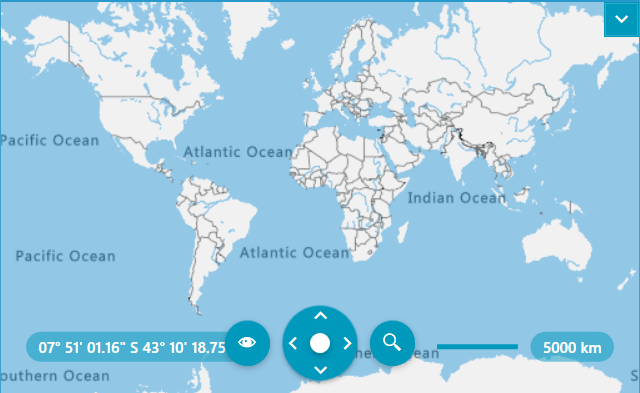
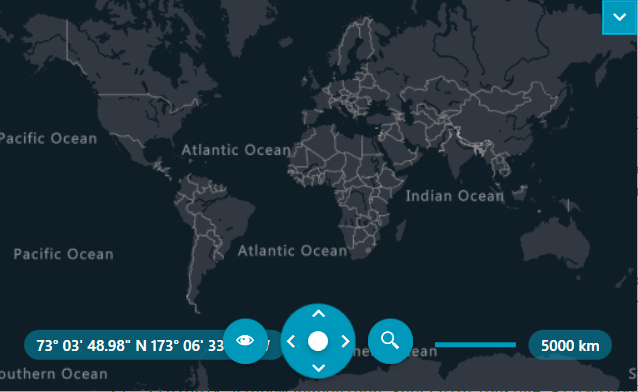
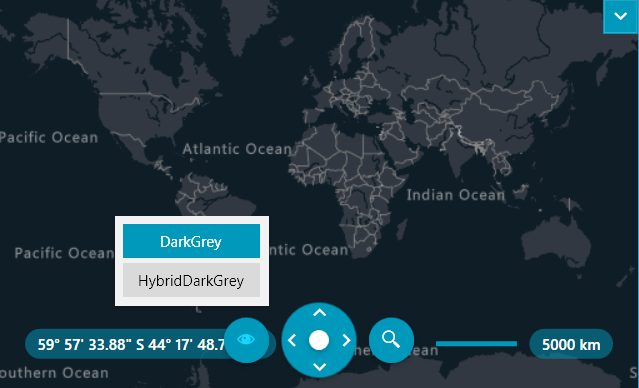
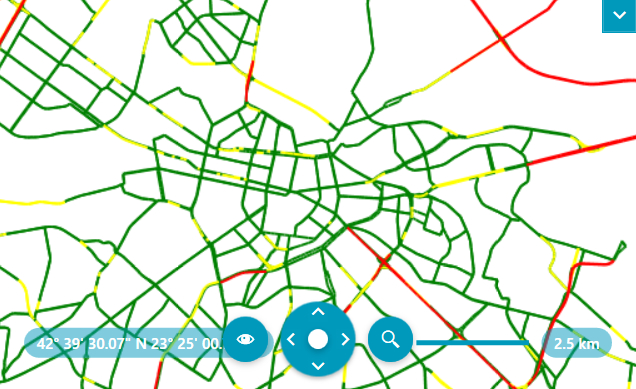
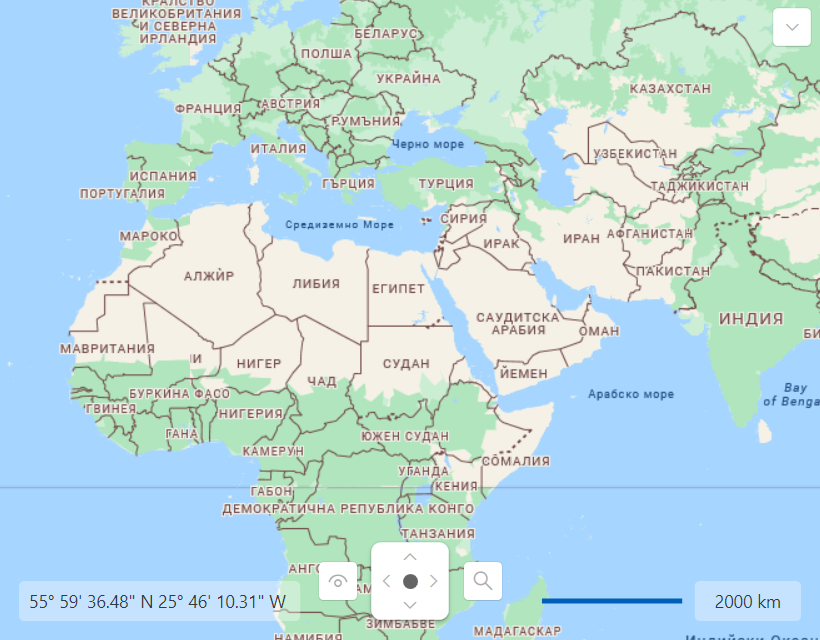

# Azure Map Provider

The `RadMap` control displays tile data from the [Azure Maps services](https://azure.microsoft.com/en-us/products/azure-maps/) through the `AzureMapProvider` class. The provider supports raster and vector sources.

>important The `AzureMapProvider` class derives from `VectorTileMapProvider`, which uses the `Newtonsoft.Json` framework. Add a reference to the corresponding `.dll`, or install the [Newtonsoft.Json NuGet package](https://www.nuget.org/packages/Newtonsoft.Json/).

## Setting Up the AzureMapProvider

Create an `AzureMapProvider` instance and add it to the `Providers` collection of the `RadMap` control. Set the Azure Maps subscription key in the provider's `SubscriptionKey` property. To obtain a key, follow the [Manage authentication in Azure Maps](https://learn.microsoft.com/en-us/azure/azure-maps/how-to-manage-authentication#view-authentication-details) guidance.

**Adding the `AzureMapProvider` to the `RadMap` control**
<snippet id='radmap-features-providers-azuremapprovider-block_1-xaml' />

**`RadMap` with `AzureMapProvider`**

>important If provider initialization fails, the `AzureMapProvider` raises the `InitializationFaulted` event. The event can fire when the internet connection is lost or the service is unavailable. The event arguments are of type `InitializationFaultEventArgs` and expose an `Error` property that contains the initialization exception.

## Attribution Copyright Label

When you use the `AzureMapProvider`, display an attribution copyright label for the Azure Maps services. For the required label content, see the [Azure Maps attribution requirements](https://learn.microsoft.com/en-us/azure/azure-maps/how-to-show-attribution).

>tip To learn how to customize the RadMap to allocate space for displaying an element containing a sample attribution copyright label, check this [article]().

## Specifying a Tile Set

The Azure Maps services provide different map layers, or [tilesets](https://learn.microsoft.com/en-us/rest/api/maps/render-v2/get-map-tileset?tabs=HTTP#tilesetid). Specify a raster or vector tileset by setting the `TileSet` property of the `AzureMapProvider`.

**Specifying the tile set**
<snippet id='radmap-features-providers-azuremapprovider-block_2-xaml' />

**`AzureMapProvider` with a specified tile set**

By default, the `RadMap` navigation UI does not display modes for the `AzureMapProvider`. To enable modes, set the provider's `UserAccessibleModes` collection property.

**Setting the tile set modes**
<snippet id='radmap-features-providers-azuremapprovider-block_3-xaml' />

**`AzureMapProvider` with `AzureTileSet` instances in `UserAccessibleModes`**

## Styling Vector Tiles with Custom Styles

The `RadMap` default vector tile styling does not support Azure Maps vector tiles. Use a compatible third-party style, such as [TomTom Map Styles](https://developer.tomtom.com/map-display-api/documentation/mapstyles/map-styles), and set it in the `StyleFileSource` property of the `AzureMapProvider`.

## Customizing Vector Tile Appearance Manually

You can also style vector tiles with the `NoStyleVectorTileRendering` event. The event is raised for each vector tile before it is rendered.

The `NoStyleVectorTileRendering` event provides `NoStyleVectorTileRenderingEventArgs` with these properties:

* `ZoomLevel`&mdash;Controls the vector tile zoom level.
* `BackgroundColor`&mdash;Sets the vector tile background color.
* `Layers`&mdash;Contains `VectorTileLayerRenderInfo` instances.

>important The `NoStyleVectorTileRendering` event is raised when the `IgnoreStyle` property of the `AzureMapProvider` is set to `False`.

**Customizing vector tile appearance**
<snippet id='radmap-features-providers-azuremapprovider-block_4-cs' />

**`AzureMapProvider` with manually customized vector tiles**

>tip You can see an example of this styling approach for the vector tiles and the AzureMapProvider in our [Demos application](https://demos.telerik.com/wpf/).

## Setting the Language

The Azure Maps services support a culture parameter in the request URL. Set the `Language` property of the `AzureMapProvider` to the desired culture string.

>tip See the [supported languages for Azure Maps](https://learn.microsoft.com/en-us/azure/azure-maps/supported-languages) for available culture strings.

**Setting the `Language` property of the `AzureMapProvider`**
<snippet id='radmap-features-providers-azuremapprovider-block_5-xaml' />

**`AzureMapProvider` with localized tile sets**

## Setting the Render API Version

Use the `APIVersion` property to specify the [Azure Maps Render REST API](https://learn.microsoft.com/en-us/rest/api/maps/render?view=rest-maps-2025-01-01) version. The `AzureMapProvider` uses `2024-04-01` by default.

**Setting a previous Render REST API version**
<snippet id='radmap-features-providers-azuremapprovider-block_6-xaml' />

## See Also

* [RadMap providers overview]()
* [Vector tile providers for RadMap]()