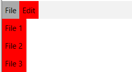

# Customizing Appearance

The `RadMenu` and `RadMenuItem` controls in Progress® Telerik® UI for WPF support styles for customizing the menu and its items.

## Style the RadMenu

Set the `Style` property of a `RadMenu` to apply a style to that control. Alternatively, define an implicit style targeting `RadMenu` to style menus within its resource scope.

The following example defines an implicit style for `RadMenu`:

<snippet id='radmenu-styles-and-templates-styling-and-templates-styling-radmenu-block_1-xaml' />

>caption RadMenu with a red background in the Fluent theme

## Style the RadMenuItem

To style menu items, set the `ItemContainerStyle` property of `RadMenu` or define an implicit style targeting `RadMenuItem`.

For static items, `RadMenu.ItemContainerStyle` applies only to its direct children. To style child items, set `ItemContainerStyle` on their parent items.

For dynamic items, the `HierarchicalDataTemplate` passes `ItemContainerStyle` through the hierarchy. To use different styles at different levels, use nested `HierarchicalDataTemplate` instances and set `ItemContainerStyle` on each. For more information, see [Binding to Dynamic Data]().

Use `ItemContainerStyleSelector` to choose a style based on an item's position in the hierarchy. For more information, see [Template and Style Selectors]().

The following example defines an implicit style for `RadMenuItem`:

<snippet id='radmenu-styles-and-templates-styling-and-appearance-styling-radmenuitem-block_1-xaml' />

>caption RadMenuItem controls with a red background in the Fluent theme

In the example, the clicked item has a different background because triggers or visual states in its `ControlTemplate` take precedence over the implicit style. To change this behavior, [extract and modify the control template]() for the theme you use.

## See Also

* [Template and Style Selectors]()
* [Editing Control Templates]()
