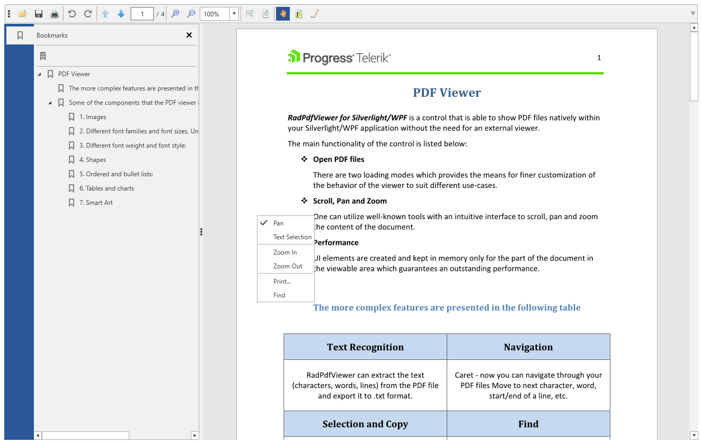
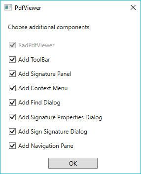
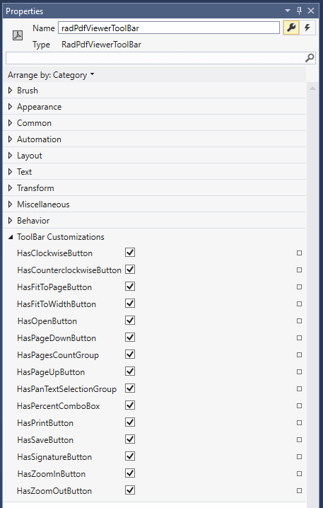
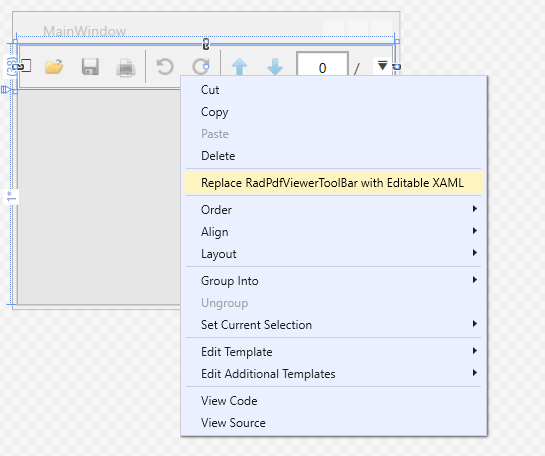

# Default UI

Use the predefined user interface (UI) of `RadPdfViewer` to add PDF viewing commands to your application. `RadPdfViewerToolBar` provides page navigation, [zoom](), and buttons to open, save, and print documents.

`RadPdfViewerNavigationPane` displays navigation panels, including the document's [bookmarks](). Add the components you need with the Visual Studio designer, then customize the toolbar and context menu.

>caption RadPdfViewer with default UI, RadPdfViewerNavigationPane, and context menu

## Adding RadPdfViewer with Predefined UI to Your Application

Before you begin, configure your Windows Presentation Foundation (WPF) project with the references described in [Getting Started with RadPdfViewer](). Include the dialogs and additional UI references, not only the minimal viewer references. For NuGet applications that use Xaml binaries, install `Telerik.Windows.Controls.FixedDocumentViewersUI.for.Wpf.Xaml`. For NoXaml applications, follow the package and theme guidance in the getting-started article.

>note The designer's component-selection dialog is available starting with R1 2018.

To add the viewer and choose its UI components:

1. Drag `RadPdfViewer` from the Visual Studio **Toolbox** to the XAML (Extensible Application Markup Language) designer.
2. Select the components you need in the component-selection dialog and select **OK** to generate the XAML.

The dialog provides the following options:

* **Add ToolBar**&mdash;Adds `RadPdfViewerToolBar` with PDF viewing commands. Clear this option to omit the toolbar.

* **Add Signature Panel**&mdash;Adds a panel that shows validation results for documents with [digital signatures]().

* **Add Context Menu**&mdash;Adds the viewer's [context menu]().

* **Add Find Dialog**&mdash;Adds the **[Find Dialog]()** for document searches.

* **Add Signature Properties Dialog**&mdash;Adds the **[Signature Properties Dialog](#using-signaturepropertiesdialog)**.

* **Add Sign Signature Dialog**&mdash;Adds the **[Sign Signature Dialog](#signing)**.

* **Add Navigation Pane**&mdash;Adds `RadPdfViewerNavigationPane` to display the document's bookmarks.

>caption Choose the components you would like to use

**Example 1** shows the XAML generated when you select all options.

**[XAML] Example 1: Default UI**

<snippet id='radpdfviewer-default-ui-block_1-xaml' />
 
## Customizing the Default UI

Use the toolbar properties to show or hide existing buttons and sections. For custom buttons or layout changes, replace the toolbar with editable XAML.

For project prerequisites, see [Getting Started with RadPdfViewer]().

### Adding and Removing Buttons and Sections from RadPdfViewerToolBar

`RadPdfViewerToolBar` exposes properties that show or hide parts of its UI. Select the toolbar in the Visual Studio designer and open the **Properties** window to find the available options.

>caption Toolbar customization options in the Visual Studio Properties window

The default value for all of the **ToolBar Customization** options is `true`. Clear an option to set the corresponding property in XAML to `false`. **Example 2** shows these properties in XAML.

**[XAML] Example 2: Using the properties of RadPdfViewerToolBar**

<snippet id='radpdfviewer-default-ui-block_2-xaml' />

### Customizing the Template of RadPdfViewerToolBar

To add a custom button or change the toolbar layout, replace `RadPdfViewerToolBar` with editable XAML:

1. Right-click `RadPdfViewerToolBar` in the Visual Studio designer.
2. Select **Replace RadPdfViewerToolBar with Editable XAML** from the context menu.

>caption Replace RadPdfViewerToolBar with editable XAML option of the Visual Studio designer's context menu

>important This operation replaces the `RadPdfViewerToolBar` instance with its generated XAML. The extracted markup no longer receives the toolbar control's automatic UI updates or styling support. Use the toolbar properties instead when you only need to show or hide existing buttons.

### Customizing the Template of the Default Context Menu

To edit the default context menu's XAML:

1. Right-click `RadPdfViewer` in the Visual Studio designer.
2. Select **Replace Default Context Menu with Editable XAML** from the context menu.

For context-menu configuration details, see the [context menu documentation]().

## See Also

* [Getting Started with RadPdfViewer]()
* [Showing a File]()
* [Bookmarks]()
* [Interactive Forms]()