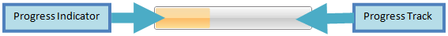

# Structure

This section defines terms and concepts used in the scope of __RadProgressBar__ you have to get familiar with prior to continue reading this help. They can also be helpful when contacting our support service in order to describe your issue better.

* __Progress Indicator__ - indicates the current status of the progress 
* __Progress Track__ - holder of the progress indicator used to hold and contrast the progress.

## See Also
 * [Editing Control Templates]()
 * [Getting Started]()