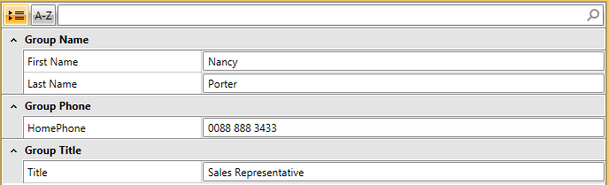
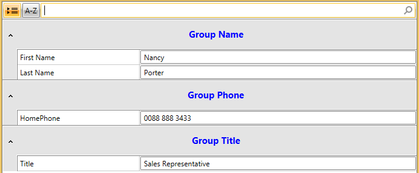
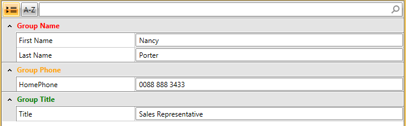

# Customizing Groups Appearance

The `RadPropertyGrid` control in Progress® Telerik® UI for WPF supports a common style for all groups or a style selector for individual groups.

Both `GroupStyle` and `GroupStyleSelector` require `RenderMode` to be set to `Flat`. For more information about grouping, see [Grouping Support]().

## Set Up the PropertyGrid

The following examples use an `Employee` object as the `Item` of a grouped `RadPropertyGrid`.

Define the `Employee` class:

<snippet id='radpropertygrid-styles-and-templates-styling-groups-block_1-cs' />
<snippet id='radpropertygrid-styles-and-templates-styling-groups-block_1-vb' />

Declare the `RadPropertyGrid` in XAML:

<snippet id='radpropertygrid-styles-and-templates-styling-groups-block_2-xaml' />

Create the `Employee` object and assign it to the control:

<snippet id='radpropertygrid-styles-and-templates-styling-groups-block_3-cs' />
<snippet id='radpropertygrid-styles-and-templates-styling-groups-block_3-vb' />

The following image shows the default group appearance:

## Apply a Common Group Style

To apply the same style to all groups, create a style resource:

<snippet id='radpropertygrid-styles-and-templates-styling-groups-block_4-xaml' />

Assign the resource to the `GroupStyle` property of the `RadPropertyGrid`:

<snippet id='radpropertygrid-styles-and-templates-styling-groups-block_5-xaml' />

The following image shows the custom group style:

## Select a Style for Each Group

Use `GroupStyleSelector` to choose a style based on the group. This example uses the `Employee` setup above and assigns different styles to the name, phone, and title groups.

Remove any local `GroupStyle` assignment before setting `GroupStyleSelector`. A locally set `GroupStyle`, including a local `null` value, takes precedence over the selector.

Create a class that inherits `StyleSelector` and overrides `SelectStyle`:

<snippet id='radpropertygrid-styles-and-templates-group-style-selectors-block_1-cs' />
<snippet id='radpropertygrid-styles-and-templates-group-style-selectors-block_1-vb' />

Define the selector as a XAML resource and set its `NameGroupStyle`, `PhoneGroupStyle`, and `TitleGroupStyle` properties:

<snippet id='radpropertygrid-styles-and-templates-group-style-selectors-block_2-xaml' />

Map the `my` XAML prefix to the CLR namespace containing the selector class. When using implicit themes, base the styles on the default style for the corresponding theme:

<snippet id='radpropertygrid-styles-and-templates-group-style-selectors-block_3-xaml' />

Assign the selector resource to the `GroupStyleSelector` property of the `RadPropertyGrid`:

<snippet id='radpropertygrid-styles-and-templates-group-style-selectors-block_4-xaml' />

The following image shows the styles selected for the groups:

## See Also

* [Grouping Support]()
* [Layout Rendering Modes]()
* [Setting a Theme Using Implicit Styles]()
* [Editing Control Templates]()
