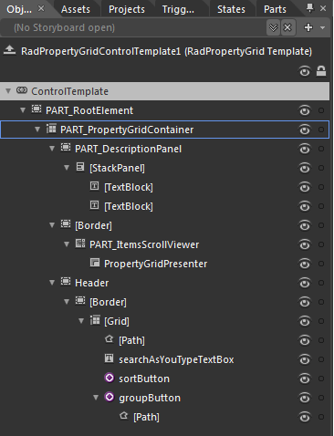
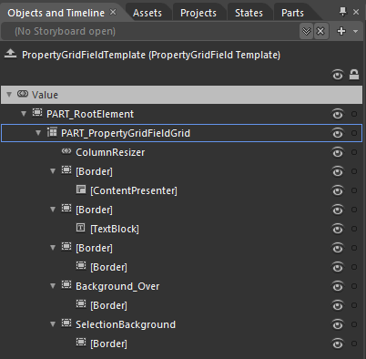

# Templates Structure

Customize the visual structure of `RadPropertyGrid` by editing its `ControlTemplate` or the templates of its fields. This article describes the following template structures:

* [RadPropertyGrid Template Structure](#radpropertygrid-template)

* [PropertyGridField Template Structure](#propertygridfield-template)

>tip For theme setup, see [Setting a Theme Using Implicit Styles](). For template extraction, see [Editing Control Templates]().

Control templates differ between themes. Use the template source for your application's theme and installed Telerik UI for WPF version when comparing it with these template structures.

## RadPropertyGrid Template

The `RadPropertyGrid` template shown in the screenshot contains the following elements:

* `PART_RootElement`&mdash;Hosts the template elements and represents the outer `Border` of `RadPropertyGrid`.

* `PART_PropertyGridContainer`&mdash;Hosts the description panel, items scroll viewer, and header.

* `PART_DescriptionPanel`&mdash;Hosts the description panel elements and represents the panel's `Border`.

* `[StackPanel]`&mdash;Contains the description panel's text elements.

* `[TextBlock]`&mdash;Displays the `DisplayName` of the selected property definition.

* `[TextBlock]`&mdash;Displays the `Description` of the selected property definition.

* `[Border]`&mdash;Represents the outer border of the items scroll viewer.

* `PART_ItemsScrollViewer`&mdash;Handles the different types of presenters and is of type `Border`.

* `PropertyGridPresenter`&mdash;Displays the `PropertyGridField` elements.

* `Header`&mdash;Represents the outer `Border` of the header.

* `[Border]`&mdash;Represents the inner border of the header.

* `[Grid]`&mdash;Hosts the header elements.

* `[Path]`&mdash;Represents a `Path` element in the header.

* `searchAsYouTypeTextBox`&mdash;Represents the search box and is of type `TextBox`.

* `sortButton`&mdash;Represents the sort button and is of type `RadRadioButton`.

* `groupButton`&mdash;Represents the group button and is of type `RadRadioButton`.

The Blend **Objects and Timeline** panel shows the description panel, items presenter, and header within the `RadPropertyGrid` template.

## PropertyGridField Template

The `PropertyGridField` template shown in the screenshot contains the following elements:

* `PART_RootElement`&mdash;Hosts the template elements and represents the outer `Border` of `PropertyGridField`.

* `PART_PropertyGridFieldGrid`&mdash;Provides columns for the template elements and represents the field's background `Grid`.

* `ColumnResizer`&mdash;Represents the field's resizer and is of type `Thumb`.

* `[Border]`&mdash;Surrounds the field's editor.

* `[ContentPresenter]`&mdash;Displays the field's content.

* `[Border]`&mdash;Surrounds the field's `TextBlock`.

* `[TextBlock]`&mdash;Displays the field's `DisplayName`.

* `[Border]`&mdash;Represents the outer border of the field's indent.

* `[Border]`&mdash;Represents the background of the field's indent.

* `Background_Over`&mdash;Represents the field's outer `Border` when the mouse hovers over it.

* `[Border]`&mdash;Represents the inner border and row background within `Background_Over`.

* `SelectionBackground`&mdash;Represents the field's outer `Border` when the field is selected.

* `[Border]`&mdash;Represents the inner border and row background within `SelectionBackground`.

The Blend **Objects and Timeline** panel shows the editor, label, and state backgrounds within the `PropertyGridField` template.

## Modifying RadPropertyGrid Template with Blend

When you extract the control template with Blend, some dependency property values of controls defined in `DataTemplate` elements do not extract correctly. Use one of the following options:

* Extract the template manually from `Telerik.Windows.Controls.Data.xaml` in the `Themes.Implicit` folder of your Telerik UI for WPF installation. Select the framework and theme folders that match your application, such as `Themes.Implicit\NET\OfficeBlack\Themes` for the Office Black theme. Use the files from the Telerik UI for WPF version installed for your project. The [manual template extraction instructions](#extracting-control-templates-manually-from-the-theme-xaml-file) explain the framework and theme folder layout.
            
* Extract the template with Blend and manually add the missing `ItemsSource` bindings for the `ItemsControl` defined in each of the four templates.

The following examples correspond to the four templates:
              
* For `FlatRenderingTemplate`:

<snippet id='radpropertygrid-styles-and-templates-templates-structure-block_1-xaml' />

* For `FlatTemplate`:

<snippet id='radpropertygrid-styles-and-templates-templates-structure-block_2-xaml' />

* For `GroupTemplate`:

<snippet id='radpropertygrid-styles-and-templates-templates-structure-block_3-xaml' />

* For `VirtualizedFlatTemplate`:

<snippet id='radpropertygrid-styles-and-templates-templates-structure-block_4-xaml' />

## See Also

* [RadPropertyGrid Styling and Templates Overview]()
