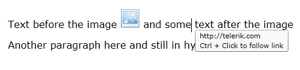
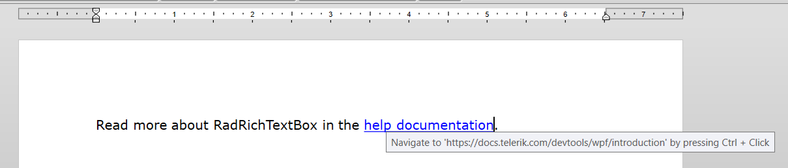
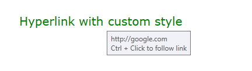

# Hyperlink

The hyperlink functionality in RadRichTextBox is encapusalted in the [HyperlinkInfo](#hyperlinkinfo), [HyperlinkRangeStart and HyperlinkRangeEnd](#hyperlinkrangestart-and-hyperlinkrangeend) classes. 

## HyperlinkInfo

The `HyperlinkInfo` class allows you to easily insert hyperlinks in the current selection of the document. The class exposes the following properties:

* `IsAnchor`&mdash;A boolean property determining if the hyperlink points to a URL or a bookmark;

* `NavigateUri`&mdash;The URI of the hyperlink;

* `Target`&mdash;Determines if the link should be opened in another window (when set to `HyperlinkTargets.Blank`) or in the same frame (`HyperlinkTargets.Self`).

* `ToolTip`&mdash;A tooltip text for the hyperlink. 

__Inserting a hyperlink pointing to a web address__  
<snippet id='radrichtextbox-features-document-elements-hyperlink-block_1-cs' />

To insert a hyperlink to a bookmark within the document, specify the bookmark's name as the `NavigateUri` and set the `IsAnchor` to `true`.

__Inserting a hyperlink pointing to a bookmark in the document__  
<snippet id='radrichtextbox-features-document-elements-hyperlink-block_2-cs' />

The `InsertHyperlink` method provides the following overloads:         

* `public void InsertHyperlink(HyperlinkInfo hyperlinkInfo, IEnumerable&lt;Inline&gt; inlines)`&mdash;Inserts a hyperlink which spans several different adjacent inlines, e.g. part of the hyperlink text is Bold or there is an image inside the hyperlink.

* `public void InsertHyperlink(HyperlinkInfo hyperlinkInfo)`&mdash;Creates a hyperlink from the currently selected part of the document.

To remove hyperlink from the document, position the caret within the hyperlink span and call the `RemoveHyperlink`.

__Removing the hyperlink under the caret position__  
<snippet id='radrichtextbox-features-document-elements-hyperlink-block_3-cs' />

## HyperlinkRangeStart and HyperlinkRangeEnd

The `HyperlinkRangeStart` and `HyperlinkRangeEnd` are Inline DocumentElements and can be added to the inlines of a document when building the contents of a RadDocument in code-behind. Using these classes give a bit more control over the creation and spanning of hyperlinks.

To add a hyperlink using this API, add the range start object and then pair it with the range end. The information about the hyperlink is stored in a `HyperlinkInfo` object assigned to the `HyperlinkRangeStart`. Then, the range objects are added to the `Paragraph`'s `Inlines` collection.

__Adding a hyperlink that spans on multiple document elements__  
<snippet id='radrichtextbox-features-document-elements-hyperlink-block_4-cs' />

>caption The document created with the hyperlink range setup

The `HyperlinkRangeStart` and `HyperlinkRangeEnd` objects are used also when accessing and modifying the hyperlinks from the document.

__Deleting all hyperlinks in a document and replace them with text__  
<snippet id='radrichtextbox-features-document-elements-hyperlink-block_5-cs' />

## Changing the Hyperlink ToolTip

By default the hyperlink tooltip displays the navigation Uri along with the navigation mode (Ctrl+Click or Click only). To change format used to display this information, set the `HyperlinkToolTipFormatString` property of `RadRichTextBox`. This will set the format for all hyperlinks in the document.

__Change the default hyperlink tooltip format__  
<snippet id='radrichtextbox-features-document-elements-hyperlink-block_6-cs' />

The tooltip can be customized also per hyperlink. To do this, set the `ToolTip` property of the corresponding `HyperlinkInfo` object.

__Inserting a hyperlink with a tooltip__

<snippet id='radrichtextbox-features-document-elements-hyperlink-block_7-cs' />

The `HyperlinkToolTipShowing` event can be used to further customize the tooltip content or cancel displaying it.

<snippet id='radrichtextbox-features-document-elements-hyperlink-block_8-cs' />

## Hyperlink Navigation Trigger

The trigger that navigates to the corresponding Uri is controlled by the `HyperlinkNavigationMode` property of `RadRichTextBox`. The mode can be set to one of the following values:

* `CtrlClick`&mdash;Triggers the hyperlink when users hold the Ctrl key and click on the hyperlink.
* `Click`&mdash;Triggers the hyperlink when users click on the hyperlink.

__Change the default hyperlink navigation mode__  
<snippet id='radrichtextbox-features-document-elements-hyperlink-block_9-cs' />

## Handling the Hyperlink Click Navigation

When a hyperlink is clicked, the `HyperlinkClicked` event of `RadRichTextBox` is raised. The sender of the event is the document element, which the user has clicked on, e.g. a `Span`, an `Image`, `InlineUIContainer`, etc. The event args provide the possibility to cancel or replace the navigation action. This is helpful when you need to validate the clicked hyperlink and prevent it from navigating to an unsecure address or from starting a local process.

Set `Handled` to `true` to cancel the default navigation. `HyperlinkClickedEventArgs` derives from `HyperlinkClickedEventArgsBase` and exposes the URL through `Url` (not `URL`), along with `IsTrustedUrl` and `Handled`. The `URL` to `Url` rename is a breaking API change; update code that reads `HyperlinkClickedEventArgs.URL`.

__Prompting that the clicked linked may be unsafe and allows it to cancel the navigation action__  
<snippet id='radrichtextbox-features-document-elements-hyperlink-block_10-cs' />

The validator trusts absolute HTTP, HTTPS, and mailto URLs by default when they pass its pattern and scheme checks. Set `IsTrustedUrl` to `true` in an event handler to allow the default launch of a URL the validator would otherwise reject.

## Handling Hyperlink Requests Globally

RichTextBox already validates external URLs before launch; the shared event does not introduce that validation. The existing document- and editor-specific `HyperlinkClicked` handlers run before `HyperlinkManager.HyperlinkClicked`. The shared event runs if those handlers do not set `Handled` to `true`. Its event arguments expose `Url`, `IsTrustedUrl`, and `Handled`; its `sender` identifies the originating component.

Set `Handled` to `true` in either event to cancel navigation. Use the shared event to handle hyperlink requests from multiple supported controls in one place. Because `HyperlinkManager.HyperlinkClicked` is static, unsubscribe when the handler owner has a shorter lifetime than the application. See [Handling hyperlink navigation in RadHyperlinkButton]() for a shared-event example.

## Customizing the Hyperlink Visual

By default, when the users insert a hyperlink in RadRichTextBox, it is styled with the built-in Hyperlink style. To change the default appearance of the hyperlinks in a document, modifying the [associated style]().

#### __Change the default hyperlink style__
{{region radrichtextbox-features-document-elements-hyperlink_9}}	
	StyleDefinition hyperlinkStyle = this.radRichTextBox.Document.StyleRepository[RadDocumentDefaultStyles.HyperlinkStyleName];
	hyperlinkStyle.SpanStyle.FontSize = 20; 
	hyperlinkStyle.SpanStyle.ForeColor = Colors.Green;
	hyperlinkStyle.SpanStyle.UnderlineDecoration = UnderlineTypes.None;
{{endregion}}

>caption A hyperlink with customized font styles

## See Also  
 * [Elements Hierarchy]()
 * [RadDocument]()
 * [Section]()
 * [Paragraph]()
 * [Span]()
 * [InlineImage]()
 * [Telerik UI for WPF API Reference](https://docs.telerik.com/devtools/wpf/api/)