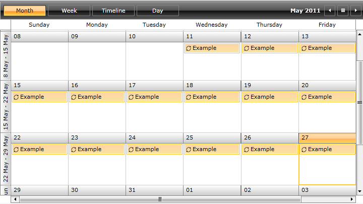
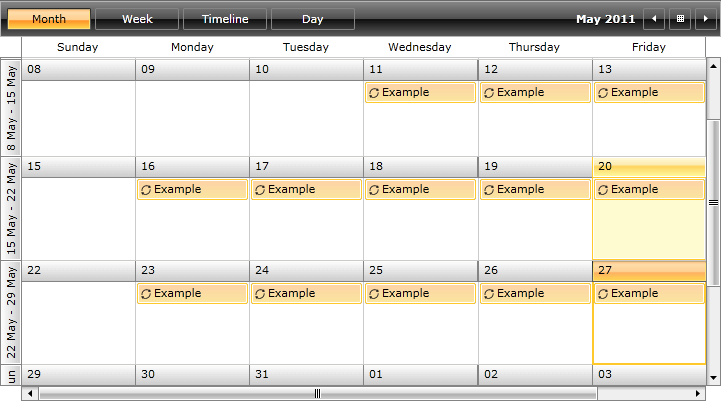
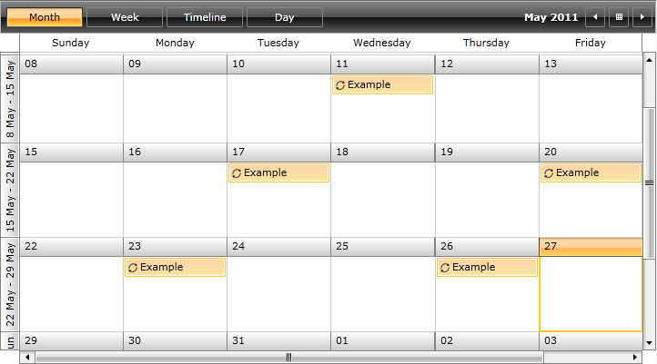
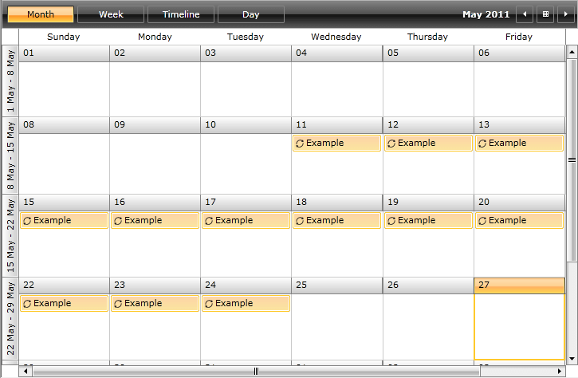

# RecurrencePattern

Use `RecurrencePattern` to configure daily, weekly, monthly, and yearly appointments in the `RadScheduleView` control of Progress® Telerik® UI for WPF. The `IAppointment` interface exposes a `RecurrenceRule` property that associates an appointment with a recurrence pattern. Recurrence rules also support exceptions.

The [`RecurrenceRule` class]() creates and evaluates recurrence rules. Its required `Pattern` property has type `RecurrencePattern`.

This article covers the following properties, methods, and examples:

* Main properties of the `RecurrencePattern` class:

	* [`Frequency`](#frequency)

	* [`MinutesOfHour`](#minutesofhour)

	* [`HoursOfDay`](#hoursofday)

	* [`DaysOfWeekMask`](#daysofweekmask)

	* [`Interval`](#interval)

	* [`DaysOfMonth`](#daysofmonth)

	* [`DayOrdinal`](#dayordinal)

	* [`MonthOfYear`](#monthofyear)

	* [`MaxOccurrences`](#maxoccurrences)

	* [`FirstDayOfWeek`](#firstdayofweek)

	* [`RecursUntil`](#recursuntil)

* Main methods of the `RecurrencePattern` class:

	* [`Copy()`](#copy)

	* [`CopyFrom()`](#recurrencepattern-copyfrom)

* [Examples of recurring appointments](#examples):

	* [Create a daily appointment](#how-to-create-every-day-recurring-appointment)

	* [Create a weekday appointment](#how-to-create-every-week-day-recurring-appointment)

	* [Create an appointment every n days](#how-to-create-an-appointment-that-occurs-on-every-n-days)
	
	* [Create an appointment on the n-th day every m months](#how-to-create-an-appointment-that-occurs-on-every-n-th-day-of-the-month-and-the-interval-between-each-recurrence-is-m-months)
	
	* [Create an appointment on the n-th weekday every m months](#how-to-create-an-appointment-that-occurs-on-every-n-th-week-day-and-the-interval-between-each-recurrence-is-m-months)

	* [Create a yearly appointment](#how-to-create-an-yearly-appointment)

	* [Set the maximum number of occurrences](#set-the-maximum-occurrences-of-the-appointment)

	* [Set the end date of occurrences](#set-the-end-date-of-the-appointment-occurrences)

## RecurrencePattern Class

The `RecurrencePattern` class defines the recurrence settings that a `RecurrenceRule` uses to generate occurrences.

The `RecurrencePattern` class is in the `Telerik.Windows.Controls.ScheduleView` namespace of the `Telerik.Windows.Controls.ScheduleView.dll` assembly.

## Frequency

Set the `Frequency` property to a value from the `RecurrenceFrequency` enumeration:

* `Minutely`&mdash;Use `RecurrenceFrequency.Minutely` for appointments that occur every minute (available starting with Q3 2012 SP1).

* `Hourly`&mdash;Use `RecurrenceFrequency.Hourly` for appointments that occur every hour (available starting with Q3 2012 SP1).

* `Daily`&mdash;Use `RecurrenceFrequency.Daily` for appointments that occur every day.

* `Monthly`&mdash;Use `RecurrenceFrequency.Monthly` for appointments that occur every month.

* `Weekly`&mdash;Use `RecurrenceFrequency.Weekly` for appointments that occur every week.

* `Yearly`&mdash;Use `RecurrenceFrequency.Yearly` for appointments that occur every year.

>important Do not use `RecurrenceFrequency.Secondly` or `RecurrenceFrequency.None` as a recurrence frequency. Although the enumeration includes these values, they are invalid for recurring appointments.

The default value of `Frequency` is `RecurrenceFrequency.None`. Always set `Frequency` to a valid value when you configure a recurring appointment.

>note Set `Minutely` and `Hourly` frequencies in code. To display these options in the **EditAppointmentDialog**, [customize the `EditAppointmentDialogStyle`]() and add them to the template manually.

## MinutesOfHour

Set `MinutesOfHour` to an array of integers to specify the minutes of the hour when the appointment occurs. This property is mainly used with the `Minutely` frequency.

## HoursOfDay

Set `HoursOfDay` to an array of integers to specify the hours of the day when the appointment occurs. This property is mainly used with the `Hourly` frequency.

## DaysOfWeekMask

Set `DaysOfWeekMask` to specify the days of the week when the appointment occurs. The `RecurrenceDays` enumeration includes these values:

* `EveryDay`

* `Friday`

* `Monday`

* `Saturday`

* `Sunday`

* `Thursday`

* `Tuesday`

* `Wednesday`

* `WeekDays`

* `WeekendDays`

* `None`

The default value of `DaysOfWeekMask` is `RecurrenceDays.None`. This property is optional.

`RecurrenceDays.WeekDays` is equivalent to `RecurrenceDays.Monday | RecurrenceDays.Tuesday | RecurrenceDays.Wednesday | RecurrenceDays.Thursday | RecurrenceDays.Friday`.

`RecurrenceDays.WeekendDays` is equivalent to `RecurrenceDays.Saturday | RecurrenceDays.Sunday`.

`RecurrenceDays.EveryDay` is equivalent to `RecurrenceDays.Monday | RecurrenceDays.Tuesday | RecurrenceDays.Wednesday | RecurrenceDays.Thursday | RecurrenceDays.Friday | RecurrenceDays.Saturday | RecurrenceDays.Sunday`.

>tip Combine `RecurrenceDays` members with the bitwise OR operator (`|`) to select multiple days for `DaysOfWeekMask`. See the [recurring appointment examples](#examples).

## Interval

Set `Interval` to specify the number of frequency units between occurrences. With `Frequency` set to `RecurrenceFrequency.Daily`, the interval is in days. With `RecurrenceFrequency.Monthly`, it is in months.

The default value of `Interval` is `1`.

>tip Combine `Interval`, `DaysOfWeekMask`, and `Frequency` to configure the [recurring appointment examples](#examples).

## DaysOfMonth

Set `DaysOfMonth` to specify the day of the month when the appointment occurs.

## DayOrdinal

Set `DayOrdinal` to specify the ordinal position of a day, such as first, second, third, or fourth. For example, configure an appointment for the second Monday of every third month.

## MonthOfYear

Set `MonthOfYear` to specify the month when the appointment occurs. This property is mainly used for yearly appointments. See the [yearly appointment example](#how-to-create-an-yearly-appointment).

## MaxOccurrences

Set `MaxOccurrences` to limit the number of appointment occurrences. See the [example of limiting occurrences](#set-the-maximum-occurrences-of-the-appointment).

## FirstDayOfWeek

`FirstDayOfWeek` gets or sets the day on which the week starts. This property is only meaningful when `Frequency` is `RecurrenceFrequency.Weekly` and `Interval` is greater than `1`.

## RecursUntil

Set `RecursUntil` to specify the end date of appointment occurrences. See the [example of setting an end date](#set-the-end-date-of-the-appointment-occurrences).

## Copy()

Use `Copy()` to create a new `RecurrencePattern` instance with the same values as an existing pattern.

<snippet id='radscheduleview-features-recurrence-recurrences-recurrencepattern-block_1-cs' />
<snippet id='radscheduleview-features-recurrence-recurrences-recurrencepattern-block_2-vb' />

In the above example, a new monthly recurrence pattern is created. It also has a limit of 10 occurrences. When you invoke the `pattern.Copy()` method this creates a new instance of the `RecurrencePattern` class with exactly the same characteristics as the source object (the `Frequency` property will be set to `RecurrenceFrequency.Monthly` and the `MaxOccurrences` property will be set to 10).

## CopyFrom()

Use `CopyFrom()` to copy properties from a specified `RecurrencePattern` to the instance that calls the method.

<snippet id='radscheduleview-features-recurrence-recurrences-recurrencepattern-block_3-cs' />
<snippet id='radscheduleview-features-recurrence-recurrences-recurrencepattern-block_4-vb' />

All properties in the current instance (`newPattern` object) will be replaced by the corresponding properties in the specified `RecurrencePattern` object.

## Examples

Before using these examples, [set up a `RadScheduleView` project](). The examples use the following appointment declaration.

<snippet id='radscheduleview-features-recurrence-recurrences-recurrencepattern-block_5-cs' />
<snippet id='radscheduleview-features-recurrence-recurrences-recurrencepattern-block_6-vb' />

The sample appointment starts on May 11, 2011 at 10:00 AM and lasts two hours.

## How to Create Every Day Recurring Appointment?

To create a daily appointment, set `Frequency` to `RecurrenceFrequency.Daily`.

<snippet id='radscheduleview-features-recurrence-recurrences-recurrencepattern-block_7-cs' />
<snippet id='radscheduleview-features-recurrence-recurrences-recurrencepattern-block_8-vb' />

The following image shows the daily recurrence.

## How to Create Every Week Day Recurring Appointment?

To create a weekday appointment, set both [`Frequency`](#frequency) and [`DaysOfWeekMask`](#daysofweekmask).

<snippet id='radscheduleview-features-recurrence-recurrences-recurrencepattern-block_9-cs' />
<snippet id='radscheduleview-features-recurrence-recurrences-recurrencepattern-block_10-vb' />

The following image shows the weekday recurrence.

>tip For weekend appointments, set `DaysOfWeekMask` to `RecurrenceDays.WeekendDays`.

For a specific day of the week, set the corresponding `DaysOfWeekMask` value. For example, use `RecurrenceDays.Friday` for appointments that occur every Friday.

## How to Create an Appointment that Occurs on Every n Days?

To create an appointment every third day, set these `RecurrencePattern` properties:

* Set `Frequency` to `RecurrenceFrequency.Daily`.

* Set `DaysOfWeekMask` to `RecurrenceDays.EveryDay`.

* Set `Interval` to `3`.

<snippet id='radscheduleview-features-recurrence-recurrences-recurrencepattern-block_11-cs' />
<snippet id='radscheduleview-features-recurrence-recurrences-recurrencepattern-block_12-vb' />

The following image shows an appointment that occurs every third day.

>tip For a daily frequency, set `Interval` to the required number of days between occurrences, such as `4`, `5`, or `6`.

## How to Create an Appointment that Occurs on Every "n-th" Day of the Month and the Interval Between Each Recurrence is "m" Months?

To create an appointment on the fifth day of every second month, set these properties:

* Set `DaysOfMonth` to `5`.
          

* Set `Frequency` to `RecurrenceFrequency.Monthly`.
          

* Set `Interval` to `2`.

<snippet id='radscheduleview-features-recurrence-recurrences-recurrencepattern-block_13-cs' />
<snippet id='radscheduleview-features-recurrence-recurrences-recurrencepattern-block_14-vb' />

## How to Create an Appointment that Occurs on Every "n-th" Week Day and the Interval Between Each Recurrence is "m" Months?

To create an appointment on the second Monday of every second month, set these properties:

* Set `DayOrdinal` to `2`.

* Set `Frequency` to `RecurrenceFrequency.Monthly`.

* Set `DaysOfWeekMask` to `RecurrenceDays.Monday`.

* Set `Interval` to `2`.

<snippet id='radscheduleview-features-recurrence-recurrences-recurrencepattern-block_15-cs' />
<snippet id='radscheduleview-features-recurrence-recurrences-recurrencepattern-block_16-vb' />

## How to Create an Yearly Appointment?

To create an appointment on November 13 each year, set these properties:

* Set `Frequency` to `RecurrenceFrequency.Yearly`.

* Set `MonthOfYear` to `11`.

* Set `DaysOfMonth` to `13`.

<snippet id='radscheduleview-features-recurrence-recurrences-recurrencepattern-block_17-cs' />
<snippet id='radscheduleview-features-recurrence-recurrences-recurrencepattern-block_18-vb' />

## Set the Maximum Occurrences of the Appointment

For a daily appointment with a limit of three occurrences, set `MaxOccurrences` to `3`.

<snippet id='radscheduleview-features-recurrence-recurrences-recurrencepattern-block_19-cs' />
<snippet id='radscheduleview-features-recurrence-recurrences-recurrencepattern-block_20-vb' />

## Set the End Date of the Appointment Occurrences

Set `RecursUntil` to the end date of the appointment occurrences.

<snippet id='radscheduleview-features-recurrence-recurrences-recurrencepattern-block_21-cs' />
<snippet id='radscheduleview-features-recurrence-recurrences-recurrencepattern-block_22-vb' />

The following image shows daily occurrences from May 11, 2011 until May 24, 2011.

## See Also

* [Creating recurrence rules and handling exceptions]()
* [Overview of recurring appointments]()