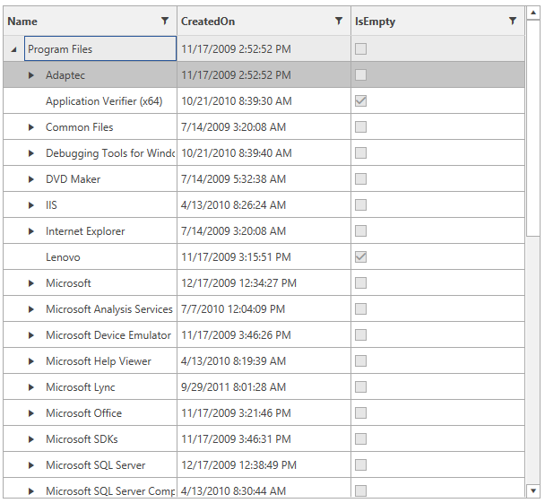

# {{ site.framework_name }} TreeListView Overview

Use `RadTreeListView` from Progress® Telerik® UI for WPF to display hierarchical data in a tabular layout. The control combines the data operations and column model of `RadGridView` with tree-style expand and collapse behavior. Use it for file explorers, organizational structures, category trees, and nested business records.

This overview highlights the main capability areas of `RadTreeListView` and points you to the most relevant next article for setup, performance, and advanced data scenarios.





The following screenshot shows a file-system hierarchy with **Name**, **CreatedOn**, and **IsEmpty** columns.

## When to Use RadTreeListView

Use `RadTreeListView` when you need to:

* Show homogeneous hierarchical data in a single table.
* Combine expand and collapse behavior with sortable and filterable columns.
* Work with large hierarchical data sets while keeping the user interface responsive.
* Let users edit, validate, select, and inspect nested records without switching controls.

If your scenario requires heterogeneous child structures, evaluate a [hierarchical `RadGridView`]() instead of `RadTreeListView`.

## Key Features

### Performance for Large Data Sets

`RadTreeListView` combines user interface virtualization, container recycling, and a Language Integrated Query (LINQ)-based data engine. These features keep scrolling and interaction responsive even with large data sets. To learn how to tune performance-sensitive scenarios, see [Performance]() and [UI Virtualization]().

### Hierarchical Data Binding

Define parent-child relationships through the data binding system and choose where the hierarchy column appears in the grid. This allows layouts similar to file explorers and other tree-based business views. See [Data Binding]() and [Hierarchy Column]().

### Built-In Data Operations

Apply [sorting]() and [filtering]() directly to your bound data.

>important By default, the distinct filter values list includes only values from the top level of the hierarchy. See [Filtering]() for details.

### Columns, Details, and Aggregates

Choose from multiple built-in [column types]() and keep important values visible with frozen columns. Show extra content through [row details]() and calculate summary values through [aggregates]().

### Editing, Validation, and Selection

Use the built-in selection model for single or multiple records, and combine editing with metadata-driven validation and custom validation logic. For more detail, see [Selection]() and [Managing Data]().

### Appearance and Customization

Adapt `RadTreeListView` to your application theme and editing workflow through styling, templating, and custom editors. See [Modifying Default Styles](), [Editing Control Templates](), and [Creating Custom Editors](). The control supports a flexible appearance model and integrates with the theming system used across Telerik UI for WPF.

>tip You can find additional implementation examples in the [Telerik XAML SDK repository](https://github.com/telerik/xaml-sdk/) under `TreeListView`.

## Next Steps

Start with the article that matches your immediate goal:

* [Configure hierarchy relationships with data binding]().
* [Configure column types and behavior]().

>note Explore the [Telerik UI for WPF demos](https://demos.telerik.com/wpf/) to review RadTreeListView behavior before integrating it into your application.


## Telerik UI for WPF Support and Learning Resources

Use these resources for product information, support, and training:

* [Telerik UI for WPF TreeListView Homepage](https://www.telerik.com/products/wpf/treelistview.aspx)
* [Telerik UI for WPF API Reference](https://docs.telerik.com/devtools/wpf/api/)
* [Getting Started with Telerik UI for WPF Components]()
* [Telerik UI for WPF Virtual Classroom (Training Courses for Registered Users)](https://learn.telerik.com/learn/course/external/view/elearning/16/telerik-ui-for-wpf) 
* [Telerik UI for WPF TreeListView Forums](https://www.telerik.com/forums/wpf)
* [Telerik UI for WPF Knowledge Base](https://docs.telerik.com/devtools/wpf/knowledge-base)


## See Also

 * [Visual Structure]()
 * [Getting Started]()
 * [Performance]()
 * [Events]()
 * [Developer Focused Examples]()
