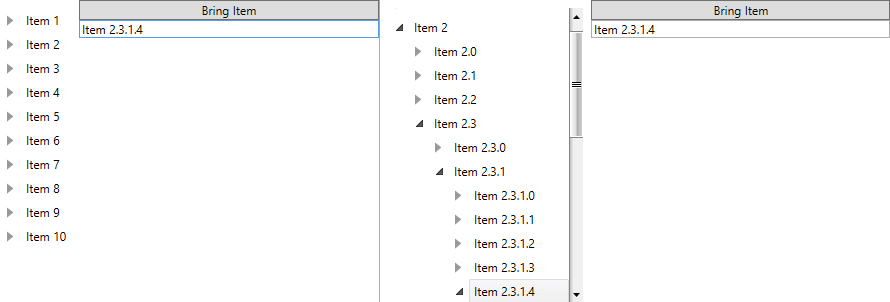

# Expand and Select Item with Load on Demand Enabled RadTreeView

This tutorial shows how to expand and select an item in `RadTreeView` with load on demand enabled (`IsLoadOnDemandEnabled` set to `True`).


Before you begin, configure a project with Progress® Telerik® UI for WPF. Follow the [TreeView getting started guide]() for references, licensing, the XAML namespace, and theme setup.


The example uses a data-bound `RadTreeView` and loads child items through the data model rather than the built-in `LoadOnDemand` event.

## Expand and Select an Item

Follow these steps to define the data hierarchy and navigate to an item:

1. Declare the data-bound `RadTreeView`:

    

    <snippet id='radtreeview-how-to-howto-exapand-select-item-with-lod-enabled-treeview-block_1-xaml' />

    
    

    <snippet id='radtreeview-how-to-howto-exapand-select-item-with-lod-enabled-treeview-block_2-xaml' />

    

2. Define the `DataItem` class for the items in the data source:

    <snippet id='radtreeview-how-to-howto-exapand-select-item-with-lod-enabled-treeview-block_3-cs' />
    <snippet id='radtreeview-how-to-howto-exapand-select-item-with-lod-enabled-treeview-block_4-vb' />

3. Create the initial data and set the `ItemsSource` property of the `RadTreeView`:

    <snippet id='radtreeview-how-to-howto-exapand-select-item-with-lod-enabled-treeview-block_5-cs' />

4. Implement load on demand in the getter of the `DataItem.Children` property:

    The load on demand feature displays an expander icon in front of each `RadTreeViewItem`. This example does not use the built-in `LoadOnDemand` event to load items. Instead, the `HierarchicalDataTemplate` binding evaluates the `Children` getter on load. The getter loads a fixed number of items when the `children` field is not yet initialized.

    <snippet id='radtreeview-how-to-howto-exapand-select-item-with-lod-enabled-treeview-block_6-cs' />
    <snippet id='radtreeview-how-to-howto-exapand-select-item-with-lod-enabled-treeview-block_7-vb' />

5. Implement the custom path-building logic for the [`BringPathIntoView()` method]():

    For path matching, set Telerik's `TextSearch.TextPath` attached property to the data property used for each path segment. `BringPathIntoView()` traverses the data hierarchy and can bring an item into view before all item containers exist. Configure selection separately. For a selection-binding example, see [bringing an item into view and selecting it]().

    <snippet id='radtreeview-how-to-howto-exapand-select-item-with-lod-enabled-treeview-block_8-cs' />
    <snippet id='radtreeview-how-to-howto-exapand-select-item-with-lod-enabled-treeview-block_9-vb' />

The following image shows the tree before and after navigation to **Item 2.3.1.4**.

## See Also
 * [Get Item by Path]()
 * [Selection]()
 * [Get Previous, Next, Parent and Sibling Node of a Specific TreeView Item]()