# ItemTemplate

When binding your __RadTreeView__ to a collection, you are able to configure the visualization of the data and the appearance of the __RadTreeViewItems__ via the __ItemTemplate__ and the __ItemTemplateSelector__ properties. 

If you want to read about the __ItemTemplateSelector__, see the main topic [ItemTemplateSelector]().

This tutorial uses Expression Blend to create a __HierarchicalDataTemplate__ and assign it to the treeview's __ItemTemplate__ property.

The resulting tree displays leagues with their divisions as child items:
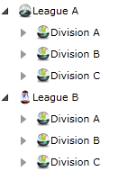

* Create a new Silverlight application and perform the following steps:
	* Add a __RadTreeView__ in your XAML. 
	* Create two empty hierarchical data templates and one empty data template in your application resources as it is shown in the XAML below: 
	
		<snippet id='radtreeview-populating-with-data-item-template-block_1-xaml' />
		
* Open your page in Expression Blend.

	In the __Resources__ window (Window->Resources), in the context of your control you will see the three templates which were declared directly in the XAML on the previous step. 
	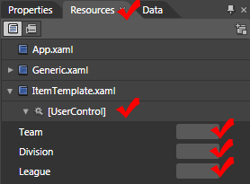

* Select __Edit resource__ for the __League__ template. Add an __Image__ and a __TextBlock__ to the template, as shown in the following XAML.
	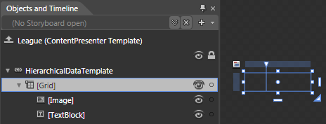
	
	<snippet id='radtreeview-populating-with-data-item-template-block_2-xaml' />

	To configure the binding for the __Source__ property of the __Image control__, select it in the "__Object and Timeline__" pane. 

	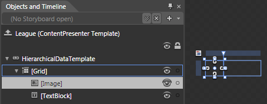

	Go to the "__Properties__" pane and find the __Source__ property in the __Common properties__ section. 
	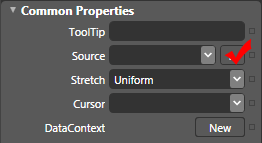

	Open the __Source__ property's options menu and choose __Data Binding__ to open the __Create Data Binding__ dialog.
	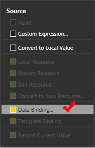

	In the __Create Data Binding__ dialog, select __Explicit Data Context__ and check __Use a custom path expression__. Enter `ImageUrl` to bind the image's __Source__ to that property. Select __OK__.
	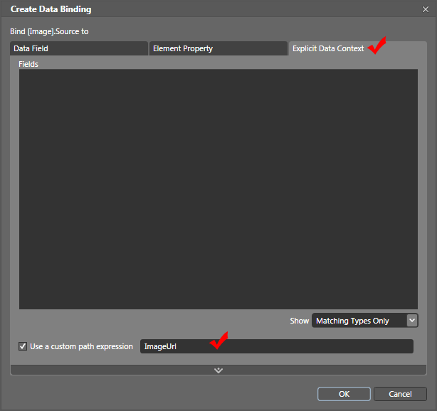

	Repeat the binding-dialog steps for __TextBlock.Text__, using the text-binding path in the completed __League__ template below, not `ImageUrl`.

	Finally, in the "__Object and Timeline__" pane, select the __HierarchicalDataTemplate:__
	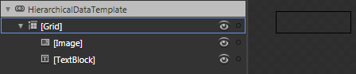

	Find and set the following properties in the "__Properties__" pane:
	
	* __ItemsSource__: Set the binding expression to `{Binding Divisions, Mode=OneWay}`.
	
		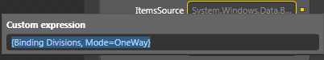

	* __ItemTemplate__: Set the resource reference to `{StaticResource Division}`.
		
		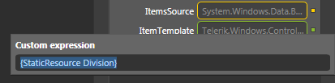

	Here is the result XAML for the __League__ data template:
	
	<snippet id='radtreeview-populating-with-data-item-template-block_3-xaml' />

* Perform the same steps for the other two templates - __Division__ and __Team__. 

* Select the treeview and set its __ItemTemplate__ property to the __League__ resource (`{StaticResource League}`), as shown in the following XAML.
	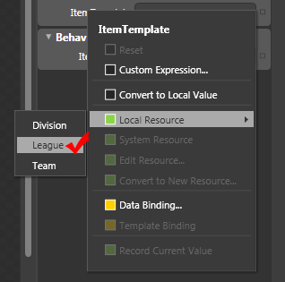

<snippet id='radtreeview-populating-with-data-item-template-block_4-xaml' />

The data source class __RadTreeViewSampleData__ assigned to the __RadTreeView__ is covered in greater details in the chapter [Binding to Object]().

## See Also
 * [ItemTemplateSelector]()
 * [ItemEditTemplate]()
 * [Hierarchical Data Templates]()
 * [DataBinding - Overview]()