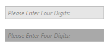
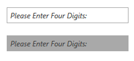
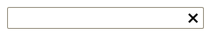

# Features

The `RadWatermarkTextBox` control in Progress® Telerik® UI for WPF supports watermark content, focus selection, and additional content. Its main properties are:

* `WatermarkContent`&mdash;Gets or sets the watermark content. By default, it appears when the text box is empty and not focused. See [WatermarkBehavior](#watermarkbehavior) for other visibility modes.

* `WatermarkTemplate`&mdash;Gets or sets the template for the watermark content. Its visibility follows the same [WatermarkBehavior](#watermarkbehavior) setting as `WatermarkContent`.

* `CurrentText`&mdash;Gets or sets the text of the text box. Use this property with `TwoWay` binding to update the binding source on each text change rather than when the control loses focus.

* `IsWatermarkVisible`&mdash;A read-only property that indicates whether the watermark is visible.

* `SelectionOnFocus`&mdash;Specifies how the selection changes when the control receives focus. The `SelectionOnFocus` enumeration provides these values:

	* `Unchanged`&mdash;Leaves the selection unchanged.

	* `SelectAll`&mdash;Selects all text.

	* `CaretToBeginning`&mdash;Moves the caret to the start of the text.

	* `CaretToEnd`&mdash;Moves the caret to the end of the text.

* `AdditionalContent`&mdash;Gets or sets an object rendered in a `ContentPresenter` on the right side of the control.

* `AdditionalContentTemplate`&mdash;Gets or sets the `System.Windows.DataTemplate` used for the `AdditionalContent` object.

>tip The `RadWatermarkTextBox` control is part of the `Telerik.Windows.Controls.dll` assembly.

For project setup and theme configuration, follow the [RadWatermarkTextBox getting-started guide]().

## Using the WatermarkContent Property

Use the `WatermarkContent` property to define a prompt for an empty text box.

The following example displays a prompt asking for four digits, not a validation rule:

**Setting the `WatermarkContent` property**
<snippet id='radwatermarktextbox-features-block_1-xaml' />

>caption `RadWatermarkTextBox` with watermark text

The `WatermarkContent` property is of type `object`, which means that you can set a value of any type. For example:

**Defining custom content for the `WatermarkContent` property**
<snippet id='radwatermarktextbox-features-block_2-xaml' />

>caption `RadWatermarkTextBox` with custom watermark content

## Using WatermarkTemplate Property

Use the `WatermarkTemplate` property to define a `DataTemplate` for the watermark content.

**Defining the `WatermarkTemplate`**
<snippet id='radwatermarktextbox-features-block_3-xaml' />

>caption `RadWatermarkTextBox` with custom `WatermarkTemplate`

## Setting the SelectionOnFocus Property

The `SelectionOnFocus` property of `RadWatermarkTextBox` controls the text selection and caret position when the control receives focus. The following example sets `SelectionOnFocus` to `SelectAll` to select all text on focus.

**Setting the `SelectionOnFocus` property**
<snippet id='radwatermarktextbox-features-block_4-xaml' />

## WatermarkBehavior

The `WatermarkBehavior` property of `RadWatermarkTextBox` specifies when to hide the watermark content. It accepts these values:

* `HiddenWhenFocused`&mdash;Hides the watermark when the control receives focus.
* `HideOnClick`&mdash;Hides the watermark when the user clicks the control.
* `HideOnTextEntered`&mdash;Hides the watermark when the user enters text into the control.

The default value is `HiddenWhenFocused`.

## ReadOnlyBackground and DisabledBackground

The `RadWatermarkTextBox` control exposes `DisabledBackground` and `ReadOnlyBackground` to set its background in the disabled and read-only states, respectively.

**Setting the `DisabledBackground` property**
<snippet id='radwatermarktextbox-features-block_5-xaml' />

>caption Disabled `RadWatermarkTextBox` with and without `DisabledBackground`

**Setting the `ReadOnlyBackground` property**
<snippet id='radwatermarktextbox-features-block_6-xaml' />

>caption Read-only `RadWatermarkTextBox` with and without `ReadOnlyBackground`

>note The read-only visual appears over the disabled visual. `ReadOnlyBackground` takes precedence over `DisabledBackground` when the control is both disabled and read-only.

## Clear Command

The `RadWatermarkTextBoxCommands` class exposes the `Clear` command, which clears the text of the text box.

**Using the `Clear` command**
<snippet id='radwatermarktextbox-features-block_7-xaml' />

## AdditionalContent and AdditionalContentTemplate

The `RadWatermarkTextBox` control exposes `AdditionalContent` and `AdditionalContentTemplate` to display and template additional content on its right side.

The following example demonstrates the `AdditionalContent` and `AdditionalContentTemplate` properties along with the `Clear` command.

**Setting the `AdditionalContent` and `AdditionalContentTemplate` properties**
<snippet id='radwatermarktextbox-features-block_8-xaml' />

>caption `RadWatermarkTextBox` with custom `AdditionalContent` and `AdditionalContentTemplate` properties

## See Also

* [RadWatermarkTextBox overview]()