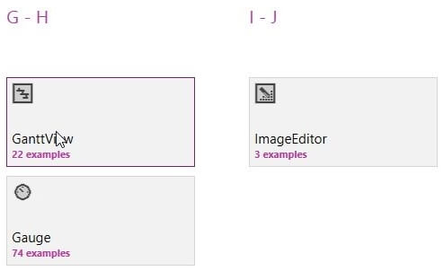
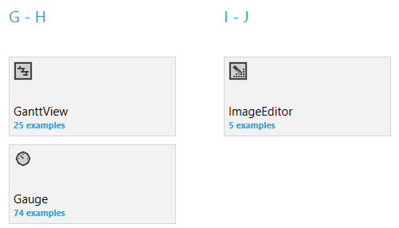
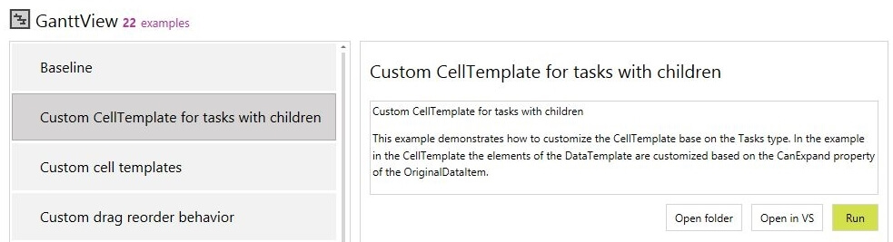
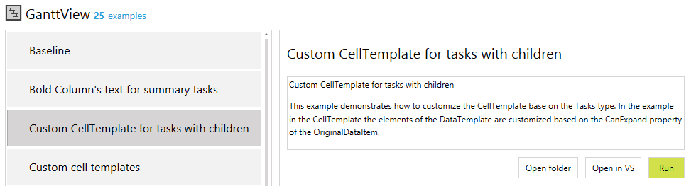
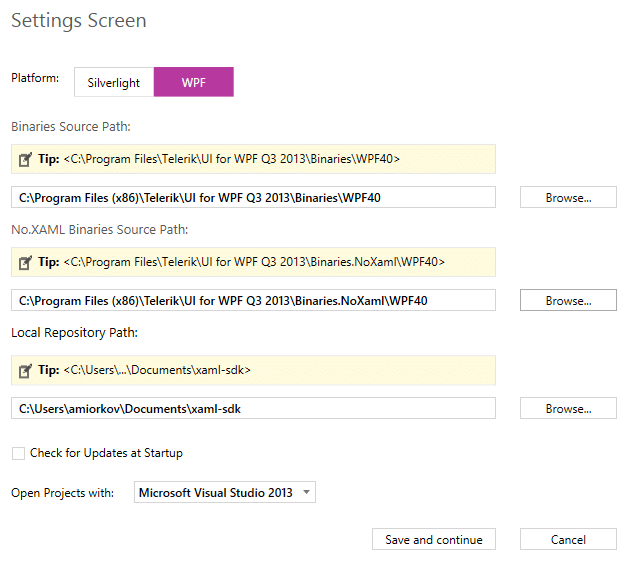
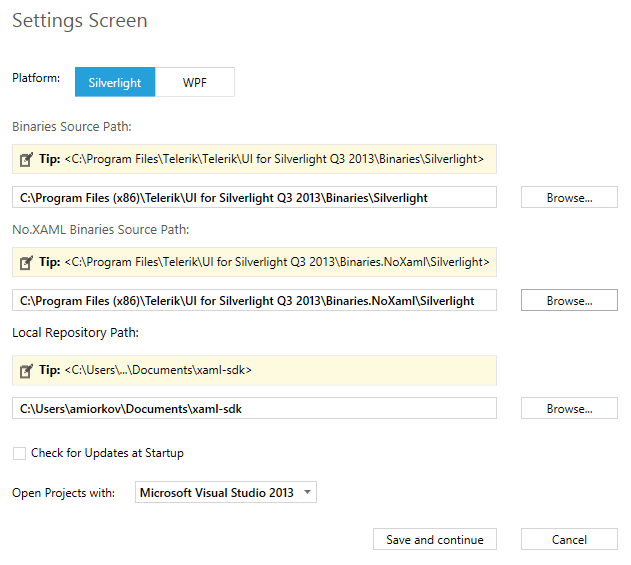

# SDK Samples Browser 

The Software Development Kit (SDK) Samples Browser downloads the [XAML SDK repository](https://github.com/telerik/xaml-sdk/) from GitHub to a local folder you choose. It lets you browse examples and search by control name, example name, or description.
            
Download the [SDK Samples Browser application](https://demos.telerik.com/xaml-sdkbrowser/).
           
Some of its __key features__ are:            

* Automatic repository download functionality                    

* Manual and automatic checking for new and updated SDK examples                    

* Search functionality through the controls names, example's titles and example's descriptions
                    
* One click examples running

* One click examples opening in Visual Studio                    

## Getting Started with SDK Samples Browser
           
To run the examples, meet one of these requirements:
                
* Install the latest [Telerik UI for WPF](http://www.telerik.com/products/wpf/download.aspx)[Telerik UI for Silverlight](http://www.telerik.com/products/silverlight/download.aspx).
                
* If it is already installed, provide a valid path to the Telerik WPFTelerik Silverlight assemblies.

## Browsing the Available Controls
            
The main screen lists controls as tiles in a RadTileList. Each tile displays the number of available examples.



## Browsing Through Control Examples
            
Select a control to open its examples screen. Choose an example from the list to read its description. Use __Open Folder__ to locate its files, __Open in VS__ to open it in Visual Studio, or __Run__ to build and run it.



## Building/Running an Example
            
By clicking the __Run__ button the application will show an indicator that says “Building example’s project”. After a few seconds it will disappear and a new Window will open of the built example.
                
## Changing the Settings
            
After the repository download completes, select the __Settings__ (gear) button in the navigation bar. The Settings screen lets you change:
                
* __Platform__&mdash;The platform for which the SDK examples should be loaded
                        
* __Binaries Source__&mdash;The location that contains all __Telerik WPF____Telerik Silverlight__ assemblies
                        
* __No.XAML Binaries Source__&mdash;The location that contains all __No.XAML Telerik WPF____No.XAML Telerik Silverlight__ assemblies
                        
* __Local Repository Path__&mdash;The location where the examples are locally placed by the automatic download                        

* __Check for Updates at Startup__&mdash;Determines if the application should automatically check for available SDK example updates                        

* __Open Projects with__&mdash;Determines which installed Visual Studio should be used to open SDK example projects with the "Open in VS" button                        

To check for updates while the application is running, select __Check for Updates__ in the navigation bar.


