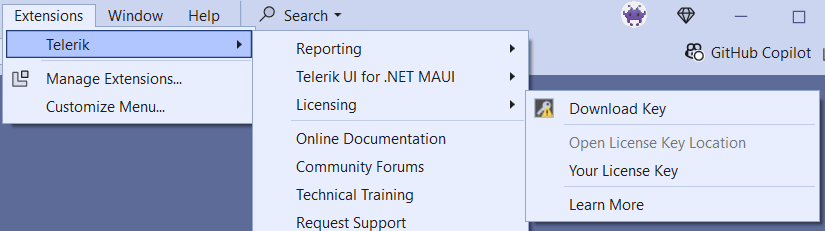

# Installing Your License Key

Starting with the 2025 Q1 release, Progress® Telerik® UI for WPF requires activation through a license key. To activate a NuGet-based project, install the `Telerik.Licensing` package. Make the license key available to the account or environment that builds the application.

If either part is missing, the build can log [errors and warnings](). The application can also show watermarks or banners at run time.

To download a license key for Telerik UI for WPF, you must have either a developer or trial license. If you are new to Telerik UI for WPF, start with a [free trial](https://www.telerik.com/try/ui-for-wpf). Then follow the steps in this article.

## Before You Start

Before you install the license key:

* Download your license key using [Telerik CLI](#automatic-license-key-installation) or from the [License Keys](https://www.telerik.com/account/your-licenses/license-keys) page in your Telerik account.
* If your project uses NuGet packages, install the `Telerik.Licensing` package. This is a required step.
* If Telerik UI for WPF is referenced in a class library, install `Telerik.Licensing` in the application project that consumes the class library too.
* If the build runs under a service account, continuous integration (CI) agent, or another user profile, do not rely on `%appdata%\Telerik` alone. Use a project-level or environment-based setup instead.

<a id="choose-the-right-installation-approach"></a>

## Choosing the Right Installation Approach

Depending on your development environment and preferences, you can install your license key in either of the following ways:

| Scenario | Recommended approach |
|---|---|
| Local development machine with Telerik productivity tools | Use [automatic installation](#automatic-license-key-installation). |
| Local development machine without Telerik productivity tools, including older Visual Studio setups such as VS2017 | Use [manual installation for NuGet projects](#manual-license-key-installation). |
| CI server, build agent, Windows service account, or other shared environment | Use a [service-oriented setup](#use-a-service-oriented-setup-for-ci-and-shared-environments). |
| Project that uses Telerik assembly references instead of NuGet packages | Use [assembly-reference installation](#adding-a-license-to-projects-using-telerik-assembly-references-no-nuget-packages). |

## Automatic License Key Installation

Telerik provides tools that automatically provision your license key. These tools include:

* [Telerik command-line interface (CLI)]().
* [Telerik UI for WPF Visual Studio extensions]().
* [Progress Control Panel](https://docs.telerik.com/controlpanel/introduction).

The Telerik CLI requires .NET Software Development Kit (SDK) 6.0 or later and a Telerik account with an active subscription or trial license. To install or update the license key with Telerik CLI:

1. Open any command line terminal.

1. If you don't have Telerik CLI installed, run the `dotnet tool install` command:

	```bash
	dotnet tool install -g Telerik.CLI
	```

1. Sign in to your Telerik account:

	```bash
	telerik login
	```

	If browser-based sign-in is blocked, use `telerik login --no-browser`. Follow the [Telerik CLI sign-in instructions](#log-in-to-your-telerik-account).

1. Run the `license get-key` command:

	```bash
	telerik license get-key
	```

The command downloads the current license key and saves it as `telerik-license.txt` in your operating system user's folder.

>important Automatic installation downloads the `telerik-license.txt` file for you, but NuGet-based projects still require the `Telerik.Licensing` package.

### Installing a License Key with the VS Extensions

To install your license key by using the [Telerik UI for WPF Visual Studio extensions]():

1. Open Visual Studio.
1. Go to **Extensions** > **Telerik** > **Licensing** > **Download Key**.

  

The Visual Studio extension puts the file in your home directory as `%appdata%\Telerik\telerik-license.txt`.

### Installing a License Key with the Progress Control Panel

Start the [Progress Control Panel](https://docs.telerik.com/controlpanel/introduction) to install your license key. It automatically downloads the `telerik-license.txt` file to `%appdata%\Telerik`.

## Manual License Key Installation

Use this approach when you do not use Telerik productivity tools or when you want explicit control over the setup. This is also the recommended path for developers working in environments where automatic tooling may not be part of the workflow.

To manually download and install a license key for Telerik UI for WPF:

1. Go to the [License Keys](https://www.telerik.com/account/your-licenses/license-keys) page in your Telerik account.

1. Select the **Manual Setup** tab in the tabstrip with the installation options.

1. Click the **Set Up License Key** button.

1. Check the instructions in the opened dialog and click the **Download License Key** button.

1. Copy the downloaded `telerik-license.txt` license key file to one of the following locations:

	* `%appdata%\Telerik\telerik-license.txt` to make it available for the current Windows user on the local machine.
	* The project root folder (the folder containing the project file) to make it available only to that project.

	>warning Do not commit the file to source control. This file contains your personal license key.

1. Install the `Telerik.Licensing` NuGet package in the project that starts the build or application.

For a C# application using NuGet packages, add the following XML fragment inside an `ItemGroup` in the consuming application's `.csproj` file:

```xml
<PackageReference Include="Telerik.Licensing" Version="1.*" />
```

In Visual Studio, right-click the executable or startup project and select **Manage NuGet Packages**. Search for `Telerik.Licensing` and install it.

When you build the project, the `Telerik.Licensing` package locates the license file and uses it to activate the product. If your project doesn’t use NuGet packages, follow the [assembly-reference installation](#adding-a-license-to-projects-using-telerik-assembly-references-no-nuget-packages) instructions instead.

>important When Telerik UI for WPF components are used in a class library, install `Telerik.Licensing` in the consuming application project too. Installing it only in the class library is not enough.

## When Copying the File to %appdata%\Telerik Does Not Work

Copying `telerik-license.txt` to `%appdata%\Telerik` works only when the application or build runs under the same Windows user profile that owns that folder.

If the license is still not found, check the following:

* The file name is exactly `telerik-license.txt`.
* The file is stored under the current user profile, not under a different user or administrator account.
* The project includes the `Telerik.Licensing` package.
* If the Telerik controls are referenced from a class library, the main application project also includes `Telerik.Licensing`.
* For CI, Windows services, or shared accounts, provide the key through a project-level location or an environment variable, not a personal profile folder.
* If `TELERIK_LICENSE` is set, its value takes precedence over the license file. Unset it to force use of the file, as described in the [license key precedence FAQ](#what-happens-if-both-the-environment-variable-and-the-license-key-file-are-present).
* If the project uses assembly references instead of NuGet packages, use a [script key](#adding-a-license-to-projects-using-telerik-assembly-references-no-nuget-packages). Copying `telerik-license.txt` alone does not activate assembly-reference projects.

If `%appdata%\Telerik` is not suitable for your setup, place the file in the project root. Alternatively, use the [CI and shared-environment setup](#use-a-service-oriented-setup-for-ci-and-shared-environments).

Rebuild and run the application after correcting the setup. Check for licensing build errors or warnings and for runtime watermarks or banners. If these remain, see [License Activation Errors and Warnings](). For class-library and add-in/plug-in special cases, see [No License Found - Troubleshooting]().

<a id="use-a-service-oriented-setup-for-ci-and-shared-environments"></a>

## Using a Service-Oriented Setup for CI and Shared Environments

For build servers, CI pipelines, service accounts, and other shared environments, use an environment-based setup instead of a personal profile folder.

For CI pipelines, use a deployment key as described in [Adding the License Key to CI Services](). Deployment keys are tied to an application and cannot be used for application development.

Provide the key to the build account through one of these options:

* Set the `TELERIK_LICENSE` environment variable to the key value stored in a secure secret.
* Set `TELERIK_LICENSE_PATH` to the location of a secure `telerik-license.txt` file. This option requires `Telerik.Licensing` 1.4.10 or later.

This approach is better suited for non-interactive environments because it does not depend on a specific user profile such as `%appdata%\Telerik`.

>warning Store license keys in secure secrets or secure files. Do not put plaintext keys in source files or pipeline definitions, or print them in build logs.

On local development machines, each developer should use the key associated with their own account.

## Adding a License to Projects Using Telerik Assembly References (no NuGet packages)

Telerik strongly recommends the use of NuGet packages whenever possible. Only include the license key as a code snippet when NuGet packages are not an option.

Assembly-reference projects require a script key. Copying `telerik-license.txt` alone does not activate them. The project must also reference `Telerik.Licensing.Runtime.dll`. For a missing-assembly error, see [Resolving a Missing Licensing Runtime Assembly]().

To add the script key to a project that references Telerik assemblies:

1. Go to the [License Keys](https://www.telerik.com/account/your-licenses/license-keys) page in your Telerik account.

1. Click the **View Script Keys** button.

1. In the dropdown menu, select **Progress® Telerik® UI for WPF**.

1. Copy the C# code snippet into a new file, for example, `TelerikLicense.cs`. The code snippet contains an assembly attribute called `EvidenceAttribute` that holds information about the license key.

1. Add the `TelerikLicense.cs` file to your project. For a class library, add this file to the consuming application project too.

The following example shows the assembly attribute in `TelerikLicense.cs`. Replace `your-wpf-script-key-here` with the WPF script key from your account:
```csharp
[assembly: global::Telerik.Licensing.EvidenceAttribute("your-wpf-script-key-here")]
```

If you use multiple Telerik products in the same application, add the script keys for all products. Examples include WPF, WinForms, and Reporting.

The following example shows `TelerikLicense.cs` with multiple script keys. Replace each placeholder with the script key for the corresponding product:
```csharp
[assembly: global::Telerik.Licensing.EvidenceAttribute("your-WPF-script-key-here")]
[assembly: global::Telerik.Licensing.EvidenceAttribute("your-WINFORMS-script-key-here")]
[assembly: global::Telerik.Licensing.EvidenceAttribute("your-REPORTING-script-key-here")]
```

>warning Do not publish the license key code snippet in publicly accessible repositories. This is your personal license key.

## Updating Your License Key

Whenever you purchase or renew a Telerik UI for WPF license, download and install a new license key. Use the [automatic installation](#automatic-license-key-installation) or [manual installation](#manual-license-key-installation) approach. The new license key includes information about all previous license purchases. This process is referred to as a license key update.

## See Also

* [License Activation Errors and Warnings]()
* [No License Found - Troubleshooting]()
* [Adding the License Key to CI Services]()
* [Frequently Asked Questions about Your UI for WPF License Key]()
