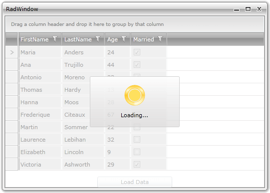

## Environment

<table>
    <tr>
        <td>Product</td>
        <td>Progress® Telerik® UI for WPF</td>
    </tr>
</table>

## Description

Show `RadBusyIndicator` while retrieving data for a `RadGridView` in a `RadWindow`. This example uses `BackgroundWorker` to run the service work on a background thread while the UI displays the busy indicator.

## Solution

Create a `RadWindow` whose content is a `RadBusyIndicator`. Set the indicator's content to the controls that should remain visible while the service call runs.

>caption RadWindow displaying RadBusyIndicator while data is retrieved

### Define the RadWindow

The example defines `RadWindow` as a user control. See [Use RadWindow as a UserControl]() for details. The XAML below defines the window, busy indicator, grid, and button:

<snippet id='radbusyindicator-how-to-integrate-with-services-and-radwindow-radwindow_declaration-xaml' />

### Define the Sample Data and Service

The following snippets define sample data and the service that retrieves it:

<snippet id='radbusyindicator-how-to-integrate-with-services-and-radwindow-retrieved_sample_data-cs' />

<snippet id='radbusyindicator-how-to-integrate-with-services-and-radwindow-retrieved_sample_data-vb' />

<snippet id='radbusyindicator-how-to-integrate-with-services-and-radwindow-employeeservice_class-cs' />

<snippet id='radbusyindicator-how-to-integrate-with-services-and-radwindow-employeeservice_class-vb' />

### Run the Service Call in the Background

`BackgroundWorker` is in the `System.ComponentModel` namespace. Use its `DoWork` event to run the time-consuming operation and its `RunWorkerCompleted` event to hide the busy indicator and display the result:

<snippet id='radbusyindicator-how-to-integrate-with-services-and-radwindow-backgroundworker_usage-cs' />

<snippet id='radbusyindicator-how-to-integrate-with-services-and-radwindow-backgroundworker_usage-vb' />

### Open the RadWindow

Create and show the window:

<snippet id='radbusyindicator-how-to-integrate-with-services-and-radwindow-open_radwindow-cs' />

<snippet id='radbusyindicator-how-to-integrate-with-services-and-radwindow-open_radwindow-vb' />

## See Also

* [RadBusyIndicator Getting Started]()
* [Progress Determination]()
* [Report Progress Value]()
* [Custom Busy Content]()
