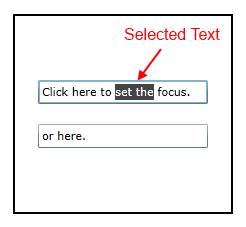
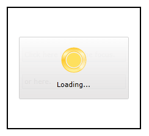
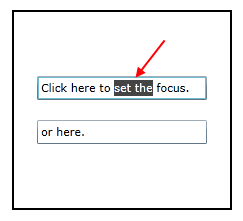

## Environment

<table>
    <tr>
        <td>Product</td>
        <td>Progress® Telerik® UI for WPF</td>
    </tr>
</table>

## Description

Restore keyboard focus to a control in `RadBusyIndicator` content after the busy indicator disappears.

## Solution

Use the read-only `IsBusyIndicationVisible` property to detect when the busy content is displayed. The property is updated after `IsBusy`, so use it when the focus change must follow the display state of the indicator.

### Return Focus to a Specific Control

The following attached property behavior returns focus to a `TextBox` when `RadBusyIndicator` is no longer visible:

<snippet id='radbusyindicator-how-to-restore-the-focus-declaring_the_attachedproperty-cs' />

Bind the attached property to `IsBusyIndicationVisible` on a control inside the busy indicator's content:

<snippet id='radbusyindicator-how-to-restore-the-focus-define_the_new_behavior_inside_the_content-xaml' />

### Return Focus to the Last Focused Control

To restore focus to whichever control was focused before the busy indicator appeared, save that control and focus it again after `RadBusyIndicator` is hidden. The following example uses a `DispatcherTimer` to show and hide the indicator:

Define the sample layout and `RadBusyIndicator`:

<snippet id='radbusyindicator-how-to-restore-the-focus-define_the_new_behavior_inside_the_content-xaml' />

Add a property to store the control that had focus:

<snippet id='radbusyindicator-how-to-restore-the-focus-define_the_new_behavior_inside_the_content-cs' />

Use a `DispatcherTimer` to enable and disable the busy indicator, then return focus to the saved control:

<snippet id='radbusyindicator-how-to-restore-the-focus-define_the_new_behavior_inside_the_content-cs' />

The screenshots show the focus before, during, and after the busy state:

>caption TextBox before RadBusyIndicator appears

>caption RadBusyIndicator displayed over its content

>caption TextBox focused after RadBusyIndicator is hidden

Find a runnable project for the example in the [WPF Samples GitHub repository](https://github.com/telerik/xaml-sdk/tree/master/BusyIndicator/RestoreFocus).

## See Also

* [Enabling the Indicator]()
* [Delayed Display]()
* [Integrate RadBusyIndicator with a Service Call in RadWindow]()
