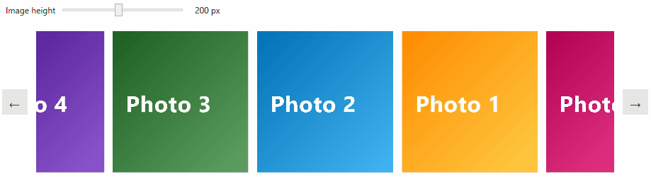

## Environment

| Version | Product | Author | 
| ---- | ---- | ---- | 
| 2026.3.1007| RadCarousel |[Desislava Yordanova](https://www.telerik.com/blogs/author/desislava-yordanova)| 

## Description

Create a flat image gallery in which images move along one horizontal row without a raised or enlarged center image. Include partially visible images at the left and right edges, a runtime image-height setting, previous and next navigation, and fullscreen image viewing.

>caption Flat image gallery with RadCarousel



## Solution

Use the existing `RadCarouselPanel` with a horizontal `Path`. Disable its scale, opacity, and skew effects. A horizontal path controls the item positions; disabling effects alone does not replace the default curved path.

Keep the panel's layout implementation. Do not override `ArrangeOverride` to rearrange its children, because the panel uses that method to update positions along the path.

>important This example requires build and visual verification with your Telerik UI for WPF version before publication or production use. It has not been verified against a specific released build.

### Prepare the Project

1. In Visual Studio, create a C# **WPF Application** named `FlatImageGallery` targeting .NET 8. Install the .NET desktop development workload and a Telerik UI for WPF release that supports this target framework.
2. Install `Telerik.Windows.Controls.Navigation.for.Wpf.Xaml` through NuGet. Select the product version available to your account and follow the package and licensing prerequisites in [Getting Started with RadCarousel](). This example uses the Xaml package, not the NoXaml package.
3. Keep the generated `App.xaml` and `App.xaml.cs`. Ensure that `App.xaml` uses `StartupUri="MainWindow.xaml"` and that both the application and window use the `FlatImageGallery` namespace.
4. Add an `Images` folder to the project. Add seven JPEG images that you have permission to use, named `photo1.jpg` through `photo7.jpg`. Set **Build Action** to **Resource** for each image. The image files must exist; declaring their names does not supply their contents.

`Telerik.Licensing.Runtime` is an assembly name in the control's dependency list. Do not create a package reference with that name and the WPF product version. Follow the licensing dependencies and setup instructions for the selected Telerik package.

### Configure the Horizontal Path

Replace the contents of `MainWindow.xaml` with the following markup. Keep the `FlatImageGallery.MainWindow` class name consistent with the code in the next section.

The gallery uses five positions along the path. The code extends the path beyond the viewport so that the first and last visible images straddle the viewport edges. The outer grid clips those images. The custom `CarouselItem` template removes the theme's item borders and reflection presentation, so they do not add space around the images.

__Main window layout__

```XAML
<Window x:Class="FlatImageGallery.MainWindow"
        xmlns="http://schemas.microsoft.com/winfx/2006/xaml/presentation"
        xmlns:x="http://schemas.microsoft.com/winfx/2006/xaml"
        xmlns:telerik="http://schemas.telerik.com/2008/xaml/presentation"
        Title="Image gallery" Width="960" Height="520"
        MinWidth="600" MinHeight="460">
    <Grid Margin="16">
        <Grid.RowDefinitions>
            <RowDefinition Height="Auto" />
            <RowDefinition Height="Auto" />
            <RowDefinition Height="*" />
        </Grid.RowDefinitions>

        <StackPanel Orientation="Horizontal" Margin="0,0,0,16">
            <Label Content="_Image height" Target="{Binding ElementName=HeightSlider}"
                   VerticalAlignment="Center" />
            <Slider x:Name="HeightSlider" Width="180" Minimum="96" Maximum="320"
                    TickFrequency="8" IsSnapToTickEnabled="True"
                    VerticalAlignment="Center"
                    AutomationProperties.Name="Image height"
                    Value="{Binding ImageHeight, Mode=TwoWay,
                                    UpdateSourceTrigger=PropertyChanged}" />
            <TextBlock Margin="12,0,0,0" VerticalAlignment="Center"
                       Text="{Binding ImageHeight, StringFormat={}{0:0} px}" />
        </StackPanel>

        <Grid Grid.Row="1" PreviewKeyDown="OnGalleryKeyDown">
            <Grid.ColumnDefinitions>
                <ColumnDefinition Width="Auto" />
                <ColumnDefinition Width="*" />
                <ColumnDefinition Width="Auto" />
            </Grid.ColumnDefinitions>

            <Button Width="36" Height="36" Margin="0,0,12,0"
                    VerticalAlignment="Center" Click="OnPreviousClick"
                    ToolTip="Previous image" AutomationProperties.Name="Previous image">
                <TextBlock Text="&#x2190;" FontSize="20" />
            </Button>

            <Grid Grid.Column="1" Height="{Binding GalleryHeight}" ClipToBounds="True">
                <telerik:RadCarousel x:Name="Gallery"
                                     ItemsSource="{Binding Images}"
                                     AutoGenerateDataPresenters="False"
                                     CanUserSelect="False"
                                     BorderThickness="0" Padding="0"
                                     Background="Transparent" Focusable="True"
                                     HorizontalScrollBarVisibility="Hidden"
                                     VerticalScrollBarVisibility="Hidden"
                                     AutomationProperties.Name="Image gallery">
                    <telerik:RadCarousel.Resources>
                        <Style TargetType="{x:Type telerik:CarouselItem}">
                            <Setter Property="Template">
                                <Setter.Value>
                                    <ControlTemplate TargetType="{x:Type telerik:CarouselItem}">
                                        <ContentPresenter />
                                    </ControlTemplate>
                                </Setter.Value>
                            </Setter>
                        </Style>
                    </telerik:RadCarousel.Resources>

                    <telerik:RadCarousel.ItemsPanel>
                        <ItemsPanelTemplate>
                            <telerik:RadCarouselPanel ItemsPerPage="5"
                                                      ItemsPerSwipe="1"
                                                      IsContinuous="True"
                                                      IsScalingEnabled="False"
                                                      IsOpacityEnabled="False"
                                                      IsSkewAngleXEnabled="False"
                                                      IsSkewAngleYEnabled="False"
                                                      Loaded="OnPanelLoaded"
                                                      SizeChanged="OnPanelSizeChanged">
                                <telerik:RadCarouselPanel.Path>
                                    <Path Data="M 0,0 L 1,0" Stretch="Fill" />
                                </telerik:RadCarouselPanel.Path>
                            </telerik:RadCarouselPanel>
                        </ItemsPanelTemplate>
                    </telerik:RadCarousel.ItemsPanel>

                    <telerik:RadCarousel.ItemTemplate>
                        <DataTemplate>
                                <Button Click="OnImageClick" Padding="0" BorderThickness="0"
                                    ClipToBounds="True"
                                    ToolTip="{Binding Title}"
                                    AutomationProperties.Name="{Binding Title}"
                                    Width="{Binding DataContext.ImageWidth,
                                        RelativeSource={RelativeSource AncestorType={x:Type Window}}}"
                                    Height="{Binding DataContext.ImageHeight,
                                        RelativeSource={RelativeSource AncestorType={x:Type Window}}}">
                                <Button.Template>
                                    <ControlTemplate TargetType="{x:Type Button}">
                                        <ContentPresenter />
                                    </ControlTemplate>
                                </Button.Template>
                                <Image Source="{Binding Source}" Stretch="UniformToFill" />
                            </Button>
                        </DataTemplate>
                    </telerik:RadCarousel.ItemTemplate>
                </telerik:RadCarousel>
            </Grid>

            <Button Grid.Column="2" Width="36" Height="36" Margin="12,0,0,0"
                    VerticalAlignment="Center" Click="OnNextClick"
                    ToolTip="Next image" AutomationProperties.Name="Next image">
                <TextBlock Text="&#x2192;" FontSize="20" />
            </Button>
        </Grid>
    </Grid>
</Window>
```

`ItemsPerPage` is an integer. Do not assign a fractional value to request partial images. Use the path bounds, item size, and viewport clipping to control how much of an edge image is visible.

### Add Sizing and Navigation

Replace the contents of `MainWindow.xaml.cs` with the following code. It includes the image data class and creates the fullscreen window in code, so you do not need an additional window file.

__Main window behavior and image data__

```C#
using System;
using System.Collections.Generic;
using System.ComponentModel;
using System.Windows;
using System.Windows.Controls;
using System.Windows.Input;
using System.Windows.Media;
using System.Windows.Media.Imaging;
using Telerik.Windows.Controls;

namespace FlatImageGallery
{
    public partial class MainWindow : Window, INotifyPropertyChanged
    {
        private double imageHeight = 180;
        private double imageWidth = 180;

        public MainWindow()
        {
            InitializeComponent();

            for (int imageNumber = 1; imageNumber <= 7; imageNumber++)
            {
                var source = new BitmapImage(new Uri(
                    $"pack://application:,,,/Images/photo{imageNumber}.jpg",
                    UriKind.Absolute));

                Images.Add(new GalleryImage($"Photo {imageNumber}", source));
            }

            DataContext = this;
        }

        public event PropertyChangedEventHandler? PropertyChanged;

        public List<GalleryImage> Images { get; } = new List<GalleryImage>();

        public double ImageHeight
        {
            get { return imageHeight; }
            set
            {
                if (imageHeight == value)
                {
                    return;
                }

                imageHeight = value;
                PropertyChanged?.Invoke(this, new PropertyChangedEventArgs(nameof(ImageHeight)));
                PropertyChanged?.Invoke(this, new PropertyChangedEventArgs(nameof(GalleryHeight)));
            }
        }

        public double ImageWidth
        {
            get { return imageWidth; }
        }

        public double GalleryHeight
        {
            get { return ImageHeight + 2; }
        }

        private void OnPanelLoaded(object sender, RoutedEventArgs eventArgs)
        {
            UpdateGalleryLayout((RadCarouselPanel)sender);
        }

        private void OnPanelSizeChanged(object sender, SizeChangedEventArgs eventArgs)
        {
            UpdateGalleryLayout((RadCarouselPanel)sender);
        }

        private void UpdateGalleryLayout(RadCarouselPanel panel)
        {
            if (panel.ActualWidth <= 0 || panel.ItemsPerPage < 2)
            {
                return;
            }

            double spacing = panel.ActualWidth / (panel.ItemsPerPage - 1);
            double newWidth = Math.Max(1, spacing - 12);

            if (imageWidth != newWidth)
            {
                imageWidth = newWidth;
                PropertyChanged?.Invoke(this, new PropertyChangedEventArgs(nameof(ImageWidth)));
            }

            var padding = new Thickness(-spacing, 0, -spacing, 0);
            if (panel.PathPadding != padding)
            {
                panel.PathPadding = padding;
            }
        }

        private void OnPreviousClick(object sender, RoutedEventArgs eventArgs)
        {
            MoveGallery(-1);
        }

        private void OnNextClick(object sender, RoutedEventArgs eventArgs)
        {
            MoveGallery(1);
        }

        private void OnGalleryKeyDown(object sender, KeyEventArgs eventArgs)
        {
            if (Keyboard.Modifiers != ModifierKeys.None)
            {
                return;
            }

            if (eventArgs.Key == Key.Left || eventArgs.Key == Key.Right)
            {
                eventArgs.Handled = true;
                MoveGallery(eventArgs.Key == Key.Left ? -1 : 1);
            }
        }

        private void MoveGallery(int displacement)
        {
            RadCarouselPanel panel = Gallery.FindCarouselPanel();
            if (panel != null)
            {
                panel.MoveBy(displacement);
                Gallery.Focus();
            }
        }

        private void OnImageClick(object sender, RoutedEventArgs eventArgs)
        {
            if (!(sender is Button button) || !(button.DataContext is GalleryImage image))
            {
                return;
            }

            eventArgs.Handled = true;

            var viewer = new Window
            {
                Owner = this,
                Title = image.Title,
                WindowStyle = WindowStyle.None,
                ResizeMode = ResizeMode.NoResize,
                WindowStartupLocation = WindowStartupLocation.CenterOwner,
                WindowState = WindowState.Maximized,
                ShowInTaskbar = false,
                Background = Brushes.Black,
                Content = new Image
                {
                    Source = image.Source,
                    Stretch = Stretch.Uniform
                }
            };

            viewer.PreviewKeyDown += (viewerSender, keyArgs) =>
            {
                if (keyArgs.Key == Key.Escape)
                {
                    keyArgs.Handled = true;
                    viewer.Close();
                }
            };

            viewer.MouseLeftButtonUp += (viewerSender, mouseArgs) => viewer.Close();
            viewer.Loaded += (viewerSender, loadedArgs) => viewer.Focus();
            viewer.ShowDialog();
            Gallery.Focus();
        }
    }

    public sealed class GalleryImage
    {
        public GalleryImage(string title, ImageSource source)
        {
            Title = title;
            Source = source;
        }

        public string Title { get; }

        public ImageSource Source { get; }
    }
}
```

The code uses `FindCarouselPanel()` after the control loads. It changes panel instance properties and calls `MoveBy(-1)` or `MoveBy(1)` to request a single position change. It does not use `SelectedIndex` or `ItemsPanelRoot`.

The Left and Right arrow handlers belong to the gallery's grid, not the window. They navigate when focus is in the gallery or on its navigation buttons. When the height slider has focus, the arrow keys retain the slider's normal behavior. Image buttons also support keyboard activation.

`ItemsPerSwipe="1"` configures the displacement for recognized swipe gestures. It does not configure keyboard or button navigation. The example keeps the panel's existing gesture handling rather than implementing a separate swipe recognizer.

### Understand the Edge Clipping

The panel spaces the visible positions between the path's start and end points. With `ItemsPerPage="5"`, the five visible positions lie approximately at one-sixth through five-sixths of the path. The start and end positions themselves are not visible item positions.

For viewport width `W`, the example sets the center-to-center spacing to `W / 4`. Negative horizontal `PathPadding` extends the path by this spacing on each side. This places the outer visible image centers approximately at the viewport edges, leaving three full images between them. The image width is the spacing minus a 12-pixel gap. Path-position rounding means the clipped portions are approximately, not exactly, half an image.

The gallery height follows the image height, with two pixels of vertical clearance. It does not reserve an upper area for a featured image. The unused window area is below the gallery.

`UniformToFill` fills each thumbnail box and can crop the source image. The fullscreen viewer uses `Uniform` to show the entire source image without changing its aspect ratio.

>note This layout uses seven images, five visible path positions, and continuous movement. Recheck the layout if you reduce the collection, change the item count, add container padding, change the path, or remove the window's minimum width. The example does not define endpoint behavior for a non-continuous gallery.

### Verify the Gallery

1. Build and run the project. Resolve all package, licensing, XAML, and binding errors before checking the layout. Confirm that all seven resource images load.
2. Wait for movement to finish. Check that the images form a horizontal row with equal dimensions, no reflections, and no enlarged center image. At the configured sizes, check for three full images and two partially clipped neighbors.
3. Resize the window and move the **Image height** slider across its range. Check that the row height follows the setting, the images remain separated, and the edge images remain partially visible.
4. Click each navigation button once, then test each arrow key with focus in the gallery. Verify one position change per action and movement through the collection boundary. Test rapid repeated input separately.
5. With focus on the slider, verify that arrow keys change the height rather than navigate the gallery. Tab to an image button and verify keyboard activation and a visible focus indicator in the selected theme.
6. Click an image. Check that the maximized, borderless viewer displays the complete image. Close it with `Escape` or a left click, including a click in a letterboxed area. Verify that keyboard navigation works again after it closes.
7. If touch is required, test both a tap and a swipe on the target device. Verify that a swipe navigates one position and does not also activate the image button. Verify fullscreen placement and taskbar behavior on the target monitor and DPI configuration; this example uses a maximized WPF window, not an exclusive fullscreen mode.

If images do not load, compare their names with the resource URIs and check **Build Action**. If item spacing differs, check the actual panel width and confirm that the content-only `CarouselItem` template is applied. If changing the height has no effect, inspect the bindings to the window's `DataContext`.

### Share the Project

To distribute this example as a project archive, include the generated solution and project files, `App.xaml`, `App.xaml.cs`, the two `MainWindow` files, and all seven source image files. Include any other files referenced by the project. The project generated by Visual Studio and updated through NuGet contains the selected package references; do not replace their versions with unverified values.

Exclude `bin`, `obj`, `.vs`, account credentials, and license-key files. Add a readme with the target framework, tested Telerik package version, restore and licensing prerequisites, and instructions to run the gallery. Do not bundle Telerik binaries unless their license permits redistribution.

Extract the archive into a different directory, open its solution, restore packages using the recipient's authorized package access, and build it again. Check that no references depend on files outside the extracted directory. These steps describe how to create and verify an archive; this article does not include a downloadable ZIP.

## See Also

- [Getting Started with RadCarousel]()
- [Carousel Properties]()