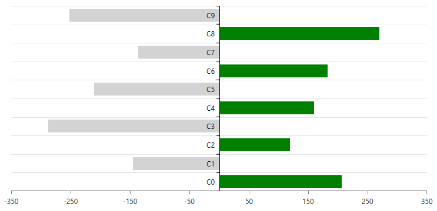

## Environment
<table>
    <tr>
        <td>Product</td>
        <td>RadChartView for WPF</td>
    </tr>
    <tr>
        <td>SDK Example Target Framework</td>
        <td>.NET Framework 4.8</td>
    </tr>
</table>

## Description

`RadCartesianChart` places vertical Cartesian axes on the left or right. It places horizontal Cartesian axes at the top or bottom of the plot area. This example shows a sample approach of placing a chart axis somewhere other than the chart’s edges, for example, inside the plot at zero or between two groups of data.

The following image shows a vertical axis placed at zero inside the plot area.



## Solution

Keep the real axis for data mapping. Use annotations to draw its visible line, ticks, and labels inside the plot area. This technique customizes the chart's appearance. It does not create a new axis implementation.

The following example shows how to keep the axis assigned to the chart and hide its visuals. Retain the chart's series and other configuration.

### Drawing a Categorical Axis

Use the following XAML for the `UserControl`. It includes a hidden categorical axis, a horizontal linear axis, a bar series, and a chart grid:

```XAML
<UserControl x:Class="AxisLikeAnnotations.CategoricalAxisExample"
             xmlns="http://schemas.microsoft.com/winfx/2006/xaml/presentation"
             xmlns:x="http://schemas.microsoft.com/winfx/2006/xaml"
             xmlns:mc="http://schemas.openxmlformats.org/markup-compatibility/2006"
             xmlns:d="http://schemas.microsoft.com/expression/blend/2008"
             xmlns:local="clr-namespace:AxisLikeAnnotations"
             xmlns:telerik="http://schemas.telerik.com/2008/xaml/presentation"
             mc:Ignorable="d"
             d:DesignHeight="300" d:DesignWidth="300">
    <UserControl.Resources>
        <local:ValueToBrushConverter x:Key="ValueToBrushConverter" />
    </UserControl.Resources>
    <telerik:RadCartesianChart x:Name="chart">
        <telerik:RadCartesianChart.VerticalAxis>
            <telerik:CategoricalAxis x:Name="verticalAxis"
                                     Visibility="Hidden" />
        </telerik:RadCartesianChart.VerticalAxis>
        <telerik:RadCartesianChart.HorizontalAxis>
            <telerik:LinearAxis x:Name="horizontalAxis"
                                Minimum="-350"
                                Maximum="350" />
        </telerik:RadCartesianChart.HorizontalAxis>
        <telerik:RadCartesianChart.Series>
            <telerik:BarSeries ValueBinding="Value"
                               CategoryBinding="Category"
                               ItemsSource="{Binding}"
                               OriginValue="0">
                <telerik:BarSeries.DefaultVisualStyle>
                    <Style TargetType="Border">
                        <Setter Property="Background"
                                Value="{Binding Value, Converter={StaticResource ValueToBrushConverter}, ConverterParameter=Green;LightGray}" />
                    </Style>
                </telerik:BarSeries.DefaultVisualStyle>
            </telerik:BarSeries>
        </telerik:RadCartesianChart.Series>
        <telerik:RadCartesianChart.Grid>
            <telerik:CartesianChartGrid MajorLinesVisibility="Y" />
        </telerik:RadCartesianChart.Grid>
    </telerik:RadCartesianChart>
</UserControl>
```

Add the following code to the `CategoricalAxisExample.xaml.cs` code-behind file. It creates the custom axis line, labels, and tick marks. It also updates the annotations when the chart size or horizontal axis range changes:

```C#
using System;
using System.Collections.ObjectModel;
using System.Linq;
using System.Windows;
using System.Windows.Controls;
using System.Windows.Media;
using System.Windows.Shapes;
using Telerik.Charting;
using Telerik.Windows.Controls.ChartView;

namespace AxisLikeAnnotations
{
    public partial class CategoricalAxisExample : UserControl
    {
        public CategoricalAxisExample()
        {
            InitializeComponent();
            this.DataContext = GetData();
            this.horizontalAxis.ActualRangeChanged += HorizontalAxis_ActualRangeChanged;
            this.chart.SizeChanged += Chart_SizeChanged;
        }

        private void Chart_SizeChanged(object sender, SizeChangedEventArgs e)
        {
            Dispatcher.BeginInvoke(new Action(() =>
            {
                UpdateAxis();
            }));
        }

        private void HorizontalAxis_ActualRangeChanged(object sender, NumericalRangeChangedEventArgs e)
        {
            UpdateAxis();
        }

        private void UpdateAxis()
        {
            ClearCustomAxis();

            var line = CreateLine();
            this.chart.Annotations.Add(line);

            if (this.verticalAxis.PlotMode == AxisPlotMode.OnTicks)
            {
                GenerateLabelsOnTicks();
            }
            else
            {
                GenerateLabelsBetweenTicks();
            }
        }

        private void GenerateLabelsBetweenTicks()
        {
            var count = this.verticalAxis.Categories.Count();
            var slotSize = this.chart.PlotAreaClip.Height / count;
            for (int i = 0; i < count; i++)
            {
                var category = this.verticalAxis.Categories.ElementAt(i);
                var tick = CreateTick(category, -slotSize);
                this.chart.Annotations.Add(tick);
            }
        }

        private void GenerateLabelsOnTicks()
        {
            foreach (var category in this.verticalAxis.Categories)
            {
                var tick = CreateTick(category);
                this.chart.Annotations.Add(tick);
            }
        }

        private CartesianCustomAnnotation CreateTick(ChartAxisCategoryInfo item, double verticalOffset = 0)
        {
            var tick = new CartesianCustomAnnotation();
            tick.Content = CreateTickVisual(item.Category, verticalOffset);
            tick.VerticalValue = item.Category;
            tick.HorizontalValue = GetAxisCenter();
            tick.HorizontalAlignment = HorizontalAlignment.Left;
            tick.VerticalAlignment = VerticalAlignment.Center;
            tick.Tag = "CustomAxisElement";
            return tick;
        }

        private UIElement CreateTickVisual(object category, double verticalOffset = 0)
        {
            var tickVisual = new Rectangle
            {
                Fill = Brushes.Black,
                Width = 5,
                Height = 1,
                Margin = new Thickness(3, verticalOffset, 0, 0)
            };
            var label = new TextBlock { Text = category.ToString() };
            var panel = new StackPanel { Orientation = Orientation.Horizontal };
            panel.Children.Add(label);
            panel.Children.Add(tickVisual);
            return panel;
        }

        public CartesianGridLineAnnotation CreateLine()
        {
            var annotation = new CartesianGridLineAnnotation();
            annotation.Stroke = Brushes.Black;
            annotation.Axis = this.horizontalAxis;
            annotation.Value = GetAxisCenter();
            annotation.Tag = "CustomAxisElement";
            return annotation;
        }

        private double GetAxisCenter()
        {
            var min = this.horizontalAxis.ActualRange.Minimum;
            var max = this.horizontalAxis.ActualRange.Maximum;
            var delta = max - min;
            var center = min + (delta / 2);
            return center;
        }

        private void ClearCustomAxis()
        {
            var axisElements = this.chart.Annotations
                .Where(x => x.Tag != null && x.Tag.Equals("CustomAxisElement"))
                .ToList();
            foreach (var item in axisElements)
            {
                this.chart.Annotations.Remove(item);
            }
        }

        public ObservableCollection<PlotInfo> GetData()
        {
            var data = new ObservableCollection<PlotInfo>();
            for (int i = 0; i < 10; i++)
            {
                var value = i % 2 == 0
                    ? PlotInfo.RandomNumberGenerator.Next(100, 300)
                    : PlotInfo.RandomNumberGenerator.Next(-300, -100);
                data.Add(new PlotInfo { Value = value, Category = "C" + i });
            }
            return data;
        }
    }
}
```

The code-behind uses a `PlotInfo` model. Define the model in the same namespace:

```C#
using System;

namespace AxisLikeAnnotations
{
    public class PlotInfo
    {
        public static Random RandomNumberGenerator = new Random();

        public double? Value { get; set; }
        public string Category { get; set; }
    }
}
```

The XAML resource also uses the `ValueToBrushConverter` class. Define the converter in the same namespace:

```C#
using System;
using System.Globalization;
using System.Windows.Data;
using System.Windows.Media;

namespace AxisLikeAnnotations
{
    public class ValueToBrushConverter : IValueConverter
    {
        public object Convert(object value, Type targetType, object parameter, CultureInfo culture)
        {
            var colors = parameter.ToString().Split(';');

            if ((double)value < 0)
            {
                return new SolidColorBrush((Color)ColorConverter.ConvertFromString(colors[1]));
            }
            return new SolidColorBrush((Color)ColorConverter.ConvertFromString(colors[0]));
        }

        public object ConvertBack(object value, Type targetType, object parameter, CultureInfo culture)
        {
            throw new NotImplementedException();
        }
    }
}
```

Use the `PlotMode` property to position the ticks. The SDK example places ticks at category positions for `OnTicks` and uses an offset routine for every other mode. Verify the offset for your selected mode, especially for `OnTicksPadded`.

When the chart size or axis range changes, remove the annotations tagged with `CustomAxisElementTag` and recreate them. The SDK example updates after chart size changes. It also updates when the horizontal axis raises `ActualRangeChanged`.

### Drawing a Numeric Axis-Like Visual

For a numeric axis, keep the real `LinearAxis` to provide the scale. Use its `ActualRange` and `ActualMajorStep` to place the custom labels.

The SDK example hides the numeric axis and reserves a category on the perpendicular categorical axis. It adds a data item for that category with a `null` numeric value. The sample uses this category to anchor the custom line and tick annotations. It also sets `ClipToPlotArea` to `false` when annotation visuals extend outside the plot area.

If the numeric range or major step can change at runtime, regenerate the annotations when the axis raises `ActualRangeChanged` or `ActualMajorStepChanged`.

The complete categorical and numeric implementations are available in the [AxisLikeAnnotations SDK example](https://github.com/telerik/xaml-sdk/tree/master/ChartView/AxisLikeAnnotations). 

## See Also

* [Custom Annotations]()
* [GridLine Annotations]()
* [Axis]()
* [Plot Mode]()
