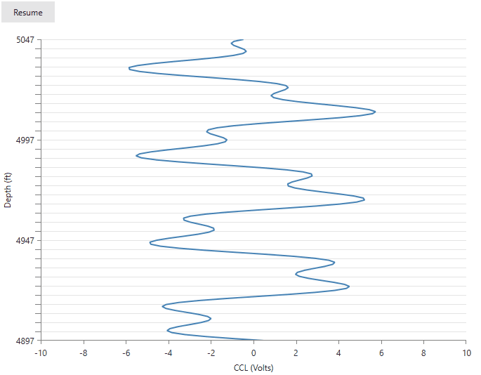

## Environment

| Version | Product | Author | 
| ---- | ---- | ---- | 
| 2026.3.1007| RadChartView |[Desislava Yordanova](https://www.telerik.com/blogs/author/desislava-yordanova)| 

## Description

Display a live voltage-versus-depth chart with a moving Y-axis window that always spans 150 depth units. As new samples arrive, move existing points downward with the axis ticks and gridlines without changing the recorded depths.

>caption Live depth chart with a fixed-span Y axis



## Solution

To create a live or running chart, move the visible axis range as new samples arrive. Keep `Maximum - Minimum` constant to preserve the visible span. For example, a 150-unit depth window can move from 2950-3100 to 2960-3110 without changing its size.

Keep each sample's recorded depth unchanged. Updating the range recalculates the screen positions of existing points. Adding points without moving a fixed range does not shift the old points.

For a non-inverted vertical axis, increasing both bounds moves existing visible points downward. Setting `IsInverse="True"` reverses that direction. Choose the direction according to whether depth increases or decreases in your application. See [Invert Axis Range]().

>important This example uses `RadCartesianChart` and `LinearAxis`. `LinearAxis` does not expose `AutoRange`. Set `Minimum` and `Maximum` directly instead of applying classic RadChart axis settings.

For a moving numeric range, keep `TickOrigin` fixed to anchor ticks to absolute values. For example, `TickOrigin="0"` with `MajorStep="50"` aligns major ticks with multiples of 50. Do not update the tick origin to match every new minimum if ticks must move with the recorded values. Without a fixed origin, tick positions can remain fixed relative to the window while their labels change.

### Creating the Live Chart

Create a WPF application named `ScrollingDepthChart` and follow the package and licensing setup in [Getting Started](). Use a Telerik UI for WPF release that supports the [minor ticks and grid lines]() shown in this example.

Replace `MainWindow.xaml` with the following markup. Keep the generated application files and their `StartupUri="MainWindow.xaml"` setting. The example uses two numeric axes and a `ScatterLineSeries`, so each sample has an independent voltage and depth coordinate.

#### Chart with a moving depth window

```xml
<Window x:Class="ScrollingDepthChart.MainWindow"
		xmlns="http://schemas.microsoft.com/winfx/2006/xaml/presentation"
		xmlns:x="http://schemas.microsoft.com/winfx/2006/xaml"
		xmlns:telerik="http://schemas.telerik.com/2008/xaml/presentation"
		Title="Live depth chart" Width="720" Height="600">
	<Grid Margin="16">
		<Grid.RowDefinitions>
			<RowDefinition Height="Auto" />
			<RowDefinition Height="*" />
		</Grid.RowDefinitions>

		<Button x:Name="PauseButton" Content="Pause" Click="OnPauseClick"
				HorizontalAlignment="Left" Padding="16,6" Margin="0,0,0,12" />

		<telerik:RadCartesianChart x:Name="DepthChart" Grid.Row="1">
			<telerik:RadCartesianChart.HorizontalAxis>
				<telerik:LinearAxis Minimum="-10" Maximum="10"
									MajorStep="2" Title="CCL (Volts)" />
			</telerik:RadCartesianChart.HorizontalAxis>
			<telerik:RadCartesianChart.VerticalAxis>
				<telerik:LinearAxis x:Name="DepthAxis"
									Minimum="2950" Maximum="3100"
									MajorStep="50" TickOrigin="0"
									IsInverse="False"
									MinorTicksPerMajor="10" MinorTickLength="8"
									LabelFormat="F0" Title="Depth (ft)">
					<telerik:LinearAxis.MinorTickStyle>
						<Style TargetType="Rectangle">
							<Setter Property="Fill" Value="Gray" />
						</Style>
					</telerik:LinearAxis.MinorTickStyle>
				</telerik:LinearAxis>
			</telerik:RadCartesianChart.VerticalAxis>
			<telerik:RadCartesianChart.Grid>
				<telerik:CartesianChartGrid MajorLinesVisibility="Y"
											 MinorLinesVisibility="Y" />
			</telerik:RadCartesianChart.Grid>
			<telerik:RadCartesianChart.Series>
				<telerik:ScatterLineSeries ItemsSource="{Binding CclData}"
										   XValueBinding="CclVoltage"
										   YValueBinding="Depth"
										   Stroke="SteelBlue" StrokeThickness="2" />
			</telerik:RadCartesianChart.Series>
		</telerik:RadCartesianChart>
	</Grid>
</Window>
```

The fixed `TickOrigin` keeps ticks aligned with absolute depth values as the bounds change. `MajorStep="50"` controls the major tick interval, not the visible span. `MinorTicksPerMajor="10"` creates eleven subdivisions per major interval, giving a minor spacing of `50 / 11` units. Use nine minor ticks if you need five-unit subdivisions instead.

Replace `MainWindow.xaml.cs` with the following code. It includes the sample data class and all event handlers used by the example.

#### Appending samples without changing historical depths

```C#
using System;
using System.Collections.ObjectModel;
using System.Windows;
using System.Windows.Threading;

namespace ScrollingDepthChart
{
	public partial class MainWindow : Window
	{
		private const double FirstDepth = 2950;
		private const double VisibleDepthSpan = 150;
		private const double SampleDepthStep = 1;

		private readonly DispatcherTimer timer;
		private double latestDepth;
		private bool isPaused;

		public MainWindow()
		{
			InitializeComponent();
			DataContext = this;

			latestDepth = FirstDepth + VisibleDepthSpan;
			for (double depth = FirstDepth; depth <= latestDepth; depth += SampleDepthStep)
			{
				CclData.Add(CreateSample(depth));
			}

			UpdateDepthWindow();

			timer = new DispatcherTimer
			{
				Interval = TimeSpan.FromMilliseconds(200)
			};
			timer.Tick += OnTimerTick;

			Loaded += OnLoaded;
			Unloaded += OnUnloaded;
			Closed += OnClosed;
		}

		public ObservableCollection<DepthSample> CclData { get; } =
			new ObservableCollection<DepthSample>();

		private static DepthSample CreateSample(double depth)
		{
			double offset = depth - FirstDepth;
			double voltage = 4 * Math.Sin(offset * 0.15) + 2 * Math.Cos(offset * 0.43);
			return new DepthSample(voltage, depth);
		}

		private void OnTimerTick(object sender, EventArgs eventArgs)
		{
			latestDepth += SampleDepthStep;
			CclData.Add(CreateSample(latestDepth));
			UpdateDepthWindow();

			double minimumDepth = latestDepth - VisibleDepthSpan;
			while (CclData.Count > 2 && CclData[1].Depth < minimumDepth)
			{
				CclData.RemoveAt(0);
			}
		}

		private void UpdateDepthWindow()
		{
			DepthAxis.Maximum = latestDepth;
			DepthAxis.Minimum = latestDepth - VisibleDepthSpan;
		}

		private void OnPauseClick(object sender, RoutedEventArgs eventArgs)
		{
			isPaused = !isPaused;
			PauseButton.Content = isPaused ? "Resume" : "Pause";

			if (isPaused)
			{
				timer.Stop();
			}
			else
			{
				timer.Start();
			}
		}

		private void OnLoaded(object sender, RoutedEventArgs eventArgs)
		{
			if (!isPaused)
			{
				timer.Start();
			}
		}

		private void OnUnloaded(object sender, RoutedEventArgs eventArgs)
		{
			timer.Stop();
		}

		private void OnClosed(object sender, EventArgs eventArgs)
		{
			timer.Stop();
			timer.Tick -= OnTimerTick;
		}
	}

	public sealed class DepthSample
	{
		public DepthSample(double cclVoltage, double depth)
		{
			CclVoltage = cclVoltage;
			Depth = depth;
		}

		public double CclVoltage { get; }

		public double Depth { get; }
	}
}
```

The timer appends one synthetic sample every 200 milliseconds. After the first update, the window changes from 2950-3100 to 2951-3101. The new sample enters at the top, and existing samples move down without changing their stored depths. This example demonstrates discrete range updates, not interpolated animation.

The removal loop keeps one sample below the lower bound so the line can continue across the viewport boundary. It limits the display collection without changing retained samples. A 150-unit range is not a limit of 150 data points. Store a separate history if you need to retain all measurements.

`ObservableCollection` notifies the series when samples are added or removed. The sample objects are read-only, so they do not need item-property notifications. If your application edits an existing sample, implement `INotifyPropertyChanged` on that object as described in [Create Data-Bound Chart]().

For a real data feed, replace the synthetic generator with the incoming voltage and depth. Update the collection and both axis bounds on the UI dispatcher. The example assumes increasing, ordered depths; decreasing or out-of-order depths need a corresponding window and retention policy. Do not change measured depths to simulate movement.

### Verifying Point Movement

Build and run the example with your target Telerik release. Check that voltage features move downward, the displayed depth span stays at 150 units, and ticks remain aligned with their depth values. Check **Pause**, **Resume**, and window closure to verify the timer lifecycle.

To isolate range movement from data updates:

1. Pause the example immediately after startup, while the sample at depth 3000 remains in `CclData`.
2. In the debugger, set `DepthAxis.Minimum` to 2950 and `DepthAxis.Maximum` to 3100. Allow the UI to render, then note the sample's screen position.
3. Without modifying the collection or any sample, set `DepthAxis.Maximum` to 3110 and `DepthAxis.Minimum` to 2960. Allow the UI to render again.
4. With `IsInverse="False"` and an unchanged plot size, the same sample moves downward by approximately one-fifteenth of the plot height. Its stored depth remains 3000.

If gridlines change but an identifiable sample does not move, verify that you update the axis used by the series. Inspect the axis's `ActualRange` and `ActualVisibleRange` after layout, check binding errors, and reproduce without additional series axes or zoom settings. A stationary series is not a reason to rewrite historical measurements.

## See Also

* [Controlling Axis Range]()
* [Minor Ticks and Stripes]()