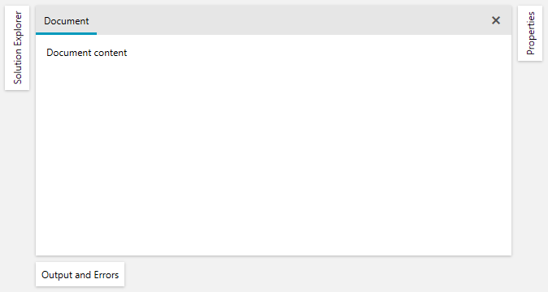
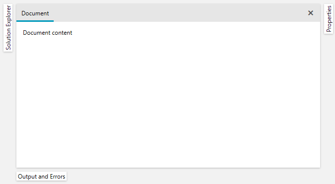

## Environment

| Version | Product | Author | 
| ---- | ---- | ---- | 
| 2026.3.1007| RadDocking |[Desislava Yordanova](https://www.telerik.com/blogs/author/desislava-yordanova)| 

## Description

Make the tab buttons of auto-hidden panes more compact and use different header templates when panes are pinned or unpinned. For a layout with left, right, and bottom panes, customize the visible tabs without changing the size of the flyouts that open when you activate them.

The following images compare the default and compact auto-hide tab headers.

| Default Tab Headers | Compact Tab Headers |
| --- | --- |
|  |  |

## Solution

Use `RadPane.HeaderTemplate` to customize tab content. Switch templates with a style trigger on `IsPinned` to apply compact content only to unpinned panes. Use `Title` and `TitleTemplate` separately for the title displayed above the pane content.

>important `AutoHideWidth` and `AutoHideHeight` size the opened flyout, not the closed tab button. `FlyoutMinLength` sets a flyout minimum, not a tab minimum. The control also constrains the flyout size to the available space when `ConstraintAutoHideArea` is enabled.

### Use Different Templates for Pinned and Unpinned Tabs

1. Define a normal header template and a compact header template. Constrain the compact text and provide a tooltip so users can read the full header.
2. Set the normal template through a `RadPane` style setter. Use an `IsPinned=False` trigger to select the compact template and reduce padding. Do not also set `HeaderTemplate` directly on the panes, because a local value takes precedence over the style trigger.
3. Apply the style to the tool panes. Place each pane in a `RadPaneGroup` and a `RadSplitContainer`, and use the split container's `InitialPosition` to select its docking side.

The following example assumes an existing WPF project configured with Telerik Xaml binaries. With NoXaml binaries and the required theme dictionaries merged, add `BasedOn="{StaticResource RadPaneStyle}"` to `ToolPaneStyle` to preserve the theme's pane template.

#### Use compact auto-hide headers in a three-sided layout

```XAML
<Grid xmlns="http://schemas.microsoft.com/winfx/2006/xaml/presentation"
      xmlns:x="http://schemas.microsoft.com/winfx/2006/xaml"
      xmlns:telerik="http://schemas.telerik.com/2008/xaml/presentation">
    <Grid.Resources>
        <DataTemplate x:Key="NormalTabHeaderTemplate">
            <TextBlock Text="{Binding}" />
        </DataTemplate>

        <DataTemplate x:Key="CompactTabHeaderTemplate">
            <TextBlock Text="{Binding}"
                       MaxWidth="100"
                       TextWrapping="NoWrap"
                       TextTrimming="CharacterEllipsis"
                       ToolTip="{Binding}" />
        </DataTemplate>

        <DataTemplate x:Key="PaneTitleTemplate">
            <TextBlock Text="{Binding}" />
        </DataTemplate>

        <Style x:Key="ToolPaneStyle" TargetType="telerik:RadPane">
            <Setter Property="HeaderTemplate"
                    Value="{StaticResource NormalTabHeaderTemplate}" />
            <Setter Property="TitleTemplate"
                    Value="{StaticResource PaneTitleTemplate}" />
            <Style.Triggers>
                <Trigger Property="IsPinned" Value="False">
                    <Setter Property="HeaderTemplate"
                            Value="{StaticResource CompactTabHeaderTemplate}" />
                    <Setter Property="Padding" Value="3,1" />
                    <Setter Property="MinWidth" Value="0" />
                    <Setter Property="MinHeight" Value="0" />
                </Trigger>
            </Style.Triggers>
        </Style>
    </Grid.Resources>

    <telerik:RadDocking>
        <telerik:RadDocking.DocumentHost>
            <telerik:RadSplitContainer>
                <telerik:RadPaneGroup>
                    <telerik:RadPane Header="Document">
                        <TextBlock Text="Document content" Margin="8" />
                    </telerik:RadPane>
                </telerik:RadPaneGroup>
            </telerik:RadSplitContainer>
        </telerik:RadDocking.DocumentHost>

        <telerik:RadSplitContainer InitialPosition="DockedLeft">
            <telerik:RadPaneGroup>
                <telerik:RadPane Header="Solution Explorer"
                                 Title="Solution Explorer"
                                 IsPinned="False"
                                 AutoHideWidth="240"
                                 Style="{StaticResource ToolPaneStyle}">
                    <TextBlock Text="Solution items" Margin="8" />
                </telerik:RadPane>
            </telerik:RadPaneGroup>
        </telerik:RadSplitContainer>

        <telerik:RadSplitContainer InitialPosition="DockedRight">
            <telerik:RadPaneGroup>
                <telerik:RadPane Header="Properties"
                                 Title="Properties"
                                 IsPinned="False"
                                 AutoHideWidth="240"
                                 Style="{StaticResource ToolPaneStyle}">
                    <TextBlock Text="Property values" Margin="8" />
                </telerik:RadPane>
            </telerik:RadPaneGroup>
        </telerik:RadSplitContainer>

        <telerik:RadSplitContainer InitialPosition="DockedBottom">
            <telerik:RadPaneGroup>
                <telerik:RadPane Header="Output and Errors"
                                 Title="Output and Errors"
                                 IsPinned="False"
                                 AutoHideHeight="160"
                                 Style="{StaticResource ToolPaneStyle}">
                    <TextBlock Text="Build output" Margin="8" />
                </telerik:RadPane>
            </telerik:RadPaneGroup>
        </telerik:RadSplitContainer>
    </telerik:RadDocking>
</Grid>
```

The unpinned tabs use the compact template. Pinning a pane restores the normal tab template and removes the compact padding setters. The separate title template does not inherit the compact text-width constraint. The compact tab template remains active while an unpinned pane's flyout is open: `IsPinned` describes the pin state, not whether the popup is currently visible.

### Account for Tab Orientation and Theme Sizing

The compact template limits the text width before the tab host applies rotation. With vertically oriented side tabs, that text width contributes to the tab's vertical length, not the side strip's horizontal thickness. Font metrics, padding, and the control template determine the remaining dimensions.

Reducing `MinWidth` and `MinHeight` on the pane does not remove minimum sizes inside its control template. For example, the Fluent pane template contains a header presenter with `MinHeight="18"`. Preserve the active theme's template and change its internal constraints only when the header template and padding do not provide the required result. See [Styling the RadPane]().

To display horizontal text inside a vertically oriented tab, you can replace `CompactTabHeaderTemplate` with the following template. It counter-rotates the text by 90 degrees when the inherited `RadPane.TabOrientation` is `Vertical`. This compensates for the -90-degree rotation performed by the tab presenter used in the Fluent templates. Do not apply this compensation to a custom template that uses a different rotation mechanism.

#### Keep auto-hide tab text horizontal with the Fluent tab presenter

```XAML
<DataTemplate x:Key="CompactTabHeaderTemplate">
    <TextBlock Text="{Binding}"
               MaxWidth="100"
               TextWrapping="NoWrap"
               TextTrimming="CharacterEllipsis"
               ToolTip="{Binding}">
        <TextBlock.Style>
            <Style TargetType="TextBlock">
                <Style.Triggers>
                    <DataTrigger Binding="{Binding TabOrientation, RelativeSource={RelativeSource AncestorType={x:Type telerik:RadPane}}}"
                                 Value="Vertical">
                        <Setter Property="LayoutTransform">
                            <Setter.Value>
                                <RotateTransform Angle="90" />
                            </Setter.Value>
                        </Setter>
                    </DataTrigger>
                </Style.Triggers>
            </Style>
        </TextBlock.Style>
    </TextBlock>
</DataTemplate>
```

Use the same namespace declarations as in the layout example. `RadPane.TabOrientation` is read-only; the trigger reads it instead of assigning it. Horizontal labels can widen the left and right auto-hide strips. Keep vertical labels or use shorter header content when a narrow side strip is the priority.

Check the layout with your theme on all three docking sides, with long headers, and after pinning and unpinning. Verify tab dimensions separately from flyout dimensions.

## See Also

- [Pinned/Unpinned Panes]()
- [Add an Icon to the RadPane Header]()
- [Styling the Pane Header]()
- [Split Container]()