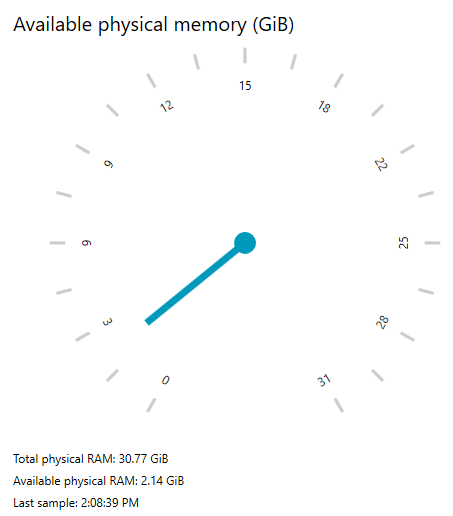

## Environment

| Version | Product | Author | 
| ---- | ---- | ---- | 
| 2026.3.1007| RadRadialGauge |[Desislava Yordanova](https://www.telerik.com/blogs/author/desislava-yordanova)| 

## Description

Display the computer's total physical memory and update its currently available physical memory in a radial gauge. Use total RAM as the scale maximum and available RAM as the indicator value.

This scenario concerns the computer, not an individual process. A process-memory reading does not provide the computer's total or available RAM.

>caption Total and available computer memory



## Solution

Read `TotalPhysicalMemory` and `AvailablePhysicalMemory` from `Microsoft.VisualBasic.Devices.ComputerInfo`. Both properties return byte counts. The class is provided by the .NET Windows desktop framework. The gauge displays the supplied values rather than measuring memory itself.

| Measurement | Use in this example |
|---|---|
| Total physical memory | Sets the radial scale's `Max` and the total-memory label. |
| Currently available physical memory | Sets the needle's `Value` and the available-memory label on each sample. |

Convert both measurements to the same unit before assigning them to the gauge. This example uses gibibytes (GiB), where one GiB equals `1024 * 1024 * 1024` bytes. Division by a `double` preserves the fractional part.

>important Total physical RAM is not a promise that a single process can allocate that amount. Available RAM changes as the system workload changes. Do not use an image-history buffer budget or a numeric editor's maximum as a computer-memory measurement.

### Preparing the Project

Create a C# WPF application named `MemoryGauge` targeting `net10.0-windows`. Install a Telerik UI for WPF release that supports your target framework and follow the package and licensing setup in [creating a radial gauge](). The example uses the `Telerik.Windows.Controls.DataVisualization.for.Wpf.Xaml` package.

`ComputerInfo` is in `Microsoft.VisualBasic.Forms.dll`, which belongs to the Windows Forms framework references. Enable `UseWindowsForms` alongside `UseWPF` to make that assembly available. The application remains a WPF application and does not create any Windows Forms controls.

Merge these properties into your project file. Preserve the package references added during Telerik setup. Disable implicit usings to avoid ambiguous WPF and Windows Forms type names, including `Application` in the generated application class.

__Project settings for the WPF memory gauge__

```xml
<PropertyGroup>
  <OutputType>WinExe</OutputType>
  <TargetFramework>net10.0-windows</TargetFramework>
  <UseWPF>true</UseWPF>
  <UseWindowsForms>true</UseWindowsForms>
  <ImplicitUsings>disable</ImplicitUsings>
  <Nullable>enable</Nullable>
</PropertyGroup>
```

Keep the generated `App.xaml` and its `StartupUri="MainWindow.xaml"` setting. The namespace in both replacement files below must match the project namespace.

### Defining the Gauge

Replace `MainWindow.xaml` with the following markup. The initial scale maximum is a placeholder that the first successful memory sample replaces.

#### Radial gauge for available physical memory

```xml
<Window x:Class="MemoryGauge.MainWindow"
        xmlns="http://schemas.microsoft.com/winfx/2006/xaml/presentation"
        xmlns:x="http://schemas.microsoft.com/winfx/2006/xaml"
        xmlns:telerik="http://schemas.telerik.com/2008/xaml/presentation"
        Title="Computer Memory" Width="520" Height="580"
        MinWidth="420" MinHeight="500">
    <Grid Margin="20">
        <Grid.RowDefinitions>
            <RowDefinition Height="Auto" />
            <RowDefinition Height="*" />
            <RowDefinition Height="Auto" />
            <RowDefinition Height="Auto" />
            <RowDefinition Height="Auto" />
        </Grid.RowDefinitions>

        <TextBlock Text="Available physical memory (GiB)"
                   FontSize="20" TextWrapping="Wrap" Margin="0,0,0,12" />

        <telerik:RadRadialGauge x:Name="MemoryGaugeControl"
                               Grid.Row="1" Visibility="Hidden">
            <telerik:RadialScale x:Name="MemoryScale" Min="0" Max="1">
                <telerik:RadialScale.Indicators>
                    <telerik:Needle x:Name="AvailableMemoryNeedle" />
                    <telerik:Pinpoint />
                </telerik:RadialScale.Indicators>
            </telerik:RadialScale>
        </telerik:RadRadialGauge>

        <TextBlock x:Name="TotalMemoryText" Grid.Row="2"
                   Text="Total physical RAM: waiting for a sample"
                   TextWrapping="Wrap" Margin="0,12,0,0" />
        <TextBlock x:Name="AvailableMemoryText" Grid.Row="3"
                   Text="Available physical RAM: waiting for a sample"
                   TextWrapping="Wrap" Margin="0,6,0,0" />
        <TextBlock x:Name="StatusText" Grid.Row="4"
                   TextWrapping="Wrap" Margin="0,6,0,0" />
    </Grid>
</Window>
```

The needle represents available memory, not consumed memory. It moves toward the lower end of the scale as less physical memory becomes available.

### Sampling Memory on the UI Thread

Replace `MainWindow.xaml.cs` with the following code. It samples immediately when the window loads, then approximately once per second through a `DispatcherTimer`.

#### Read computer memory and update the gauge

```C#
using System;
using System.ComponentModel;
using System.Windows;
using System.Windows.Threading;
using Microsoft.VisualBasic.Devices;

namespace MemoryGauge
{
    public partial class MainWindow : Window
    {
        private const double BytesPerGiB = 1024d * 1024d * 1024d;
        private readonly DispatcherTimer timer;

        public MainWindow()
        {
            InitializeComponent();

            this.timer = new DispatcherTimer
            {
                Interval = TimeSpan.FromSeconds(1)
            };
            this.timer.Tick += this.OnTimerTick;

            this.Loaded += this.OnLoaded;
            this.Unloaded += this.OnUnloaded;
            this.Closed += this.OnClosed;
        }

        private void OnLoaded(object sender, RoutedEventArgs args)
        {
            this.UpdateMemory();
            this.timer.Start();
        }

        private void OnUnloaded(object sender, RoutedEventArgs args)
        {
            this.timer.Stop();
        }

        private void OnClosed(object? sender, EventArgs args)
        {
            this.timer.Stop();
            this.timer.Tick -= this.OnTimerTick;
        }

        private void OnTimerTick(object? sender, EventArgs args)
        {
            this.UpdateMemory();
        }

        private void UpdateMemory()
        {
            try
            {
                var computerInfo = new ComputerInfo();
                ulong totalBytes = computerInfo.TotalPhysicalMemory;
                ulong availableBytes = computerInfo.AvailablePhysicalMemory;

                if (totalBytes == 0 || availableBytes > totalBytes)
                {
                    this.ShowUnavailable("The memory sample is invalid. Retrying on the next tick.");
                    return;
                }

                double totalGiB = totalBytes / BytesPerGiB;
                double availableGiB = availableBytes / BytesPerGiB;

                this.MemoryScale.Max = totalGiB;
                this.AvailableMemoryNeedle.Value = availableGiB;
                this.TotalMemoryText.Text = $"Total physical RAM: {totalGiB:F2} GiB";
                this.AvailableMemoryText.Text = $"Available physical RAM: {availableGiB:F2} GiB";
                this.StatusText.Text = $"Last sample: {DateTime.Now:T}";
                this.MemoryGaugeControl.Visibility = Visibility.Visible;
            }
            catch (Win32Exception exception)
            {
                this.ShowUnavailable($"Cannot read memory status: {exception.Message}");
            }
        }

        private void ShowUnavailable(string message)
        {
            this.MemoryGaugeControl.Visibility = Visibility.Hidden;
            this.TotalMemoryText.Text = "Total physical RAM: unavailable";
            this.AvailableMemoryText.Text = "Available physical RAM: unavailable";
            this.StatusText.Text = message;
        }
    }
}
```

The timer updates WPF controls on the UI thread. It stops when the window unloads, and its tick handler is removed when the window closes. If a memory query fails, the example hides the previous reading and retries on the next tick instead of displaying a stale value as current.

This example assigns the indicator value directly, as in the Gauge live-update demos. For an MVVM implementation, expose the sampled values through properties with change notification and bind the scale maximum and indicator value to those properties.

### Checking the Result

Confirm that the first successful sample replaces the initial scale maximum with total physical RAM in GiB. The available-memory label and needle must use the same sampled value, between zero and the scale maximum.

Observe several samples as other applications run. Available RAM can change between samples. It is not the amount of memory used by this application. The one-second timer interval is a requested polling interval, not a hard real-time guarantee.

>note The memory API and byte units were checked against the installed .NET 10 Windows desktop reference documentation. The combined Telerik example has not been build- or runtime-validated. Validate it with your Telerik package version before deployment.

## See Also

* [Create a WPF radial gauge]()
* [Gauge indicator values and refresh behavior]()
* [Gauge scale configuration]()