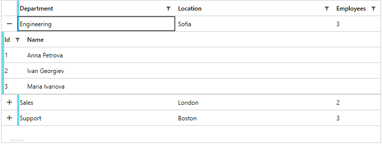

## Environment

| Version | Product | Author | 
| ---- | ---- | ---- | 
| 2026.4.1110| RadGridView |[Desislava Yordanova](https://www.telerik.com/blogs/author/desislava-yordanova)| 

## Description

Expand the selected parent row in a hierarchical `RadGridView` and collapse the other parent rows when the selection changes.

>caption Selecting Engineering expands its hierarchy and displays employee IDs and names while Sales and Support remain collapsed.



## Solution

The C# example populates the parent grid and handles selection changes to expand the selected hierarchy row. The XAML defines the department-to-employee relation and the child-grid columns.

The following steps describe the C# data and selection handler, followed by the XAML hierarchy and child grid:

1. In the code-behind, populate `DepartmentsGrid` with department and employee data. The `SelectionChanged` handler calls `CollapseAllHierarchyItems()` before checking `e.OriginalSource`. For a parent-grid event with a selected item, it expands the selected `GridViewRow`. If the row is not expanded, it calls `ExpandHierarchyItem()`. A child-grid event reaches the collapse call before the handler returns.

```C#
using System;
using System.Collections.Generic;
using System.Windows;
using Telerik.Windows.Controls;
using Telerik.Windows.Controls.GridView;

namespace WPFSample
{
    public partial class HierarchicalGridWindow : Window
    {
        public HierarchicalGridWindow()
        {
            InitializeComponent();
            DepartmentsGrid.ItemsSource = new List<Department>
            {
                new Department("Engineering", "Sofia", new List<Employee>
                {
                    new Employee(1, "Anna Petrova", "Software Engineer", new DateTime(2019, 3, 12)),
                    new Employee(2, "Ivan Georgiev", "Senior Engineer", new DateTime(2016, 7, 1)),
                    new Employee(3, "Maria Ivanova", "QA Engineer", new DateTime(2021, 1, 18))
                }),
                new Department("Sales", "London", new List<Employee>
                {
                    new Employee(4, "John Smith", "Account Manager", new DateTime(2018, 5, 23)),
                    new Employee(5, "Emma Brown", "Sales Director", new DateTime(2014, 11, 3))
                }),
                new Department("Support", "Boston", new List<Employee>
                {
                    new Employee(6, "Michael Lee", "Support Specialist", new DateTime(2020, 9, 14)),
                    new Employee(7, "Sarah Davis", "Support Lead", new DateTime(2017, 2, 27)),
                    new Employee(8, "David Wilson", "Support Specialist", new DateTime(2022, 6, 6))
                })
            };
        }

        private void RadGridView_SelectionChanged(object sender, SelectionChangeEventArgs e)
        {
            var grid = (RadGridView)sender;
            grid.CollapseAllHierarchyItems();
            // SelectionChanged is a routed event, so ignore notifications bubbling up from the nested child grids.
            if (e.OriginalSource != grid || grid.SelectedItem == null)
            {
                return;
            }

            if (grid.ItemContainerGenerator.ContainerFromItem(grid.SelectedItem) is GridViewRow row)
            {
                row.IsExpanded = true;
            }
            else
            {
                // Row container isn't realized (UI virtualization), so expand through the grid.
                grid.ExpandHierarchyItem(grid.SelectedItem);
            }
        }
    }

    public record Department(string Name, string Location, List<Employee> Employees);

    public record Employee(int Id, string Name, string Title, DateTime HireDate);
}
```

2. In the window XAML, define the relation between each department and its employees. The child grid displays the employee ID, name, title, and hire date. The GIF shows the ID and name columns.

```XAML
<Window x:Class="WPFSample.HierarchicalGridWindow"
        xmlns="http://schemas.microsoft.com/winfx/2006/xaml/presentation"
        xmlns:x="http://schemas.microsoft.com/winfx/2006/xaml"
        xmlns:telerik="http://schemas.telerik.com/2008/xaml/presentation"
        Title="RadGridView Hierarchy Example"
        Width="800" Height="500"
        WindowStartupLocation="CenterScreen">
    <Grid Margin="16">
        <telerik:RadGridView x:Name="DepartmentsGrid"
                             AutoGenerateColumns="False"
                             IsReadOnly="True"
                             RowIndicatorVisibility="Collapsed"
                             ShowGroupPanel="False"
                             SelectionChanged="RadGridView_SelectionChanged">
            <telerik:RadGridView.ChildTableDefinitions>
                <telerik:GridViewTableDefinition>
                    <telerik:GridViewTableDefinition.Relation>
                        <telerik:PropertyRelation ParentPropertyName="Employees" />
                    </telerik:GridViewTableDefinition.Relation>
                </telerik:GridViewTableDefinition>
            </telerik:RadGridView.ChildTableDefinitions>

            <telerik:RadGridView.Columns>
                <telerik:GridViewDataColumn Header="Department" DataMemberBinding="{Binding Name}" Width="*" />
                <telerik:GridViewDataColumn Header="Location" DataMemberBinding="{Binding Location}" Width="*" />
                <telerik:GridViewDataColumn Header="Employees" DataMemberBinding="{Binding Employees.Count}" Width="Auto" />
            </telerik:RadGridView.Columns>

            <telerik:RadGridView.HierarchyChildTemplate>
                <DataTemplate>
                    <telerik:RadGridView ItemsSource="{Binding Employees}"
                                         AutoGenerateColumns="False"
                                         IsReadOnly="True"
                                         RowIndicatorVisibility="Collapsed"
                                         ShowGroupPanel="False">
                        <telerik:RadGridView.Columns>
                            <telerik:GridViewDataColumn Header="Id" DataMemberBinding="{Binding Id}" Width="Auto" />
                            <telerik:GridViewDataColumn Header="Name" DataMemberBinding="{Binding Name}" Width="*" />
                            <telerik:GridViewDataColumn Header="Title" DataMemberBinding="{Binding Title}" Width="*" />
                            <telerik:GridViewDataColumn Header="Hire Date" DataMemberBinding="{Binding HireDate}" DataFormatString="{}{0:d}" Width="Auto" />
                        </telerik:RadGridView.Columns>
                    </telerik:RadGridView>
                </DataTemplate>
            </telerik:RadGridView.HierarchyChildTemplate>
        </telerik:RadGridView>
    </Grid>
</Window>
```

Select a parent row to expand its hierarchy and collapse the other parent rows. If no parent row is selected, the sample collapses all parent rows.

## See Also

* [setting up a hierarchical RadGridView]()
* [binding the expanded state of hierarchy rows]()
