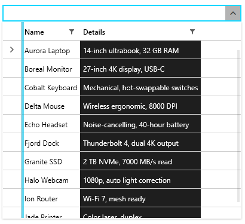
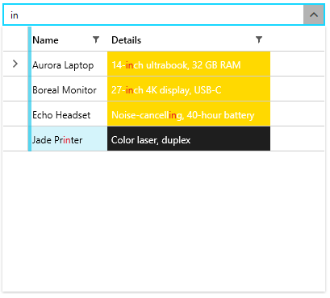

## Environment

| Version | Product | Author | 
| ---- | ---- | ---- | 
| 2026.3.1007| RadMultiColumnComboBox |[Desislava Yordanova](https://www.telerik.com/blogs/author/desislava-yordanova)| 

## Description

Customize the background and tooltip of a RadMultiColumnComboBox drop-down column while preserving search highlighting. Distinguish the full cell background from matched-text styling, and account for custom cell templates and Fluent theme states.

The following images show the customized Details column before and during a search.

| Custom cell background | Custom search-match background |
| --- | --- |
|  |  |

## Solution

The RadMultiColumnComboBox drop-down displays `GridViewCell` elements. To change the full cell background, assign a `CellStyle` to the corresponding column. A `Border` or `Grid` inside a `CellTemplate` paints only that element's area, not the cell's padding or its separate state layers.

Choose the styling property according to the intended result:

* `GridViewCell.Background` sets the normal cell background.
* `GridViewCell.HighlightedBackground` sets the background used when the cell has a search match.
* `RadHighlightTextBlock.HighlightBackground` colors matched text ranges in that text block. It does not set the surrounding GridView cell's background or establish the cell's search-match state.

### Keep the Default Cell Renderer

If you only need to display a bound value, show a tooltip, and change the cell background, leave `CellTemplate` and `CellTemplateSelector` unset. This keeps the default renderer that connects search matches to the cell's highlighted state.

The following example assumes that the data context exposes an `Items` collection with `Name` and `YourPropertyName` string properties. It styles the second column and shows its cell value in a tooltip, without replacing the cell content.

The example uses NoXaml binaries with the Fluent theme resource dictionaries already merged and the dark variation selected. For setup instructions, see the [Fluent theme]() article. If you use Xaml binaries with `StyleManager`, omit `BasedOn="{StaticResource GridViewCellStyle}"` from the style instead of referencing that NoXaml style resource.

__Style the second column without a custom cell template__

```xml
<Grid xmlns:x="http://schemas.microsoft.com/winfx/2006/xaml"
      xmlns:telerik="http://schemas.telerik.com/2008/xaml/presentation"
      xmlns:grid="clr-namespace:Telerik.Windows.Controls.GridView;assembly=Telerik.Windows.Controls.GridView">
    <Grid.Resources>
        <Style x:Key="SecondColumnCellStyle"
               TargetType="grid:GridViewCell"
               BasedOn="{StaticResource {x:Type grid:GridViewCell}}">
            <Setter Property="Background" Value="#FF1E1E1E" />
            <Setter Property="Foreground" Value="White" />
            <Setter Property="HighlightedBackground" Value="#FFD900" />
            <Setter Property="ToolTip"
                    Value="{Binding Value, RelativeSource={RelativeSource Self}}" />
        </Style>
    </Grid.Resources>

    <telerik:RadMultiColumnComboBox AutoCompleteMode="Search"
                                    DisplayMemberPath="Name">
        <telerik:RadMultiColumnComboBox.ItemsSourceProvider>
            <telerik:GridViewItemsSourceProvider ItemsSource="{Binding Items}"
                                                AutoGenerateColumns="False">
                <telerik:GridViewItemsSourceProvider.Columns>
                    <telerik:GridViewDataColumn Header="Name"
                                               DataMemberBinding="{Binding Name}" />
                    <telerik:GridViewDataColumn Header="Details"
                                               DataMemberBinding="{Binding YourPropertyName}"
                                               CellStyle="{StaticResource SecondColumnCellStyle}"
                                               IsSearchable="True" />
                </telerik:GridViewItemsSourceProvider.Columns>
            </telerik:GridViewItemsSourceProvider>
        </telerik:RadMultiColumnComboBox.ItemsSourceProvider>
    </telerik:RadMultiColumnComboBox>
</Grid>
```

With `AutoCompleteMode="Search"`, matching text in the second column participates in filtering and the default renderer supplies its match highlighting. The tooltip binding reads the cell's `Value`, which comes from `YourPropertyName` through `DataMemberBinding`. These example colors are local overrides, not Fluent defaults. Use your application's theme resources when you need colors to follow palette changes.

Selection and mouse-over visuals use separate layers. If you need to customize those states too, see the `SelectedBackground` and `MouseOverBackground` guidance in [Styling Cells](). Do not assume that the normal or highlighted background replaces every state visual.

### Use Custom Cell Templates

Setting `CellTemplate` changes the cell's rendering, not whether the provider includes the bound column in search. Keep `DataMemberBinding` pointed at the searchable property and check `IsSearchable` separately. Adding a tooltip does not enable filtering or restore search highlighting.

When a custom layout is necessary, integrate it with the shared `SearchStateManager`. GridView's `Telerik.Windows.Controls.GridView.HighlightTextBlock` is distinct from `RadHighlightTextBlock`: it evaluates the grid's search criteria and exposes `ContainsMatch`. The default column renderer binds that value to the cell's `IsHighlighted` dependency property. Custom rendering needs equivalent match-state integration before `HighlightedBackground` can represent matches. For the existing custom-column pattern, see the custom-highlighting guidance in [GridView Search as You Type]().

The dropdown does not provide a public `SearchPanel.SearchText` property path. It shares the provider's search state with its GridView. Bindings that look for a `RadAutoSuggestBox` ancestor do not target this control's search mechanism.

Keep custom template content transparent where the cell's state background must remain visible. An opaque background inside the template can cover the cell's highlighted background. Define a tooltip explicitly in the custom content when needed. The automatic [trimmed-text tooltip]() behavior does not supply it for custom cell templates.

## See Also

* [Search as You Type in MultiColumnComboBox]()