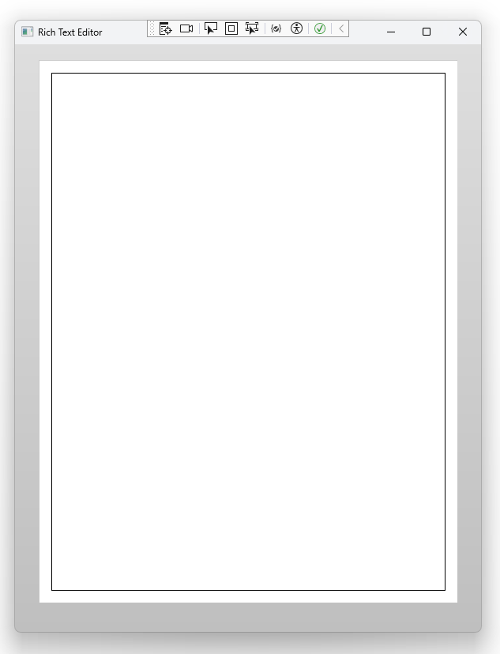

## Environment

| Version | Product | Author | 
| ---- | ---- | ---- | 
| 2026.4.1110| RadRichTextBox |[Desislava Yordanova](https://www.telerik.com/blogs/author/desislava-yordanova)| 

## Description

Use a custom UI layer to draw a border around each page displayed by a paged `RadRichTextBox`. The layer positions a WPF `Rectangle` from the document's section layout boxes and page settings.

With the supplied constants, the layer draws a black border with a 24-unit inset and a stroke thickness of 1.5. Change `BorderInset` and `BorderWidth` to match your layout.

This border is a visual decoration. It does not add border elements to the document content. This article does not cover DOCX or PDF export.

>caption The page border is drawn inside the page edges in the RadRichTextBox editor.



## Solution

The implementation has two parts: a UI layer that draws the border and a host window that registers the layer. The host also includes optional table-size diagnostics.

### Defining the Page Border Layer

Add the following code to `PageBorderLayer.cs`. `PageBorderLayersBuilder` appends the custom layer after the default layers. `PageBorderLayer` draws a non-interactive rectangle when the document uses paged layout.

`GetPageBounds` maps each section layout box to its physical page. It uses the section page size and orientation, and reuses the same bounds for sections that share a page.

```C#
using System;
using System.Windows;
using System.Windows.Controls;
using System.Windows.Media;
using System.Windows.Shapes;
using Telerik.Documents.Model;
using Telerik.Windows.Documents.Layout;
using Telerik.Windows.Documents.Model;
using Telerik.Windows.Documents.UI;
using Telerik.Windows.Documents.UI.Layers;

namespace RichTextBox_Table
{
    public sealed class PageBorderLayersBuilder : UILayersBuilder
    {
        protected override void BuildUILayersOverride(IUILayerContainer container)
        {
            base.BuildUILayersOverride(container);
            container.UILayers.AddLast(new PageBorderLayer());
        }
    }

    public sealed class PageBorderLayer : DecorationUILayerBase
    {
        public const double BorderInset = 24;
        public const double BorderWidth = 1.5;

        public PageBorderLayer()
        {
            this.IsHitTestVisible = false;
        }

        public override string Name
        {
            get { return "DocumentPageBorder"; }
        }

        public override void UpdateUIViewPortOverride(UILayerUpdateContext context)
        {
            if (this.Document.LayoutMode != DocumentLayoutMode.Paged ||
                context.CurrentSectionBox == null || this.Document.Parent != null)
            {
                return;
            }

            Rect pageBounds = GetPageBounds(this.Document, context.CurrentSectionBox);
            if (pageBounds.IsEmpty || pageBounds.Width <= BorderInset * 2 ||
                pageBounds.Height <= BorderInset * 2)
            {
                return;
            }

            Rectangle border = new Rectangle
            {
                Width = pageBounds.Width - BorderInset * 2,
                Height = pageBounds.Height - BorderInset * 2,
                Stroke = Brushes.Black,
                StrokeThickness = BorderWidth,
                IsHitTestVisible = false
            };
            Canvas.SetLeft(border, pageBounds.Left + BorderInset);
            Canvas.SetTop(border, pageBounds.Top + BorderInset);
            this.AddDecorationElement(border);
        }

        internal static Rect GetPageBounds(RadDocument document, SectionLayoutBox target)
        {
            Rect pageBounds = Rect.Empty;
            double accumulatedHeight = 0;

            foreach (SectionLayoutBox sectionBox in document.DocumentLayoutBox.ChildLayoutBoxes)
            {
                var bounds = sectionBox.ControlBoundingRectangle;
                if (pageBounds.IsEmpty || accumulatedHeight >= pageBounds.Height - 0.5)
                {
                    Size size = sectionBox.AssociatedSection.PageSize;
                    bool landscape = sectionBox.AssociatedSection.PageOrientation == PageOrientation.Landscape;
                    pageBounds = new Rect(bounds.Left, bounds.Top,
                        landscape ? size.Height : size.Width,
                        landscape ? size.Width : size.Height);
                    accumulatedHeight = 0;
                }

                if (ReferenceEquals(sectionBox, target))
                {
                    return pageBounds;
                }

                accumulatedHeight += bounds.Height;
            }

            return Rect.Empty;
        }
    }
}
```

`BorderInset` controls the distance between the page edge and the border. `BorderWidth` controls the stroke thickness. Adjust these constants for your layout.

### Registering the Layer in the Host Window

The code-behind expects a control named `radRichTextBox`. Add the following markup to `RichTextWindow.xaml` in an existing Telerik UI for WPF application.

```XAML
<Window x:Class="RTB_Border.RichTextWindow"
        xmlns="http://schemas.microsoft.com/winfx/2006/xaml/presentation"
        xmlns:x="http://schemas.microsoft.com/winfx/2006/xaml"
        xmlns:telerik="http://schemas.telerik.com/2008/xaml/presentation">
    <Grid>
        <telerik:RadRichTextBox x:Name="radRichTextBox" />
    </Grid>
</Window>
```

Add the following code to `RichTextWindow.xaml.cs`. The constructor registers the custom builder and sets paged layout. The `DocumentChanged` handler clears saved table measurements. The `DocumentArranged` handler reports changes to table dimensions, column widths, or row heights.

```C#
using System;
using System.Collections.Generic;
using System.Diagnostics;
using System.Linq;
using System.Windows;
using RichTextBox_Table;
using DocumentTable = Telerik.Windows.Documents.Model.Table;
using DocumentTableRow = Telerik.Windows.Documents.Model.TableRow;

namespace RTB_Border
{
    public partial class RichTextWindow : Window
    {
        private readonly Dictionary<DocumentTable, TableSizeSnapshot> tableSizes = new Dictionary<DocumentTable, TableSizeSnapshot>();
        private bool checkingTableSizes;
        private int resizeNotificationCount;

        public RichTextWindow()
        {
            this.InitializeComponent();
            this.radRichTextBox.UILayersBuilder = new PageBorderLayersBuilder();
            this.radRichTextBox.LayoutMode = Telerik.Windows.Documents.Model.DocumentLayoutMode.Paged;
            this.radRichTextBox.DocumentArranged += this.RadRichTextBox_DocumentArranged;
            this.radRichTextBox.DocumentChanged += this.RadRichTextBox_DocumentChanged;
        }

        private void RadRichTextBox_DocumentChanged(object sender, EventArgs e)
        {
            this.tableSizes.Clear();
            this.RadRichTextBox_DocumentArranged(sender, e);
        }

        private void RadRichTextBox_DocumentArranged(object sender, EventArgs e)
        {
            if (this.checkingTableSizes || this.radRichTextBox.Document == null)
            {
                return;
            }

            this.checkingTableSizes = true;
            try
            {
                DocumentTable[] tables = this.radRichTextBox.Document.EnumerateChildrenOfType<DocumentTable>().ToArray();
                foreach (DocumentTable removedTable in this.tableSizes.Keys.Except(tables).ToArray())
                {
                    this.tableSizes.Remove(removedTable);
                }

                for (int tableIndex = 0; tableIndex < tables.Length; tableIndex++)
                {
                    DocumentTable table = tables[tableIndex];
                    TableSizeSnapshot current = new TableSizeSnapshot(table);
                    TableSizeSnapshot previous;
                    this.tableSizes.TryGetValue(table, out previous);
                    this.tableSizes[table] = current;

                    if (previous == null || !previous.Rows.SequenceEqual(current.Rows) ||
                        previous.ColumnWidths.Length != current.ColumnWidths.Length)
                    {
                        continue;
                    }

                    List<string> changes = new List<string>();
                    if (!SizesEqual(previous.TableDimensions, current.TableDimensions))
                    {
                        changes.Add("table size");
                    }

                    if (!SizesEqual(previous.ColumnWidths, current.ColumnWidths))
                    {
                        changes.Add("column widths");
                    }

                    if (!SizesEqual(previous.RowHeights, current.RowHeights))
                    {
                        changes.Add("row heights");
                    }

                    if (changes.Count > 0)
                    {
                        this.resizeNotificationCount++;
                        string message = string.Format("Table {0}: {1} changed (notification {2})",
                            tableIndex + 1, string.Join(", ", changes), this.resizeNotificationCount);
                        Debug.WriteLine(message);
                        this.Title = message;
                    }
                }
            }
            finally
            {
                this.checkingTableSizes = false;
            }
        }

        private static bool SizesEqual(double[] previous, double[] current)
        {
            if (previous.Length != current.Length)
            {
                return false;
            }

            for (int index = 0; index < previous.Length; index++)
            {
                if (!previous[index].Equals(current[index]) &&
                    !(Math.Abs(previous[index] - current[index]) < 0.1))
                {
                    return false;
                }
            }

            return true;
        }

        protected override void OnClosed(EventArgs e)
        {
            this.radRichTextBox.DocumentArranged -= this.RadRichTextBox_DocumentArranged;
            this.radRichTextBox.DocumentChanged -= this.RadRichTextBox_DocumentChanged;
            this.tableSizes.Clear();
            base.OnClosed(e);
        }

        private sealed class TableSizeSnapshot
        {
            public readonly DocumentTableRow[] Rows;
            public readonly double[] TableDimensions;
            public readonly double[] ColumnWidths;
            public readonly double[] RowHeights;

            public TableSizeSnapshot(DocumentTable table)
            {
                this.Rows = table.Rows.ToArray();
                this.TableDimensions = table.GetAssociatedLayoutBoxes()
                    .SelectMany(box => new double[] { box.BoundingRectangle.Width, box.BoundingRectangle.Height }).ToArray();
                this.ColumnWidths = table.Grid.Columns.Select(column => (double)column.Width).ToArray();
                this.RowHeights = this.Rows.SelectMany(row => row.GetAssociatedLayoutBoxes())
                    .Select(box => (double)box.BoundingRectangle.Height).ToArray();
            }
        }
    }
}
```

The table-size monitoring code is diagnostic. It logs changes to the Visual Studio Output window and the window title; it does not draw the page border.

## Notes

* The layer draws only in `Paged` layout when a current section box is available and the document has no parent.
* The border uses `BorderInset` and `BorderWidth` constants. The supplied values are 24 and 1.5.
* `RichTextWindow.xaml.cs` tracks table-size changes as a diagnostic; remove that code if you do not need to monitor table dimensions.

## See Also

* [Customizing Presentation through UI Layers]()
* [RadRichTextBox UI Layers]()
* [RadRichTextBox Events]()
