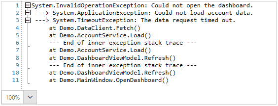

## Environment

| Version | Product | Author | 
| ---- | ---- | ---- | 
| 2026.3.1007| RadSyntaxEditor |[Desislava Yordanova](https://www.telerik.com/blogs/author/desislava-yordanova)| 

## Description

How can you create multiple folding levels for stack-trace text in RadSyntaxEditor?

Nested folding requires an outer region that contains the text of its inner regions. Region definitions describe matching rules, not nesting levels. A single marker pair can produce multiple levels. For stack traces, define the groups that users need to collapse before you create the folding spans.

>caption Nested folding regions in a stack trace



## Solution

Derive from `FoldingTaggerBase`, override `RebuildFoldingRegions`, and populate `FoldingRegionTags` with the nested spans. Register the custom tagger with `TaggersRegistry.RegisterTagger`.

The following complete window example uses a synthetic .NET-style trace with three nested exceptions. Each exception header occupies a separate line. The trace is illustrative display data, not captured runtime output or a universal stack-trace format.

### Prepare the Application

Set up a WPF application with the Telerik references and licensing described in [Getting Started with RadSyntaxEditor](). Use the same namespace in the window markup and code-behind. If your project has a different namespace, replace `SyntaxEditorFoldingExample` in both snippets.

Replace the startup window's markup with the following definition.

__Window containing the syntax editor__

```XAML
<Window x:Class="SyntaxEditorFoldingExample.MainWindow"
        xmlns="http://schemas.microsoft.com/winfx/2006/xaml/presentation"
        xmlns:x="http://schemas.microsoft.com/winfx/2006/xaml"
        xmlns:telerik="http://schemas.telerik.com/2008/xaml/presentation"
        Title="Nested Stack Trace Folding"
        Width="900" Height="500">
    <Grid>
        <telerik:RadSyntaxEditor x:Name="syntaxEditor" />
    </Grid>
</Window>
```

The named editor is used by the code-behind to load the trace and register its folding tagger.

### Implement and Register the Tagger

Replace the window's code-behind with the following code. It includes the sample text, registration, and the complete custom tagger.

__Window code-behind and stack-trace folding tagger__

```C#
using System;
using System.Collections.Generic;
using System.Windows;
using Telerik.Windows.Controls.SyntaxEditor.Taggers;
using Telerik.Windows.SyntaxEditor.Core.Editor;
using Telerik.Windows.SyntaxEditor.Core.Tagging;
using Telerik.Windows.SyntaxEditor.Core.Text;

namespace SyntaxEditorFoldingExample
{
    public partial class MainWindow : Window
    {
        public MainWindow()
        {
            InitializeComponent();

            string trace = string.Join(Environment.NewLine, new[]
            {
                "System.InvalidOperationException: Could not open the dashboard.",
                " ---> System.ApplicationException: Could not load account data.",
                " ---> System.TimeoutException: The data request timed out.",
                "     at Demo.DataClient.Fetch()",
                "     at Demo.AccountService.Load()",
                "     --- End of inner exception stack trace ---",
                "     at Demo.AccountService.Load()",
                "     at Demo.DashboardViewModel.Refresh()",
                "     --- End of inner exception stack trace ---",
                "     at Demo.DashboardViewModel.Refresh()",
                "     at Demo.MainWindow.OpenDashboard()"
            });

            this.syntaxEditor.Document = new TextDocument(trace);
            this.syntaxEditor.TaggersRegistry.RegisterTagger(
                new StackTraceFoldingTagger(this.syntaxEditor));
        }
    }

    public class StackTraceFoldingTagger : FoldingTaggerBase
    {
        private const string InnerExceptionPrefix = "--->";
        private const string InnerExceptionEnd =
            "--- End of inner exception stack trace ---";

        public StackTraceFoldingTagger(ITextDocumentEditor editor)
            : base(editor)
        {
        }

        protected override void RebuildFoldingRegions()
        {
            this.FoldingRegionTags.Clear();

            TextSnapshot snapshot = this.Document.CurrentSnapshot;
            var openRegions = new Stack<Tuple<int, string>>();
            var pendingRegions = new List<TagSpan<FoldingRegionTag>>();
            int outerStart = -1;
            int lastContentEnd = 0;
            string outerTitle = string.Empty;

            foreach (TextSnapshotLine line in snapshot.Lines)
            {
                string text = snapshot.GetText(line.Span).Trim();
                if (text.Length == 0)
                {
                    continue;
                }

                lastContentEnd = line.Span.End;

                if (outerStart < 0)
                {
                    outerStart = line.Span.Start;
                    outerTitle = GetTitle(text);
                    continue;
                }

                if (text.StartsWith(InnerExceptionPrefix, StringComparison.Ordinal))
                {
                    string header = text.Substring(InnerExceptionPrefix.Length).Trim();
                    openRegions.Push(Tuple.Create(line.Span.Start, GetTitle(header)));
                }
                else if (string.Equals(text, InnerExceptionEnd, StringComparison.Ordinal))
                {
                    if (openRegions.Count == 0)
                    {
                        return;
                    }

                    Tuple<int, string> start = openRegions.Pop();
                    this.AddRegion(snapshot, start.Item1, line.Span.End,
                        start.Item2, pendingRegions);
                }
            }

            if (outerStart < 0 || openRegions.Count != 0)
            {
                return;
            }

            this.AddRegion(snapshot, outerStart, lastContentEnd,
                outerTitle, pendingRegions);

            foreach (TagSpan<FoldingRegionTag> region in pendingRegions)
            {
                this.FoldingRegionTags.Add(region);
            }
        }

        private void AddRegion(TextSnapshot snapshot, int start, int end,
            string title, IList<TagSpan<FoldingRegionTag>> regions)
        {
            if (end <= start ||
                snapshot.GetLineNumberFromPosition(start) ==
                snapshot.GetLineNumberFromPosition(end))
            {
                return;
            }

            Span span = Span.FromBounds(start, end);
            string toolTip = this.GetFoldingRegionToolTipContent(span);
            regions.Add(new TagSpan<FoldingRegionTag>(
                new TextSnapshotSpan(snapshot, span),
                new FoldingRegionTag(title, false, toolTip)));
        }

        private static string GetTitle(string header)
        {
            int separator = header.IndexOf(':');
            string message = separator >= 0
                ? header.Substring(separator + 1).Trim()
                : header;
            return message.Length > 0 ? message : header;
        }
    }
}
```

The first nonempty line starts the outer exception region. Each `--->` header opens an inner region, and each separator closes the most recently opened inner region. The outer region ends at the last nonempty line. Snapshot line boundaries supply the character offsets, so the code does not depend on fixed line lengths or newline widths.

The tagger publishes regions only after all inner headers and separators are paired. An unmatched header or separator produces no regions until the text is corrected. This behavior avoids partial folding hierarchies while editing the trace. The base tagger invalidates its regions when document content changes and requests a rebuild when tags are next needed.

### Check the Folding Levels

Run the application. The three regions start expanded. Collapse an inner region before collapsing the outer region, then expand the outer region to inspect the nested folding state.

The sample produces the following inclusive, one-based line ranges:

| Level | Lines | Collapsed label |
|---|---|---|
| Outer exception | 1-11 | Could not open the dashboard. |
| Inner exception | 2-9 | Could not load account data. |
| Innermost exception | 3-6 | The data request timed out. |

These regions represent nested exceptions, not a call tree inferred from individual stack frames. The built-in language taggers do not infer this exception hierarchy.

## Matching Rules and Limitations

* The example accepts one trace with an outer header, separate inner headers prefixed by `--->`, and the exact English separator shown in the sample. It is not a general parser for arbitrary exception output, aggregate exceptions, or multiple log entries.
* If your input places several exception headers on one line, format the displayed document with separate header lines before calculating spans. Do not collapse multiple regions that start on the same line; the folding manager rejects that configuration.
* Use this custom tagger alone for the trace. Registering additional folding taggers can introduce duplicate or conflicting regions.
* For text with unambiguous marker pairs, `FoldingRegionDefinitions` can be sufficient. The default matcher uses a stack and does not create regions for matches on a single line.
* The default pattern builders join markers into regular expressions without adding word boundaries or escaping regex characters. Definitions for `FUNCTION`/`END` and `IF`/`END IF` alone do not reliably identify nested blocks: `IF` also matches within `END IF`, and an `END` alternative can consume part of the longer closing marker.
* Override `BuildStartRegionBlockPattern` and `BuildEndRegionBlockPattern` to distinguish complete markers when you use the default matcher. The built-in `VisualBasicFoldingTagger` uses context-aware patterns. The custom tagger in this article bypasses that matcher by overriding `RebuildFoldingRegions`.
* `GetFoldingRegionTitle` customizes labels in the default matching path, not nesting. This example assigns labels directly when it creates each `FoldingRegionTag`.

## See Also

* [Folding Taggers]()
* [Custom Tagger]()