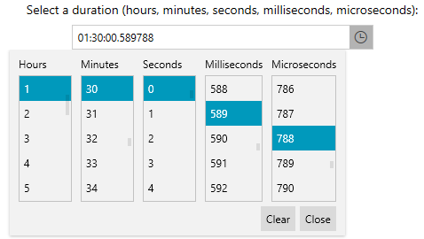

## Environment

| Version | Product | Author | 
| ---- | ---- | ---- | 
| 2026.3.1007| RadTimeSpanPicker |[Desislava Yordanova](https://www.telerik.com/blogs/author/desislava-yordanova)| 

## Description

Display a `TimeSpan` with six fractional-second digits and select microseconds in the `RadTimeSpanPicker` dropdown. The built-in components support units through milliseconds, so microsecond selection requires a custom component.

## Solution

Set `EditMode` to `DropDownOnly` and use six `f` specifiers in `StringFormat` to display microseconds. For selection, create a component that converts each microsecond to 10 `TimeSpan` ticks.

1. Define a custom component. Derive it from `StepTimeSpanComponentBase` and override `GetTicksFromItem` and `CreateInstanceCore`.

__Define the Microsecond Component__

```C#
using System;
using System.Windows;
using Telerik.Windows.Controls;

namespace MicrosecondExample
{
    public sealed class MicrosecondTimeSpanComponent : StepTimeSpanComponentBase
    {
        private const long TicksPerMicrosecond = 10;

        public override long GetTicksFromItem(object item)
        {
            return Convert.ToInt64(item) * TicksPerMicrosecond;
        }

        protected override Freezable CreateInstanceCore()
        {
            return new MicrosecondTimeSpanComponent();
        }
    }
}
```

The base class populates the selectable items from `Minimum`, `Maximum`, and `Step`. The custom component maps these items directly to ticks without converting through milliseconds.

2. Add the component alongside the built-in hour, minute, second, and millisecond components. Use a range of 0 through 999 for both fractional components: milliseconds represent the first three fractional digits, and microseconds represent the remaining three.

__Configure the Dropdown and Six-Digit Display__

```XAML
<Window x:Class="MicrosecondExample.MainWindow"
        xmlns="http://schemas.microsoft.com/winfx/2006/xaml/presentation"
        xmlns:x="http://schemas.microsoft.com/winfx/2006/xaml"
        xmlns:telerik="http://schemas.telerik.com/2008/xaml/presentation"
        xmlns:local="clr-namespace:MicrosecondExample"
        Title="Microsecond Selection" Width="800" Height="400">
    <Grid>
        <telerik:RadTimeSpanPicker x:Name="timeSpanPicker"
                                  EditMode="DropDownOnly"
                                  StringFormat="hh\:mm\:ss\.ffffff"
                                  VerticalAlignment="Top">
            <telerik:RadTimeSpanPicker.TimeSpanComponents>
                <telerik:HourTimeSpanComponent Maximum="23" Step="1" />
                <telerik:MinuteTimeSpanComponent Maximum="59" Step="1" />
                <telerik:SecondTimeSpanComponent Maximum="59" Step="1" />
                <telerik:MillisecondTimeSpanComponent Maximum="999" Step="1" />
                <local:MicrosecondTimeSpanComponent Header="Microseconds"
                                                   Minimum="0"
                                                   Maximum="999"
                                                   Step="1" />
            </telerik:RadTimeSpanPicker.TimeSpanComponents>
        </telerik:RadTimeSpanPicker>
    </Grid>
</Window>
```

The escaped separators are literals in the `TimeSpan` format. The `local` namespace references the custom component defined in the same project. The example represents a duration below 24 hours.

3. Assign a value in ticks to retain the microsecond portion.

__Set an Initial Value__

```C#
using System;
using System.Windows;

namespace MicrosecondExample
{
    public partial class MainWindow : Window
    {
        public MainWindow()
        {
            InitializeComponent();
            this.timeSpanPicker.Value = new TimeSpan(452961234560L);
        }
    }
}
```

The control displays `12:34:56.123456`. In the dropdown, the millisecond component selects `123` and the microsecond component selects `456`.

The following image shows the custom component with a selected duration of `01:30:00.589788`.



>important Keep `EditMode="DropDownOnly"` for this example. The built-in text editor handles fractional sections as milliseconds. Setting a six-digit `StringFormat` does not add microsecond text editing. `RadTimeSpanPicker` edits a duration, not a date or a time zone.

## See Also

* [RadTimeSpanPicker Overview]()
* [Custom TimeSpan Components](#custom-timespancomponent)
* [RadTimeSpanPicker StringFormat]()