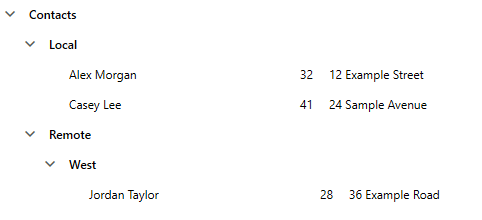

## Environment

| Version | Product | Author | 
| ---- | ---- | ---- | 
| 2026.3.1007| RadTreeView |[Desislava Yordanova](https://www.telerik.com/blogs/author/desislava-yordanova)| 

## Description

Display a tree of user folders and person records, with Name, Age, and Address fields alongside each person. Folders and person records have different CLR types, and folders can contain both nested folders and person records.

>caption Nested folders and person records with Name, Age, and Address fields



## Solution

Use an `ItemTemplateSelector` to choose a `HierarchicalDataTemplate` for folders and a `DataTemplate` for person records. The folder template binds to a mixed-type child collection. The person template arranges its three fields in a `Grid`.

These fields are part of each tree item's content, not a table-wide column model. The example does not add sortable headers, column resizing, drag/drop behavior, or persistence.

### Define the Data and Template Selector

Start with a WPF application configured to use RadTreeView. The following example uses the `TreeViewFields` namespace and Telerik Xaml binaries. Adjust the namespace to match your application.

Add the following classes to the project. `People` holds the person records separately from `RootFolders`. Each folder's `Children` collection contains references to folders or existing person records, not copies of the person data.

#### Folder and person models, sample data, and template selector

```C#
using System.Collections.ObjectModel;
using System.Windows;
using System.Windows.Controls;

namespace TreeViewFields
{
    public sealed class UserFolder
    {
        public UserFolder(string name)
        {
            this.Name = name;
            this.Children = new ObservableCollection<object>();
        }

        public string Name { get; private set; }

        public ObservableCollection<object> Children { get; private set; }
    }

    public sealed class PersonData
    {
        public PersonData(string name, int age, string address)
        {
            this.Name = name;
            this.Age = age;
            this.Address = address;
        }

        public string Name { get; private set; }

        public int Age { get; private set; }

        public string Address { get; private set; }
    }

    public sealed class MainViewModel
    {
        public MainViewModel()
        {
            this.People = new ObservableCollection<PersonData>
            {
                new PersonData("Alex Morgan", 32, "12 Example Street"),
                new PersonData("Casey Lee", 41, "24 Sample Avenue"),
                new PersonData("Jordan Taylor", 28, "36 Example Road")
            };

            var contacts = new UserFolder("Contacts");
            var local = new UserFolder("Local");
            var remote = new UserFolder("Remote");
            var west = new UserFolder("West");

            local.Children.Add(this.People[0]);
            local.Children.Add(this.People[1]);
            west.Children.Add(this.People[2]);
            remote.Children.Add(west);
            contacts.Children.Add(local);
            contacts.Children.Add(remote);

            this.RootFolders = new ObservableCollection<UserFolder>
            {
                contacts
            };
        }

        public ObservableCollection<PersonData> People { get; private set; }

        public ObservableCollection<UserFolder> RootFolders { get; private set; }
    }

    public sealed class FolderPersonTemplateSelector : DataTemplateSelector
    {
        public HierarchicalDataTemplate FolderTemplate { get; set; }
            = new HierarchicalDataTemplate();

        public DataTemplate PersonTemplate { get; set; }
            = new DataTemplate();

        public override DataTemplate SelectTemplate(object item, DependencyObject container)
        {
            if (item is UserFolder)
            {
                return this.FolderTemplate;
            }

            if (item is PersonData)
            {
                return this.PersonTemplate;
            }

            return base.SelectTemplate(item, container);
        }
    }
}
```

The classes do not require a common base type. The selector distinguishes them by CLR type, and `ObservableCollection<object>` allows a folder to contain either type. The sample initializes the displayed properties once. Add property-change notifications if your application edits them after binding.

### Define the Templates and TreeView

Replace the contents of the application's main window with the following XAML. Keep the folder template's `ItemTemplate` unset so the inherited selector can choose the appropriate template for each descendant.

#### Recursive folder template and three-field person template

```XAML
<Window x:Class="TreeViewFields.MainWindow"
        xmlns="http://schemas.microsoft.com/winfx/2006/xaml/presentation"
        xmlns:x="http://schemas.microsoft.com/winfx/2006/xaml"
        xmlns:local="clr-namespace:TreeViewFields"
        xmlns:telerik="http://schemas.telerik.com/2008/xaml/presentation"
        Title="Folder Contacts"
        Width="840" Height="440"
        MinWidth="420" MinHeight="280">
    <Window.DataContext>
        <local:MainViewModel />
    </Window.DataContext>

    <Window.Resources>
        <HierarchicalDataTemplate x:Key="FolderTemplate"
                                  ItemsSource="{Binding Children}">
            <TextBlock Text="{Binding Name}"
                       FontWeight="SemiBold"
                       Margin="4,3" />
        </HierarchicalDataTemplate>

        <DataTemplate x:Key="PersonTemplate">
            <Grid Width="560" Margin="4,3" HorizontalAlignment="Left">
                <Grid.ColumnDefinitions>
                    <ColumnDefinition Width="200" />
                    <ColumnDefinition Width="60" />
                    <ColumnDefinition Width="300" />
                </Grid.ColumnDefinitions>

                <TextBlock Grid.Column="0"
                           Text="{Binding Name}"
                           ToolTip="{Binding Name}"
                           TextTrimming="CharacterEllipsis"
                           Margin="0,0,12,0" />
                <TextBlock Grid.Column="1"
                           Text="{Binding Age}"
                           TextAlignment="Right"
                           Margin="0,0,16,0" />
                <TextBlock Grid.Column="2"
                           Text="{Binding Address}"
                           ToolTip="{Binding Address}"
                           TextTrimming="CharacterEllipsis" />
            </Grid>
        </DataTemplate>

        <local:FolderPersonTemplateSelector x:Key="NodeTemplateSelector"
            FolderTemplate="{StaticResource FolderTemplate}"
            PersonTemplate="{StaticResource PersonTemplate}" />

        <Style x:Key="ExpandedItemStyle" TargetType="telerik:RadTreeViewItem">
            <Setter Property="IsExpanded" Value="True" />
        </Style>
    </Window.Resources>

    <Grid Margin="12">
        <telerik:RadTreeView
            ItemsSource="{Binding RootFolders}"
            ItemTemplateSelector="{StaticResource NodeTemplateSelector}"
            ItemContainerStyle="{StaticResource ExpandedItemStyle}" />
    </Grid>
</Window>
```

For NoXaml binaries, merge your application's theme resources and base `ExpandedItemStyle` on `RadTreeViewItemStyle`. Do not replace the folder template with a plain `DataTemplate` if folders need to expose further descendants.

### Expected Result and Limitations

The sample data defines `Contacts` with `Local` and `Remote` subfolders. `Local` contains Alex and Casey, while `Remote` contains the `West` folder with Jordan. Folders display their names. Person rows display Name, Age, and Address from left to right.

The fixed field widths align person rows at the same indentation level. Tree indentation moves the entire row content at deeper levels, so fields at different depths do not form shared vertical columns. The widths are illustrative. Adjust them for your data and available space. Long names and addresses use ellipses, with the full values available in tooltips.

The separate collections demonstrate an in-memory presentation model only. Updating folder membership does not automatically save relationships to a database or synchronize external repositories. Drag/drop rules and persistence remain application responsibilities.

## See Also

* [Customize TreeView item templates]()
* [Select templates for different item types]()
* [Bind hierarchical data through templates]()
* [Create an Explorer-style tree with heterogeneous items]()
